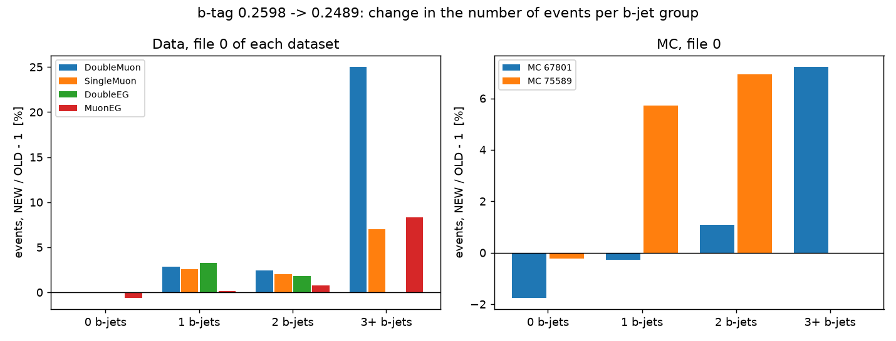
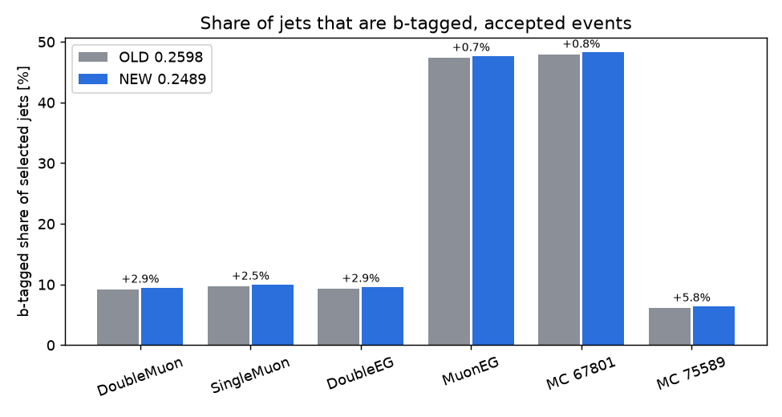
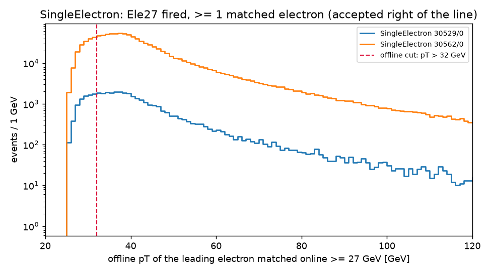

# b-tag 0.2489 + SingleElectron: real-file checks (20 Oct 2026)

Every number below is **VERIFIED BY RUNNING** unless it is marked
otherwise. The numbers come from the evidence JSONs in `evidence/`, which
`cluster/analyse.py` wrote from the cluster outputs. This was a check on a
few files only: no production and no delivery was made, and nothing was
merged into master.

## What was run

| side | data code | MC code |
|---|---|---|
| OLD | fork master `aaf945a` (b-tag 0.2598, `--population matched4`) | `sync/mc-upstream-35-20261020` `0e98075` (0.2598, 4-flag union) |
| NEW | `feature/cms-btag-singleelectron-20261020` `31f21ce` (0.2489, `--population matched5`) | `feature/cms-mc-btag-singleelectron-20261020` `cd22aa2` (0.2489, SingleElectron bit 6, 5-flag union) |
| ovr | NEW code with the b-tag constant set back to 0.2598 inside that one process (nothing on disk changed) | same, NEW MC code |

How the code was run:

- **Pinned code:** each commit was exported with `git archive` to
  `checkouts/btagse_20261020/`. Every job unpacked it on node-local disk.
- **Jobs (wipp-campus):**
  - per-file array `5253152[]`, 20 Oct 10:21;
  - 5 subjobs failed on a CERN Open Data portal "502 Bad Gateway" while
    looking up file URLs, an outage outside our code. They were retried as
    `5253218[]` and `5253219` at 10:48; runs that had finished were skipped,
    none redone;
  - build `5253220`, done 11:40;
  - analyse `5255520`, done 14:29. The first analyse attempt, `5253221`,
    failed at start-up: my script looked for compare.py in the data code,
    and it lives only on the MC line. The script was fixed and the
    analysis rerun.
- All 22 per-file runs and every build and analysis step exited 0.
- **Comparison tool:** the unchanged `studies/mcport_validation_20261014/compare.py`
  (`compare_dbs`, `json_diff`).

## A. Data, file 0 of DoubleMuon, SingleMuon, DoubleEG, MuonEG

### A1. The b-tag is the only difference

**OLD vs ovr** (NEW code with the b-tag back at 0.2598):

- all 32 shards (4 files × 8), 18,278 arrays and 12,144,056 values, are
  identical value by value;
- the single shard-level difference is the stored mode name (`matched4` vs
  `matched5`);
- `job_metadata.json` differs in 10 places per file, all of them the
  SingleElectron additions:
  - the 5-dataset `delivery_veto_order`;
  - SingleElectron's acceptance, fired, cutflow and attribution entries;
  - `n_accepted_by_none` (events that only SingleElectron accepts are no
    longer "none");
  - the SingleElectron guard counter and title check;
  - the `singleelectron` block;
  - `population`.

So NEW differs from OLD **only through the b-tag value**.

### A2. OLD (0.2598) vs NEW (0.2489)

| file | events after trigger | accepted | acceptance counts of the 4 datasets | b-tagged share of jets OLD → NEW | relative |
|---|---:|---:|---|---|---:|
| DoubleMuon 30522/0 | 729,741 = | 223,393 = | identical | 9.228% → 9.494% | **+2.9%** |
| SingleMuon 30530/0 | 1,878,767 = | 1,511,878 = | identical | 9.751% → 9.999% | **+2.5%** |
| DoubleEG 30521/0 | 219,416 = | 60,201 = | identical | 9.345% → 9.614% | **+2.9%** |
| MuonEG 30528/0 | 279,559 = | 4,512 = | identical | 47.35% → 47.69% | **+0.7%** |

"=" means OLD and NEW are equal. The exclusive counts are equal too
(223,393; 1,425,358; 60,189; 394), and so is every per-dataset attribution.
MuonEG is dominated by top-pair events, so most of its jets were already
b-tagged and the relative change is smaller.

Per event (debug dumps joined on run/lumi/event; the same accepted events
on both sides; 0 changes to any acceptance or exclusive flag):

| file | unchanged | light → b migration (e, μ and total jets unchanged) | newly rejected by Version B (e+μ+b > 4) | anything else |
|---|---:|---:|---:|---:|
| DoubleMuon | 223,231 | 159 | 3 | **0** |
| SingleMuon | 1,510,544 | 1,329 | 5 | **0** |
| DoubleEG | 60,159 | 42 | 0 | **0** |
| MuonEG | 4,487 | 22 | 3 | **0** |

The n_b migration, for events kept on both sides:

| file | 0→1 | 1→2 | 2→3 |
|---|---:|---:|---:|
| DoubleMuon | 140 | 19 | — |
| SingleMuon | 1,152 | 148 | 29 |
| DoubleEG | 39 | 3 | — |
| MuonEG | 12 | 10 | — |

Every event moves up exactly one b-group. None moves down or by two.

The n_b distribution over all accepted events (OLD → NEW):

| file | 0 b | 1 b | 2 b | 3+ b |
|---|---|---|---|---|
| DoubleMuon | 218,457 → 218,317 | 4,266 → 4,387 | 658 → 674 | 12 → 15 |
| SingleMuon | 1,466,194 → 1,465,042 | 39,328 → 40,332 | 5,913 → 6,030 | 443 → 474 |
| DoubleEG | 58,925 → 58,886 | 1,101 → 1,137 | 169 → 172 | 6 → 6 |
| MuonEG | 1,986 → 1,974 | 1,610 → 1,612 | 880 → 887 | 36 → 39 |

The large 3+ percentage for DoubleMuon is 12 → 15 events: a small-number
effect.

Trigger-guard violations (NEW, every matcher including the new
SingleElectron one): **0** in all four files.

## B. SingleElectron (NEW) vs the singleelectron_prep study at T = 32 GeV

The study's per-file outputs (19 Oct re-run, identical to 7 Oct; read-only)
are `work/serecheck_20261019/se/a_0p2598/tnp_{G,H}_0.json`.

| file | same file URL | after Ele27 (new / study) | accepted (new / study) | not taken by the other four (new / study) | guard violations |
|---|---|---|---|---|---:|
| 30529/0 (2016G) | yes | 62,554 / 62,554 | **32,459 / 32,459** | **30,774 / 30,774** | 0 |
| 30562/0 (2016H) | yes | 1,730,519 / 1,730,519 | **902,673 / 902,673** | **855,435 / 855,435** | 0 |

The SingleElectron cutflow per file:

| file | Ele27 fired | ≥1 matched electron | of those, matched online ≥ 27 GeV | accepted (> 32 GeV) | lost to the 32 GeV cut |
|---|---:|---:|---:|---:|---:|
| 30529/0 | 62,554 | 40,225 | 40,220 | 32,459 | 7,761 |
| 30562/0 | 1,730,519 | 1,077,516 | 1,077,447 | 902,673 | 174,774 |

Accepted events that a higher-priority dataset also accepts, so they go to
that dataset and not to SingleElectron:

| file | DoubleMuon | SingleMuon | DoubleEG | MuonEG |
|---|---:|---:|---:|---:|
| 30529/0 | 2 | 41 | 1,643 | 42 |
| 30562/0 | 9 | 969 | 46,217 | 1,003 |

## C. De-duplication on real data

These are the six NEW accepted-event lists (the 4 datasets plus both
SingleElectron files), joined on run/lumi/event:

- 4,331 events are accepted in more than one file:
  - 4,307 in DoubleMuon & SingleMuon;
  - 22 in MuonEG & SingleMuon;
  - 1 in DoubleMuon & MuonEG;
  - 1 in DoubleEG & SingleMuon.
- In every file holding a shared event, all five acceptance flags agree.
- Pooled exactly as the builder pools (first dataset inclusive, the rest
  exclusive): 2,595,543 events are counted exactly once and **0 more than
  once**.

**SingleElectron overlap: none in these files.** SingleElectron 30529/0
shares 2 runs with DoubleMuon and with DoubleEG, and 1 with SingleMuon. It
shares only 1 luminosity section (with SingleMuon) and no event.
SingleElectron 30562/0 (2016H) shares no run with the 2016G files. So the
"accepted by a higher dataset and by SingleElectron" case cannot occur
between these files. It is covered by:

- the synthetic test (P1 in `test_btag_singleelectron.py`);
- inside each SingleElectron file: 1,685 (30529/0) and 47,238 (30562/0)
  SingleElectron-accepted events are also accepted by a higher dataset.
  They are marked non-exclusive and not pooled from SingleElectron (B
  above).

## D. MC, 67801/0 (TTTo2L2Nu) and 75589/0 (ZZTo4L)

**OLD vs ovr:**

- 16 shards, 99,897 arrays and 22,427,216 values are identical, except the
  acceptance-bitmask sibling;
- that sibling differs **only** by the new bit 6: clearing bit 6 makes all
  5,014 (67801) and 3,873 (75589) differing arrays identical;
- the metadata differences (7 per file) are only the new SingleElectron
  entries.

So again the b-tag is the only physics difference.

| | 67801/0 | 75589/0 |
|---|---:|---:|
| stored events OLD = NEW | 78,632 | 47,946 |
| 4 data acceptances OLD = NEW | identical | identical |
| b-tagged share of jets OLD → NEW | 47.88% → 48.24% (+0.8%) | 6.07% → 6.42% (+5.8%) |
| light → b migration / newly Version-B-rejected / other | 676 / 15 / **0** | 105 / 1 / **0** |
| SingleElectron flag (bit 6) set, of stored | 35,383 (**45.0%**) | 18,550 (**38.7%**) |
| stored with SingleElectron but none of the 4 data flags | 23,548 | 10,441 |
| stored in the 5-flag union | 76,920 | 45,835 |
| SingleElectron guard violations | 0 | 0 |

The n_b migration for kept events:

- 67801: 0→1 248, 0→2 2, 1→2 355, 2→3 71;
- 75589: 0→1 101, 1→2 4.

**MC builder smoke test** (`--smoke-test`, defaults, `--peak-scope combined`):

| build | 67801 norm. factor | 75589 norm. factor | 67801 entries after union | 75589 entries after union | summed-SM histograms |
|---|---:|---:|---:|---:|---:|
| OLD builder, OLD runs | 0.149228117770 | 0.113739452697 | 556,754 | 90,803 | 971 |
| OLD builder, NEW runs (b-tag only) | 0.149228117770 | 0.113739452697 | 560,281 | 90,843 | 1,000 |
| NEW builder, NEW runs (b-tag + 5-flag union) | 0.149228117770 | 0.113739452697 | 755,513 | 107,492 | 1,197 |

What the table shows:

- **Normalisation is unchanged** in all three builds (Σw 9,807,582.2564
  and 222,533.0912).
- **The entries added by the 5-flag union are exactly the entries the
  SingleElectron flag rescues.**
  - 67801: 755,513 − 560,281 = 195,232 = 209,440 − 14,208 (entries dropped
    by the old union minus entries dropped by the new one).
  - 75589: 107,492 − 90,843 = 16,649 = 18,575 − 1,926.
- The b-tag step changes entries slightly (+3,527 and +40), because it
  moves masses between final states.

The smoke test uses Σw from one file per sample, so the yields are not
physics.

## E. Data delivery builder (NEW, 5 datasets) — smoke test

`build_four_dataset_delivery.py --datasets DoubleMuon,SingleMuon,DoubleEG,MuonEG,SingleElectron`
ran cleanly on the 6 NEW per-file outputs:

| dataset (priority order) | contributes | accepted | exclusive | pooled after Version B |
|---|---|---:|---:|---:|
| DoubleMuon | inclusive | 223,393 | 223,393 | 223,372 |
| SingleMuon | exclusive | 1,511,878 | 1,425,358 | 1,425,322 |
| DoubleEG | exclusive | 60,201 | 60,189 | 60,183 |
| MuonEG | exclusive | 4,512 | 394 | 393 |
| **SingleElectron (last)** | exclusive | 935,132 | 886,209 | 886,187 |

- Every per-file job recorded the same 5-dataset order.
- Result: 752 histograms in 64 final-state categories, 1,365,338 entries.
  The cropped file holds the same 752 histograms.
- For comparison, the OLD 4-dataset build on the OLD per-file outputs gave
  492 histograms in 43 categories and 849,065 entries.
- The difference is mostly SingleElectron. The histogram counts come from
  6 files, so they are **not** a projection of a full delivery.
- Not changed, noted for the future delivery: the builder's `README.txt`
  text still says "FOUR datasets" (and an old dR < 0.05).

## Local tests (VERIFIED BY RUNNING, 20 Oct)

Data branch:

- `test_btag_singleelectron.py` (new): 55/55;
- `test_electron_datasets.py`: 109/109;
- `test_exact_jet_labels.py`: 85;
- `test_funnel_upstream35.py`: 4, digest unchanged;
- `test_upstream_names.py`: 52;
- `test_width_suffix.py`: 17;
- upstream `tests/`: 38 OK (5 skipped).

MC branch, all of the above plus:

- `test_mc_singleelectron_flag.py` (new): 20/20;
- `test_mc_weights_v3.py`: 47, with 1 check added for bit 6;
- `test_builder_end_to_end.py`: 24;
- `test_peak_scope.py`: 12;
- `test_cms_shard_pruning_drift.py`: 5;
- `test_upstream35_drift.py`: 13.
