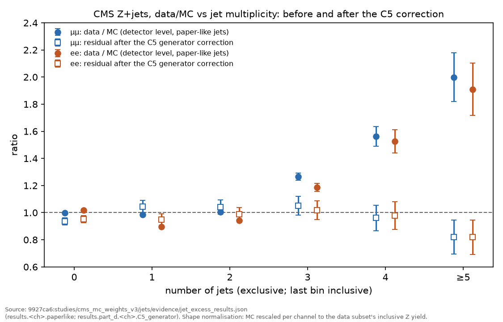
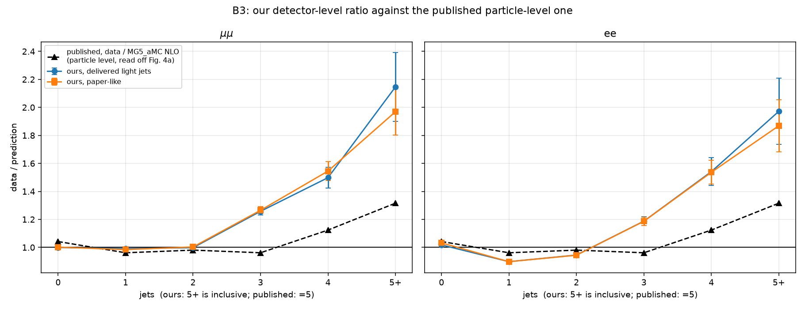
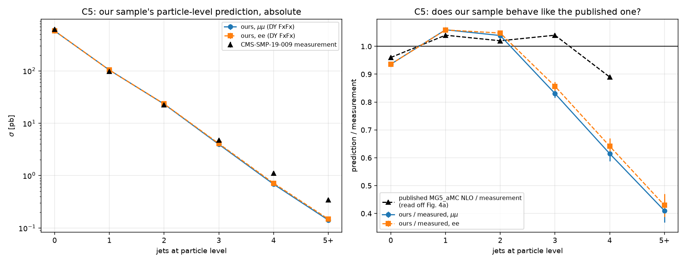

# CMS Z+jets: data/MC at ≥ 3 jets

*For the group. Written 15 Oct 2026 at Maryna's request of 13 Oct. Sources:
the jet-excess study (branch `study/cms-mc-jet-excess`, head `9927ca6`) and
the MC pilot evidence on this branch. **No new measurement was made for this
document.***

Every number below is copied from an evidence file, and the file and key are
given next to it. The study produced those numbers by running on the cluster
(VERIFIED BY RUNNING in that study). The exceptions are labelled UNVERIFIED.

Short names used below:

| short name | file |
|---|---|
| `J` | `9927ca6:studies/cms_mc_weights_v3/jets/evidence/jet_excess_results.json` |
| `H` | `9927ca6:studies/cms_mc_weights_v3/jets/evidence/hepdata_smp19009.json` |
| `P` | `studies/cms_mc_weights_v3/evidence/pilot_data_mc_comparison.json` (this branch) |
| `F` | `studies/cms_mc_weights_v3/evidence/smp19009_fig4_panel_check_20261015.json` (this branch) |

---

## a. Decisions (Maryna, 13 Oct 2026)

*As relayed in the 15 Oct task.*

- **Keep the ≥ 3-jet categories.**
- **Apply no per-jet-multiplicity correction.** A factor derived at the Z peak
  would wrongly assume that it does not depend on the mass.
- **Keep the NLO negative weights as they are.**
- **Document the measured ratios** (this file), so the group can judge any
  ≥ 3-jet BumpNet excess downstream against them.

## b. Measured detector-level data/MC ratios

**Main numbers: Z → μμ, "paper-like" jets.** These jets use the
CMS-SMP-19-009 jet definition (|η| < 2.4, ΔR > 0.4 from the leptons, b jets
counted). They are measured on our Z selection. Key: `J results.mumu.paperlike.{ratio,error}`.

| jets | data / MC |
|---|---|
| 3 | **1.265 ± 0.026** |
| 4 | **1.562 ± 0.071** |
| ≥ 5 | **1.998 ± 0.180** |

**Z → ee, same definition.** Key: `J results.ee.paperlike`.

| jets | data / MC |
|---|---|
| 3 | 1.187 ± 0.030 |
| 4 | 1.526 ± 0.086 |
| ≥ 5 | 1.909 ± 0.193 |

**Normalisation convention.** This is a shape study (`J normalisation.mode`).
- Each MC sample is first set to σ_eff × 1000 × L / Σw.
- It is then rescaled by one factor per channel, so that it matches the data
  subset's inclusive Z yield. The factors are μμ 0.3222 and ee 0.1328
  (`J normalisation.factors`).
- So the 0–2-jet bins sit at about 1 by construction, and the ≥ 3-jet numbers
  measure how the *shape* departs.

**Population.** 40 data files and 20 MC files (10 DY 35669 and 10 tt̄ 67801)
(`J meta.data_files`, `J meta.mc_files`). The errors are the values stored
under `error`.

**Cross-check on the full pilot.** This uses absolute normalisation (MC *not*
rescaled), the delivered light-jet definition, and all 98 pilot MC files with
the full delivered data. Key: `P plots.P3.{mumu_j,ee_j}.per_bin_ratio`. No
per-bin uncertainty is stored there.

| jets | μμ | ee |
|---|---|---|
| 3 | 1.279 | 1.174 |
| 4 | 1.573 | 1.518 |
| ≥ 5 | 2.030 | 2.108 |

The ≥ 3-jet excess appears in both. Its size agrees with the paper-like study
within 1–2%, except for ee at ≥ 5 jets: 2.108 here vs 1.909 there, a sparse
bin with a different jet definition and normalisation.

*`docs_plots/jet_multiplicity_ratio_summary.png`: drawn by
`docs_plots/make_jet_multiplicity_summary.py` from `J` only. Filled markers
are data/MC. Open markers are the residual after the C5 correction (section c).*

## c. Particle-level comparison with CMS-SMP-19-009

- **Reference.** CMS-SMP-19-009, arXiv:2205.02872, Phys. Rev. D 108 (2023)
  052004. HEPData record ins2078067, Table 1a. That is the exclusive
  jet-multiplicity measurement, 35.9 fb⁻¹ (`J reference`).
- **How the comparison was made.** Our DY FxFx sample (35669, at 5765.4 pb,
  `J results.c5.cross_section_pb`) was counted at generator level with the
  paper's particle-level definition, in pb. There is no rescaling, no
  detector and no selection of ours.
- **The ≥ 5 bin.** Ours is inclusive. It is compared with the sum of the
  published 5–8-jet bins, 0.3441 pb (`J results.c5.note_5plus`).

**Ours / published**, key `J results.c5.channels.<ch>.{ratio_to_measured,ratio_error}`.
The errors are MC statistics only.

| jets | μμ | ee |
|---|---|---|
| 3 | **0.831 ± 0.016** | 0.857 ± 0.016 |
| 4 | **0.615 ± 0.028** | 0.642 ± 0.028 |
| ≥ 5 | **0.410 ± 0.043** | 0.429 ± 0.041 |

**Residual detector-level data/MC after scaling the MC to the published
particle-level cross section.** Key `J results.part_d.<ch>.C5_generator.{residual_ratio,residual_error}`.
The errors include the measurement's own 6–8%.

| jets | μμ | ee |
|---|---|---|
| 3 | **1.051 ± 0.070** | 1.017 ± 0.070 |
| 4 | **0.961 ± 0.095** | 0.979 ± 0.102 |
| ≥ 5 | **0.819 ± 0.125** | 0.820 ± 0.127 |

That correction removes **81 ± 31%, 107 ± 24% and 118 ± 25%** of the μμ
excess at 3, 4 and ≥ 5 jets (`J results.part_d.mumu.C5_generator.{fraction,error}`).

*`docs_plots/B3_vs_published.png`: byte-identical copy of
`9927ca6:studies/cms_mc_weights_v3/jets/plots/B3_vs_published.png`.*

*`docs_plots/C5_generator_closure.png`: byte-identical copy of
`9927ca6:studies/cms_mc_weights_v3/jets/plots/C5_generator_closure.png`.*

## d. Conclusion of the study

The excess comes from **generator modelling, not our setup**. Even at
particle level, our DY FxFx sample produces too few extra jets: about 17%
short at 3 jets, 39% at 4 and 59% at ≥ 5. Correcting for that leaves
1.05 / 0.96 / 0.82.

What was ruled out:
- **Jet definition.** The 3-jet ratio moves by < 1% across all of them.
- **Jet energy resolution.** It removes only 3–4% of the excess.
- **Jet energy scale.** Closing the gap would need a 4σ mis-scale.
- **Noise or fake jets.** There is no hot spot, and the jet shapes are identical.
- **Leptons or photons counted as jets.** Data is *below* MC on every such measure.
- **Missing processes.** tt̄ is only 5.5 / 10.6 / 17.2% of the MC at 3 / 4 / ≥ 5 jets.

A likely but untested reason is the tune: our sample uses CP5, while the
paper's sample uses CUETP8M1.

## e. Caveats

1. **Which files the ratios come from.** The paper-like ratios in section b,
   and everything in section c, were measured in the jet study, on a subset of
   40 data files and 20 MC files. The 98-file pilot gives the delivered-jet
   cross-check table in section b. *(The 15 Oct task text said "measured on
   the pilot (98 files)". That holds only for the cross-check table.)*
2. **Old cross sections.** Both used the cross sections in force before
   15 Oct. The two samples involved keep their values in the 15 Oct decisions:
   DY 35669 at 5765.4 pb and tt̄ 67801 at 89.28 pb. So the jet ratios are not
   expected to move. ggH 37728 moves by −0.8%, but it is absent from the jet
   study and is about 3 parts per million of the pilot's μμ Z yield (27.3 of
   9.69 million, `P plots.P1.per_sample_integral`). The ratios will be re-measured on the full run, which adds
   35631, single top, dibosons, tt̄V and VBF H.
3. **Published-prediction ratios were read by eye** off the paper's Fig. 4
   (±0.02), because HEPData does not tabulate the predictions
   (`H prediction_over_data`, `H prediction_over_data_read_uncertainty`). See
   section f for which panel.
4. **The ≥ 5 residual (0.82) is over-corrected and not understood** to better
   than about 20%. Detector migration into the inclusive ≥ 5 bin is not
   unfolded.
5. **Unmatched choices.** Our subleading-lepton threshold (25 GeV) is not the
   paper's (20 GeV). The tune explanation is an interpretation, not a
   measurement.

## f. Open check: which panel of Fig. 4

**Question.** The study's handoff says the published MG5_aMC ratios were "read
off Fig. 4a". Is Fig. 4a the exclusive or the inclusive panel, and do the
quoted ratios come from the matching panel?

**Finding (VERIFIED BY RUNNING,** `probe/check_smp19009_fig4_panels.py` on the
arXiv e-print source, evidence `F`**).**

- **Fig. 4a is the INCLUSIVE panel.** The caption in the paper's LaTeX reads
  *"The measured differential cross section as a function of inclusive (left)
  and exclusive (right) jet multiplicities."*
  - `Figure_004-a.pdf` (left) labels its bins "N_jets ≥ 0, ≥ 1, …".
  - `Figure_004-b.pdf` (right) labels them "N_jets = 0, = 1, …".
  - Both ratio panels plot Prediction / Measurement.
- **The quoted ratios match the EXCLUSIVE panel (Fig. 4b), not 4a.** We pulled
  the plotted ratios out of the vector drawing and compared them with the
  study's values (`F panel_matching_the_study_values`):

  | sample | vs 4b (exclusive) | vs 4a (inclusive) |
  |---|---|---|
  | NLO FxFx | agree within 0.022 in every bin, within 0.014 at 3–5 jets | off by up to 0.071 (0.042 at 3 jets) |
  | LO MLM | agree within 0.03 in every bin | off by up to 0.16 |

**Implication.**
- The study compared like with like. The published-prediction ratios are
  exclusive, as is the HEPData Table 1a measurement they sit with.
- Only the label "Fig. 4a" in `HANDOFF_JETS.md` is wrong; it should read Fig.
  4b (right panel). No number changes.
- The "±0.02" reading accuracy holds for NLO FxFx at 3–7 jets. It is
  marginally exceeded at 8 jets (0.022) and for LO MLM at 7 jets (0.03).
- The handoff's "published data / NLO" column at 5+ ("1.316, their = 5") is an
  exclusive 5-jet value compared with our inclusive ≥ 5. The study already
  flagged this.
- The study branch was not edited.
