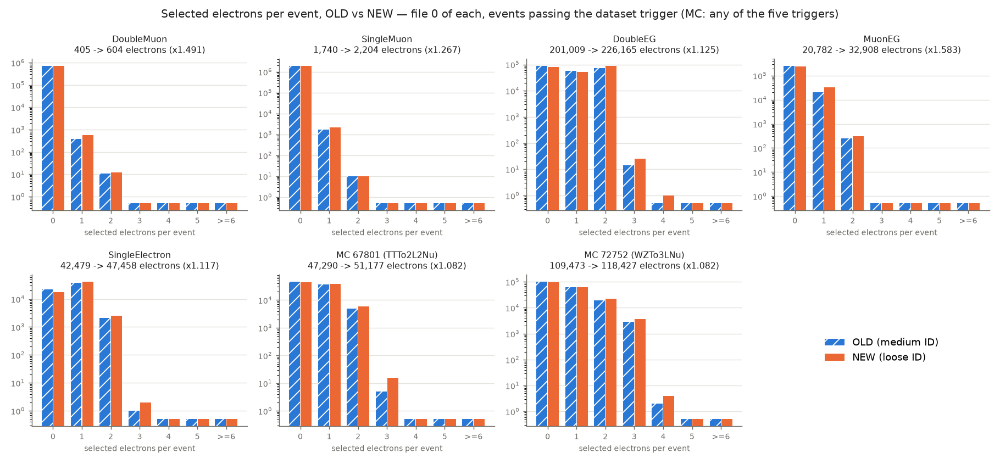
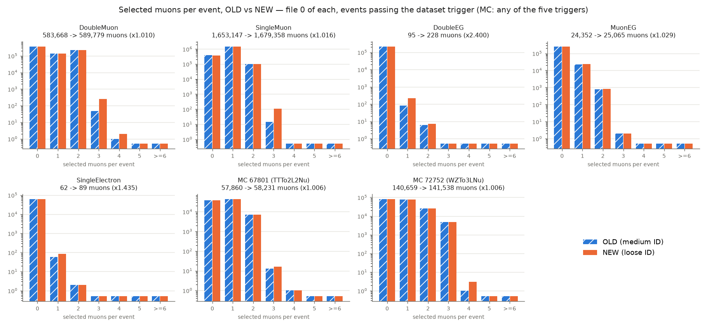
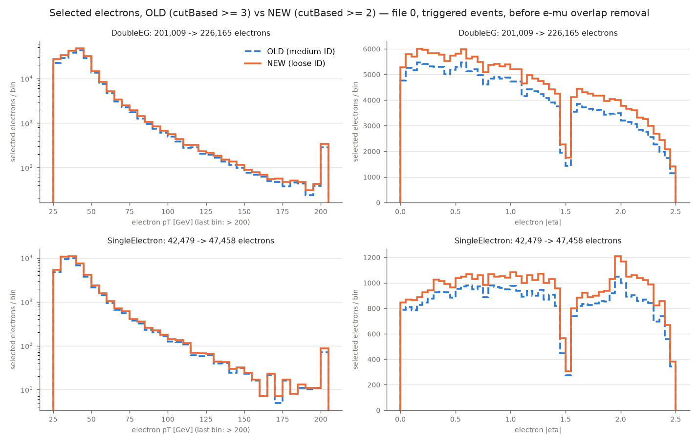
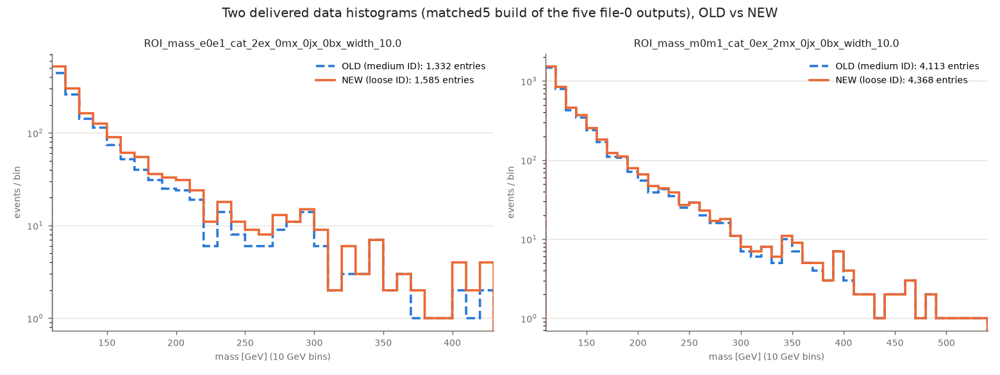

# PRECHECK — loose lepton IDs on real files, OLD vs NEW (24–25 Oct 2026)

**Result (VERIFIED BY RUNNING):** the change does exactly what was decided and nothing else is
disturbed. On all 7 files, **every muon and electron the OLD code selected is also selected by
the NEW code (0 exceptions)**. Every extra NEW muon is "loose but not medium", and every extra
NEW electron has `cutBased == 2` (Loose). More objects, more accepted events, no lost histograms.

- OLD = lean branch `33d77f5` (Muon_mediumId, electron cutBased ≥ 3). NEW = `9588cdb` on
  `run/cms-fullrun-20261025` (Muon_looseId, cutBased ≥ 2; muon iso < 0.15 in both).
- Method of `studies/sync_42_20261023` (on master): both commits as `git archive` tarballs
  (`checkouts/fullrun_20261025/precheck_code/{old,new}.tar`, sha256 `fae6b20a2867f9c3` /
  `960246367f3cb41c`), unpacked into the same node-scratch path, OLD then NEW in the same job.
- Jobs (wipp-home, 24–25 Oct): per-file array `5331447[]` (7 subjobs, 8 GB, io=25) and the build
  + comparison job `5331448` (16 GB, io=25, depend=afterok). All 8 exited 0. Work directory
  `work/fullrun_20261025/precheck/`. Logs and job IDs: `evidence/precheck_logs/`.
- Per file: the driver with `--population matched5` (data; once more with
  `--no-emu-overlap-removal`, only to count the events the overlap removal costs) or the
  `pbs_mc_pilot.sh` options (MC: `--is-mc --dataset-label MC --population matched4`); then
  `cluster/object_compare.py`, which runs the real OLD and NEW `select_muons` /
  `select_electrons` on the same file and matches objects by their index in the file.
- Builds, both sides, all defaults: `build_four_dataset_delivery.py --datasets
  DoubleMuon,SingleMuon,DoubleEG,MuonEG,SingleElectron` and `build_mc_delivery.py --smoke-test`.
  Compared by `cluster/build_compare.py` → `evidence/build_compare.json`.
- Files: data Run2016G file index 0 of DoubleMuon 30522, SingleMuon 30530, DoubleEG 30521,
  MuonEG 30528, SingleElectron 30529 (this one is a small file: 112,955 events); MC 67801 and
  72752 file 0.

## Per-file numbers

**Selected muons and electrons — events passing the dataset's own trigger (MC: any of the five datasets' triggers)** (before e–μ overlap removal)

| file | events | muons OLD | muons NEW | ratio | electrons OLD | electrons NEW | ratio | OLD-selected not NEW-selected (μ / e) |
|---|---:|---:|---:|---:|---:|---:|---:|---|
| DoubleMuon 0 | 729,741 | 583,668 | 589,779 | 1.010 | 405 | 604 | 1.491 | 0 / 0 |
| SingleMuon 0 | 1,955,197 | 1,653,147 | 1,679,358 | 1.016 | 1,740 | 2,204 | 1.267 | 0 / 0 |
| DoubleEG 0 | 219,416 | 95 | 228 | 2.400 | 201,009 | 226,165 | 1.125 | 0 / 0 |
| MuonEG 0 | 279,559 | 24,352 | 25,065 | 1.029 | 20,782 | 32,908 | 1.583 | 0 / 0 |
| SingleElectron 0 | 62,554 | 62 | 89 | 1.435 | 42,479 | 47,458 | 1.117 | 0 / 0 |
| MC 67801 TTTo2L2Nu | 89,110 | 57,860 | 58,231 | 1.006 | 47,290 | 51,177 | 1.082 | 0 / 0 |
| MC 72752 WZTo3LNu | 187,398 | 140,659 | 141,538 | 1.006 | 109,473 | 118,427 | 1.082 | 0 / 0 |

**Selected muons and electrons — every certified event in the file (MC: every event), no trigger** (before e–μ overlap removal)

| file | events | muons OLD | muons NEW | ratio | electrons OLD | electrons NEW | ratio | OLD-selected not NEW-selected (μ / e) |
|---|---:|---:|---:|---:|---:|---:|---:|---|
| DoubleMuon 0 | 2,298,786 | 699,990 | 711,030 | 1.016 | 1,777 | 2,718 | 1.530 | 0 / 0 |
| SingleMuon 0 | 2,931,332 | 1,691,349 | 1,723,175 | 1.019 | 2,793 | 3,867 | 1.385 | 0 / 0 |
| DoubleEG 0 | 1,912,413 | 672 | 1,588 | 2.363 | 272,907 | 340,245 | 1.247 | 0 / 0 |
| MuonEG 0 | 2,237,659 | 116,859 | 121,199 | 1.037 | 48,908 | 87,802 | 1.795 | 0 / 0 |
| SingleElectron 0 | 112,955 | 101 | 141 | 1.396 | 52,881 | 62,703 | 1.186 | 0 / 0 |
| MC 67801 TTTo2L2Nu | 136,000 | 61,022 | 61,509 | 1.008 | 52,265 | 57,842 | 1.107 | 0 / 0 |
| MC 72752 WZTo3LNu | 457,263 | 147,660 | 148,837 | 1.008 | 123,854 | 136,610 | 1.103 | 0 / 0 |

**Events accepted per file (driver `n_after_gate`) and the e–μ overlap removal**

| file | accepted OLD | accepted NEW | ratio | electrons removed by overlap OLD → NEW | events lost to overlap removal OLD → NEW |
|---|---:|---:|---:|---|---|
| DoubleMuon | 223,393 | 227,525 | 1.018 | 6 → 9 | 0 → 0 |
| SingleMuon | 1,511,878 | 1,532,646 | 1.014 | 4 → 7 | 0 → 0 |
| DoubleEG | 60,201 | 72,056 | 1.197 | 0 → 2 | 0 → 2 |
| MuonEG | 4,512 | 5,402 | 1.197 | 31 → 65 | 31 → 65 |
| SingleElectron | 32,459 | 35,674 | 1.099 | 0 → 0 | 0 → 0 |
| MC 67801 TTTo2L2Nu | 78,632 | 80,028 | 1.018 | 8 → 13 | not measured (MC) |
| MC 72752 WZTo3LNu | 163,294 | 165,814 | 1.015 | 29 → 34 | not measured (MC) |

**The 10 final states with the largest change — data, the five files summed** (inclusive events per label; labels OLD 188 → NEW 195; events 1,832,443 → 1,873,303)

| final state | OLD | NEW | change |
|---|---:|---:|---:|
| `0e_1m_0j_0b` | 1,042,869 | 1,056,048 | +13,179 |
| `2e_0m_0j_0b` | 50,382 | 60,310 | +9,928 |
| `0e_2m_0j_0b` | 254,477 | 259,995 | +5,518 |
| `0e_1m_1j_0b` | 255,895 | 259,200 | +3,305 |
| `1e_0m_0j_0b` | 19,200 | 20,697 | +1,497 |
| `2e_0m_1j_0b` | 7,941 | 9,428 | +1,487 |
| `0e_2m_1j_0b` | 44,698 | 45,623 | +925 |
| `1e_0m_1j_0b` | 7,783 | 8,688 | +905 |
| `1e_1m_0j_0b` | 1,316 | 1,808 | +492 |
| `0e_1m_2j_0b` | 55,596 | 56,032 | +436 |

**The 10 final states with the largest change — MC, the two files summed** (inclusive events per label; labels OLD 238 → NEW 247; events 241,926 → 245,842)

| final state | OLD | NEW | change |
|---|---:|---:|---:|
| `2e_0m_0j_0b` | 5,461 | 6,498 | +1,037 |
| `2e_0m_1j_0b` | 6,134 | 6,927 | +793 |
| `1e_0m_0j_0b` | 16,030 | 16,698 | +668 |
| `1e_0m_2j_0b` | 8,355 | 7,742 | -613 |
| `0e_1m_2j_0b` | 9,924 | 9,416 | -508 |
| `1e_1m_0j_0b` | 4,262 | 4,677 | +415 |
| `0e_1m_1j_0b` | 19,977 | 19,570 | -407 |
| `3e_0m_0j_0b` | 1,255 | 1,640 | +385 |
| `2e_1m_0j_0b` | 1,533 | 1,855 | +322 |
| `3e_0m_1j_0b` | 1,076 | 1,382 | +306 |

Notes on the tables:
- "OLD-selected not NEW-selected" is 0 everywhere: **loose contains medium** for muons, and
  cutBased ≥ 3 ⊂ ≥ 2 for electrons, on real data and MC. The extra NEW objects are 100 %
  loose-not-medium muons and 100 % cutBased == 2 electrons (`evidence/objects/*.json`).
- Biggest relative change: **electrons in MuonEG (+58 % in triggered events, +20 % accepted
  events)** and in the muon datasets (few electrons there to begin with). DoubleEG +13 %
  electrons and **+20 % accepted events**; SingleElectron +12 % electrons, +10 % events.
  Muons change little (+1–3 %) except in the electron datasets, where there are only tens of
  muons (95 → 228 in DoubleEG).
- **e–μ overlap removal:** it removes more electrons now (the new loose electrons near muons),
  but the event cost stays small: MuonEG 31 → 65 events lost of 5,467 (with removal off), DoubleEG
  0 → 2, the others 0. MC: electrons removed 8 → 13 (67801) and 29 → 34 (72752).
- **Something to note (not a problem):** in MC a few jet final states *lose* events
  (`1e_0m_2j_0b` −613, `0e_1m_2j_0b` −508, `0e_1m_1j_0b` −407). The likely reason: a newly
  selected loose lepton now removes a nearby jet (jet–lepton cleaning) or moves the event to a
  label with one more lepton. UNVERIFIED (not traced event by event).

## Delivery builds, OLD vs NEW

| build | OLD | NEW |
|---|---:|---:|
| data matched5: delivered histograms | 201 | 214 |
| data: final-state categories delivered | 33 | 35 |
| data: total entries (uncropped file) | 834,866 | 856,864 |
| data: histograms only in OLD / only in NEW / both | 0 / 13 / 201 | |
| MC `precheck_record67801_mc.root` histograms (Σw) | 290 (4,024,319.8) | 298 (4,054,761.9) |
| MC `precheck_record72752_mc.root` histograms (Σw) | 292 (51,309.8) | 297 (51,412.9) |
| MC `precheck_summedSM_mc.root` histograms (Σw) | 296 (4,075,629.6) | 302 (4,106,174.7) |
| MC final states removed by the ≥ 100 rule | 5 | 5 |

- Data: no histogram disappears. The 13 new ones are the categories `0ex_3mx_0jx_0bx` (2
  histograms) and `1ex_0mx_1jx_2bx` (11), which now pass the ≥ 100-events rule.
- Pooled events per dataset (OLD → NEW): DoubleMuon 223,372 → 227,503; SingleMuon 1,425,322 →
  1,444,526; DoubleEG 60,183 → 72,034; MuonEG 393 → 578; SingleElectron 30,774 → 33,680.
- MC: 72752 has 1 histogram only in OLD and 6 only in NEW; 67801 has 8 only in NEW; summedSM 6
  only in NEW. The MC Σw are smoke-test numbers (one file per sample), not physics yields.
- The two example histograms: `ROI_mass_e0e1_cat_2ex_0mx_0jx_0bx` 1,332 → 1,585 entries
  (+19 %) and `ROI_mass_m0m1_cat_0ex_2mx_0jx_0bx` 4,113 → 4,368 (+6 %). Same shape, more events.
- (For comparison only: the 23 Oct proof had 548 data histograms because it used the "exact"
  multiplicity rule. Both sides here use the #40 rule, the builders' default.)

## Plots (`precheck_plots/`)

- `multiplicity_muons.png`, `multiplicity_electrons.png`: selected muons / electrons per event,
  per dataset and MC sample, OLD (blue, hatched) vs NEW (orange), triggered events, log scale
  (empty bins are drawn at 0.5).
- `electron_pt_abseta.png`: electron pT and |eta| in DoubleEG and SingleElectron. NEW is higher
  everywhere by a similar fraction; the barrel–endcap gap (|eta| 1.44–1.57) is the same.
- `example_histograms.png`: the ee and μμ example histograms above.

Made by `make_precheck_plots.py` from the JSONs in `evidence/` (no ROOT reading).

