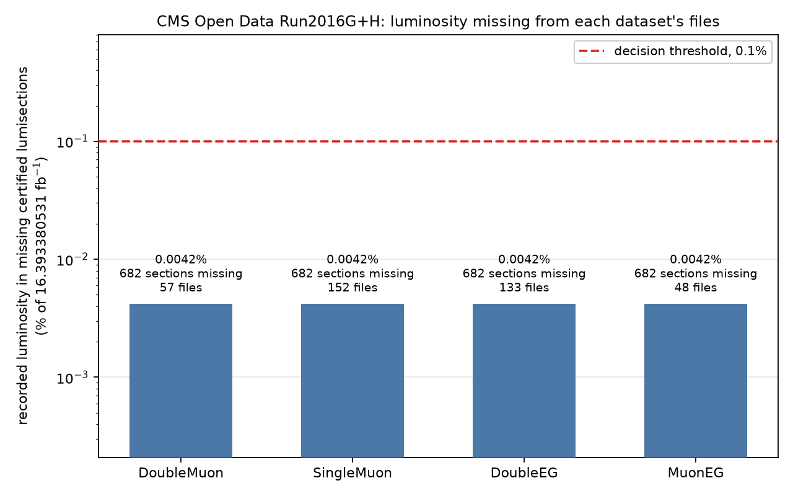

# Luminosity coverage of the four delivered datasets — Run2016G+H

Measured 13 October 2026. Every number below is **VERIFIED BY RUNNING**
unless the line says otherwise.

## The question

Do our CMS Open Data files contain every certified (golden JSON)
lumisection of Run2016G+H, and how much recorded luminosity sits in
certified lumisections that are absent from each dataset's files?

This had been answered for **DoubleEG only**
(`studies/hgg_cms/impl_checks/lumi_coverage/LUMI_DECISION.md`: 682 missing
sections carrying 0.000688616 fb⁻¹, 0.0042% of the official total, so the
official 16.393380531 fb⁻¹ was adopted unchanged). DoubleMuon, SingleMuon
and MuonEG had never been checked, and
`studies/m0m1j0_cms/cluster/make_variants_plots.py` labelled the value
explicitly "UNVERIFIED for DoubleMuon specifically".

## Answer

**No dataset is missing any meaningful luminosity.** All four miss the same
0.0042% — a factor of 24 below the 0.1% decision threshold, and about 290×
smaller than CMS's own 1.2% uncertainty on the luminosity measurement
itself.

| dataset | files | certified G+H sections | present | missing | missing luminosity (fb⁻¹) | % of 16.393380531 | effective luminosity (fb⁻¹) |
|---|---:|---:|---:|---:|---:|---:|---:|
| DoubleMuon | 57 | 90,807 | 90,125 | 682 | 0.000688522 | 0.0042% | 16.392692009 |
| SingleMuon | 152 | 90,807 | 90,125 | 682 | 0.000688522 | 0.0042% | 16.392692009 |
| DoubleEG | 133 | 90,807 | 90,125 | 682 | 0.000688616 | 0.0042% | 16.392691915 |
| MuonEG | 48 | 90,807 | 90,125 | 682 | 0.000688522 | 0.0042% | 16.392692009 |

Per era, every dataset: **332** of 43,014 certified Run2016G sections
missing, **350** of 47,793 certified Run2016H sections missing.

## Decision

The rule approved before the measurement: if every dataset misses < 0.1%
of the luminosity **and** the DoubleEG re-derivation reproduces 0.0042%,
keep **16.393380531 fb⁻¹ ± 1.2%** unchanged for both delivery files.

* worst dataset: **DoubleEG, 0.00420%** — below the 0.1% threshold
* DoubleEG re-derivation: **REPRODUCED**

**Rule passed.** `decision.passed = true` in `coverage_summary.json`; the
rule is evaluated by `aggregate_coverage.py` itself, not applied by hand
afterwards. Both delivery READMEs were updated on branch
`deliver/onedrive-upload-20261013` to state the checked value.

## DoubleEG re-derivation against the earlier task

| | recomputed here | earlier task | |
|---|---:|---:|---|
| missing sections, Run2016G | 332 | 332 | match |
| missing sections, Run2016H | 350 | 350 | match |
| missing sections, total | 682 | 682 | match |
| missing luminosity | 0.000688616 fb⁻¹ | 0.000688616 fb⁻¹ | identical |
| % of official total | 0.0042% | 0.0042% | match |

The earlier result reproduces exactly, from a completely separate run:
different file list (the repository's own committed list rather than a live
portal fetch), different access protocol (xrootd rather than HTTPS),
different machine. That is the strongest available evidence that the method
here is the same method, correctly applied.

## The ground truth, checked before it was used

* **Certified list** — the 2016 golden JSON, CERN Open Data record 14220,
  committed at
  `data/cms/validated_runs/Cert_271036-284044_13TeV_Legacy2016_Collisions16_JSON.txt`.
  It yields **43,014** certified lumisections for Run2016G and **47,793**
  for Run2016H (90,807 together), reproducing the earlier task's counts.
* **Per-lumisection recorded luminosity** — `pp_2016lumibyls.csv`, CERN
  Open Data record 1059, CMS's own `brilcalc --byls` over the certified
  list with the official 2016 normtag. Downloaded at 21,137,550 bytes,
  matching the portal's listed size exactly; its own header (`#Data tag :
  23v1`) and footer (`#144,393,234231,233406,38.184814444,36.313753344`,
  and `(run,ls) in json but not in results: []`) match what
  LUMI_DECISION.md quotes, so this is the same file the earlier task used.

Summing that table over the certified sections of each era reproduces the
official per-era totals to the ninth decimal:

| era | summed from the CSV (fb⁻¹) | official (fb⁻¹) | difference |
|---|---:|---:|---:|
| Run2016G | 7.653261218 | 7.653261227 | −0.0000001% |
| Run2016H | 8.740119376 | 8.740119304 | +0.0000008% |

Zero certified G+H sections are absent from the CSV.

## What the missing sections are

Of the 682 missing sections, **662 (97%) carry exactly 0.0 recorded
luminosity** (661 for DoubleEG) — not "small", genuinely zero. The largest
single missing section anywhere is 0.000226273 fb⁻¹. This matches the
earlier task's characterisation: these are certified lumisections in which
the accelerator delivered essentially nothing (technical stops, end-of-fill
ramp-down), not sections of real physics data that our datasets happened to
miss.

**DoubleMuon, SingleMuon and MuonEG miss exactly the same 682 sections** —
the three sets are identical, element for element. DoubleEG's set of 682
differs from them in **10 sections** (5 each way), every one carrying
between 0 and 3.4×10⁻⁸ fb⁻¹; those 10 are the entire reason its missing
total differs, by 9.4×10⁻⁸ fb⁻¹. This is also the check that the four
measurements are genuinely independent reads rather than one result copied
four times.

Each dataset's files also contain lumisections that are *not* certified
(3,106 in Run2016G and 4,300 in Run2016H for the three muon/EG datasets;
3,636 and 5,100 for DoubleEG). Those are excluded by the golden-JSON filter
in the production itself and play no part in this measurement.

## Method

Per file, only the small `LuminosityBlocks` tree was opened, and only its
`run` and `luminosityBlock` branches — **no event content was read**. This
is the method of the earlier task's `recompute_missing_sections.py`,
changed only in that the file list comes from the repository's committed
`studies/cms_datasets/evidence/record_file_lists.json`, that files are
opened over xrootd, and that one record runs per process so the work can be
an array job.

A subjob that could not read one of its files would **fail**, and
`aggregate_coverage.py` refuses to aggregate any record reporting a failed
or short read — a transient read error must never be mistaken for a
genuinely absent lumisection. **All 390 files were read successfully**
(57 + 152 + 133 + 48), all 8 subjobs exited 0.

## Run record

| | |
|---|---|
| code commit | `56b3db3` on `study/lumi-coverage-four-datasets`, off `origin/master` `2734dd3` |
| PBS array | `5220621[]`, 8 subjobs, queue `N`, `-m n`, 1 cpu / 4 GB / 4 h each |
| walltime used | 14 s to 62 s per subjob |
| work directory | `/storage/agrp/berkom/atlas-utilization/work/lumi_coverage_four_20261013/` |
| file-count quota at submission | 110,708 of 150,000 |

Full job and resume detail in `HANDOFF.md`. Nothing was written to `$HOME`,
no existing `output/` directory was touched, `/storage/agrp/marybo/` was
never accessed, and no permissions were changed.

## Nothing here is UNVERIFIED

Every number in this report was produced by the run described above, from
the two cited ground-truth files. The one figure carried over from the
earlier task rather than re-measured is its published DoubleEG result
(0.000688616 fb⁻¹ / 0.0042%), quoted only so that this run can be compared
against it — and this run reproduces it exactly.
