# Plan: closing the MC background gap with CMS 2016 Open Data (26 Oct 2026)

> **31 Oct 2026: superseded for the sample list and normalisation by `DECISIONS.md` / `XSEC_PROPOSALS_v2.md` (summary: `PLAN_v2_summary.md`).**

Branch `plan/mc-expansion-20261026` (fork only). **Research and planning only:** no production
was run, no sample was added to any config, mapping or registry, and no existing file was edited.
Every number is VERIFIED BY RUNNING (read from the CERN Open Data API, a public page or paper, or
computed by a script in this folder) unless it is marked ESTIMATE, PROVISIONAL or UNVERIFIED.

## In plain words

**What is missing.** Our CMS simulation ("MC") has 13 samples covering 11 processes. The ATLAS side's
background list (Maryna, 26 Oct, 353 DSIDs) also has W+jets, more top (single top t- and s-channel,
fully hadronic tt̄), more dibosons, tribosons, many Higgs samples, photon+jets and diphotons. We do
not have her DSID-by-DSID list yet, so this plan works from her group list.

**What CMS Open Data has.** Everything except one detail of the photon samples:

| missing ATLAS group | CMS 2016 samples found (post-VFP NanoAODv9) | proposed now? |
|---|---|---|
| W+jets | inclusive LO and NLO, jet-binned NLO (0/1/2 jets), jet-binned LO (1-4), HT-binned LO (8 bins), W-pT-binned NLO (4 bins), Sherpa, EWK W+2 jets | **yes** (tier 1) |
| top: single top t- and s-channel, tt̄ hadronic | t-channel 4- and 5-flavour (top, antitop), s-channel leptonic and hadronic, TTToHadronic | **yes** (tier 1) |
| diboson (beyond our WW/WZ/ZZ → leptons) | WZ → ℓℓqq, ℓνqq, ℓννν; ZZ → ℓℓqq; WW → ℓνqq; inclusive Pythia WW/WZ/ZZ; gg → WW; VBS samples | **yes** (tier 2) |
| triboson | WWW, WWZ, WZZ, ZZZ (NLO, all decays) | **yes** (tier 3) |
| rare top (part of ATLAS "top") | tZq, tWZ(ℓℓ), tt̄H, tt̄Z → qq, tt̄W → qq, tt̄tt̄, tt̄ + low-mass ℓℓ, tHq/tHW | **yes** (tier 4) |
| Higgs (133 ATLAS DSIDs) | every production mode (ggF, VBF, W+H, W−H, qq̄ → ZH, gg → ZH, tt̄H, bb̄H, tH) with many decays | **15 samples** (tier 5) |
| Z+jets / Drell-Yan | we already have the full NLO set; many binned extras exist | no (not needed) |
| photon+jets, diphoton, W/Zγ | yes, but one GJets bin (HT 100-200, non-ΔR set) is **not observed** in this release | DEFERRED (photons not delivered) |
| QCD multijet (not on the ATLAS list) | muon-enriched, EM-enriched, b/c → e, HT-binned | no (question pending with Maryna) |

**What I recommend.** 39 samples in 5 priority tiers (and 4 alternatives kept for two decisions):
1. W+jets (NLO, split by jet count into 3 pieces), single top t-channel (top, antitop), single top
   s-channel (leptonic), tt̄ fully hadronic;
2. the five dibosons where one boson decays to quarks;
3. the four tribosons;
4. eight rare-top samples;
5. fifteen Higgs samples (H → WW, H → ττ, H → ZZ in the production modes we do not have).

**What it costs (ESTIMATES, from the 25-26 Oct production).** About 1,145 files, 740 million events,
~180 CPU hours, and ~20,600 new files on the cluster. With today's count (92,041, VERIFIED BY RUNNING after
the probe; 90,665 before it) that gives ~112,600, under the 125,000 ceiling, **so all five tiers fit**. Tier 1 alone is 518 files / 75 CPU hours / ~7,500 cluster files.

**The one statistical warning.** W+jets is the only group whose simulation has *less* luminosity than
the data: 2.1, 4.7 and 2.7 fb⁻¹ for the three pieces, i.e. 0.13-0.29 × the data's 16.4 fb⁻¹ (confirmed by the probe). Once the
negative weights are taken into account, each effective simulated W+jets event stands for about 3.5-8 data
events, which can make isolated spikes in sparse histograms. Every other sample has 7 to 100,000 × the data luminosity. (`plots/mc_lumi_vs_data.png`)

**The existing 13 samples:** all are the correct 2016 post-VFP campaign (RunIISummer20UL16NanoAODv9,
conditions 106X_mcRun2_asymptotic_v17), none is the pre-VFP "APV" campaign, all use tune CP5.
**No problem found.**

**The one-file probe (step 4) ran on 26 Oct** (PBS array 5365612[], 30 samples, all exit 0). Every probed
sample has **all the branches our production reads** (including the prefiring weight and pileup branches),
the per-file weight sums match the files' own bookkeeping, and the statistics agree with the earlier
estimates (within ~3 %, except s-channel +14 % and four-top −9 %): **no conclusion changed**. One detail for
the technical lead: the NLO W+jets pieces are not "pure" 0 / 1 / 2 parton samples at the LHE level (each also
has events with one parton more, as NLO samples do), so they must not be cut against each other by
LHE_Njets — not needed for the recommended option. Details §4a; genWeight plots in `plots/`.

## 1. Campaign check of the 13 delivered samples (step 1)

From the portal API (`evidence/records/<recid>.json.gz`, VERIFIED BY RUNNING): every NanoAOD record's
dataset name is `/<sample>/RunIISummer20UL16NanoAODv9-106X_mcRun2_asymptotic_v17-v{1,2}/NANOAODSIM`, its
MiniAOD parent is `RunIISummer20UL16MiniAODv2-106X_mcRun2_asymptotic_v17-v{1,2}`, and every name contains
`TuneCP5`. The pre-VFP campaign would read `RunIISummer20UL16NanoAODAPVv9` with a `preVFP` conditions
tag; none does. (In fact no `APV` NanoAOD record appeared in any of this task's searches with the
portal's `nanoaodsim` filter: the 2016 MC on the portal is post-VFP only, as far as observed.)

| NanoAOD / MiniAOD | dataset | post-VFP | CP5 |
|---|---|---|---|
| 67801 / 67800 | TTTo2L2Nu_TuneCP5_13TeV-powheg-pythia8 …-v1 | yes | yes |
| 67993 / 67992 | TTToSemiLeptonic_TuneCP5_13TeV-powheg-pythia8 …-v1 | yes | yes |
| 35669 / 35668 | DYJetsToLL_M-50_TuneCP5_13TeV-amcatnloFXFX-pythia8 …-v1 | yes | yes |
| 35631 / 35630 | DYJetsToLL_M-10to50_TuneCP5_13TeV-amcatnloFXFX-pythia8 …-v1 | yes | yes |
| 64895 / 64894 | ST_tW_top_5f_NoFullyHadronicDecays_TuneCP5_13TeV-powheg-pythia8 …-v1 | yes | yes |
| 64839 / 64838 | ST_tW_antitop_5f_NoFullyHadronicDecays_TuneCP5_13TeV-powheg-pythia8 …-v1 | yes | yes |
| 72676 / 72675 | WWTo2L2Nu_TuneCP5_13TeV-powheg-pythia8 …-v1 | yes | yes |
| 72752 / 72751 | WZTo3LNu_TuneCP5_13TeV-amcatnloFXFX-pythia8 …-v1 | yes | yes |
| 75589 / 75588 | ZZTo4L_TuneCP5_13TeV_powheg_pythia8 …-v1 | yes | yes |
| 68187 / 68186 | TTZToLLNuNu_M-10_TuneCP5_13TeV-amcatnlo-pythia8 …-v1 | yes | yes |
| 68073 / 68072 | TTWJetsToLNu_TuneCP5_13TeV-amcatnloFXFX-madspin-pythia8 …-v1 | yes | yes |
| 37728 / 37727 | GluGluHToZZTo4L_M125_TuneCP5_13TeV_powheg2_JHUGenV7011_pythia8 …-v2 | yes | yes |
| 68847 / 68846 | VBF_HToZZTo4L_M125_TuneCP5_13TeV_powheg2_JHUGenV7011_pythia8 …-v2 | yes | yes |

Side check (VERIFIED BY RUNNING): the JHUGen decay cards of 37728 and 68847 say `DecayMode1=8 DecayMode2=8`
(Z → ℓℓ with ℓ = e, μ, τ, per the JHUGen source), which matches the branching ratio in our registry
(2.745e-4, "l = e, μ, τ").

## 2. What exists, group by group (step 2)

Searches: `https://opendata.cern.ch/api/records/?q=title:*<pattern>*&experiment=CMS&type=Dataset&subtype=Simulated&file_type=nanoaodsim`,
one per pattern (`evidence/portal_search_titles.json`), keeping only `RunIISummer20UL16NanoAODv9` titles.
Tune variations (CP5up/down, CR1/2, hdamp, top-mass, width), BSM signals and non-125 GeV Higgs masses
were left out. 311 records were fetched with their MiniAOD parents (`fetch_records.py`,
`evidence/records/`, summary `evidence/records_summary.json`); the full tables (events, files, size,
portal cross section with filter and matching efficiency, link) are the appendix of this file and
`candidates.json`. Generator cards of the planned samples are in `evidence/cards/` (`fetch_cards.py`).

**a. W+jets.** Complete sets that exist: inclusive LO (madgraphMLM, 69747, 81.0 M events) and inclusive
NLO (amcatnloFXFX, 69745, 28.3 M); **jet-binned NLO 0J/1J/2J complete** (69715/69717/69719, 413 M events);
jet-binned LO W1-W4Jets complete (69545-69551); **HT-binned LO complete** from 70 GeV (8 bins
70-100 … 2500-Inf, 69721-69735); W-pT-binned NLO from 100 GeV (4 bins, 69737-69743, "MatchEWPDG20");
plus W+b (Wpt-binned), a BPS-filtered high-pT sample, Sherpa NLO (two records) and EWK W+2 jets (W⁺, W⁻,
35987/35993). All W+jets cards define ℓ = e, μ, τ (`evidence/cards/697*/…proc_card.dat`) and exclude top
and Higgs diagrams (`$$ t t~ h`).

**b. Single top.** t-channel 4-flavour (POWHEG+MadSpin; top 64759, antitop 64659) and 5-flavour (POWHEG;
top 64793, antitop 64693), all inclusive decays; s-channel 4-flavour amcatnlo with leptonic (64635) and
hadronic (64633) top decays. Also CompHEP t-channel by lepton flavour (mostly anomalous-coupling
variants) and inclusive tW (64881/64825) — the latter would double-count our NoFullyHadronic tW.

**c. tt̄ hadronic.** TTToHadronic POWHEG (67841, 107 M events, 146 files). Inclusive TTJets (LO, NLO) also
exist but would double-count our dilepton/semileptonic tt̄.

**d. Dibosons.** New and relevant: WZTo2Q2L (72742), WZTo1L1Nu2Q (72738), WZTo1L3Nu (72740),
ZZTo2Q2L (75573), WWTo1L1Nu2Q (72658). Also: ZZTo2Nu2Q, WWTo4Q, ZZTo4Q (no leptons), inclusive Pythia
WW/WZ/ZZ (LO, overlap everything), other WZ → 3ℓν generators, VVTo2L2Nu (overlaps WW+ZZ → 2ℓ2ν), gg → WW
MCFM (9 records), WW double-parton scattering, VBS (W±W±jj, WZjj, ZZjj EWK/QCD). **ZZTo4Nu: not observed.**
**ZZTo2L2Nu 75567** (16 M events) exists; it was **excluded on 15 Oct** because its portal value
(0.9738 pb, VERIFIED today) did not match expectations by 42 % and the mismatch was never resolved. That
history stands; it is not resolved here and the sample is not proposed. (Two smaller POWHEG ZZ → 2e2ν /
2μ2ν "DipoleRecoil" records, 75565/75569, have no cross section on the portal.)

**e. Tribosons.** WWW (4F), WWZ (4F), WZZ, ZZZ at NLO with all decays, each as a small record and a large
"ext1" record of the same configuration; filtered variants (WWW dilepton filter, WWZ → 4ℓ2ν) and LO
"dim6" EFT samples.

**f. Rare top.** tZq → ℓℓ (68325), tWℓℓ (64873, LO), tt̄H → bb̄ / non-bb̄ (POWHEG 67645/67691 and amcatnlo
67589/67639), tt̄Z → qq̄ (68206, and a larger 68207 without a portal cross section), tt̄W → qq (68083),
tt̄tt̄ (68045), tt̄ + ℓℓ with 1 < m(ℓℓ) < 10 GeV (68185), tt̄Z → νν (subset of our tt̄Z → ℓℓ/νν), LO
tt̄WW, tt̄WZ, tt̄ZZ, tt̄tW, tt̄tj, tt̄WH, tt̄ZH, and tHq/tHW (65649/65721, "ctcvcp").

**g. Higgs at 125 GeV, production × decay that exists** (post-VFP NanoAODv9; ✓ = found):

| decay ↓ / production → | ggF | VBF | W⁺H / W⁻H | qq̄ → ZH | gg → ZH | tt̄H | bb̄H |
|---|---|---|---|---|---|---|---|
| ZZ → 4ℓ | ✓ (delivered) | ✓ (delivered) | ✓ | ✓ (4ℓ filter) | not observed | in non-bb̄ | — |
| ZZ → 2ℓ2ν | ✓ | ✓ | ✓ | ✓ (2ν2X filter) | not observed | in non-bb̄ | — |
| ZZ → 2ℓ2q / 2ℓ2X | ✓ (2ℓ2q) | ✓ (2ℓ2X) | ✓ (2ℓ2X) | ✓ (2ℓ2q filter) | not observed | in non-bb̄ | — |
| WW → 2ℓ2ν | ✓ | ✓ | ✓ (and W → ℓ) | ✓ (Z → ℓℓ) | ✓ (Z → ℓℓ) | in non-bb̄ | — |
| WW (inclusive) / ℓνqq | ✓ ℓνqq, 4q | ✓ ℓνqq, any | ✓ inclusive | ✓ inclusive, ℓνqq | ✓ (Z → ℓℓ) | in non-bb̄ | — |
| ττ | ✓ | ✓ | ✓ | ✓ | not observed | ✓ | ✓ |
| bb̄ | ✓ | ✓ | ✓ (W → ℓν, qq) | ✓ (Z → ℓℓ, νν, qq) | ✓ (Z → ℓℓ, νν, qq) | ✓ | ✓ |
| μμ | ✓ | ✓ | ✓ | ✓ | not observed | ✓ | — |
| Zγ (ℓℓγ) | ✓ | ✓ | ✓ | ✓ | not observed | ✓ | — |
| γγ | ✓ | ✓ | ✓ | ✓ | ✓ (Z → ℓℓ, νν, qq) | ✓ | — |
| inclusive | — | — | — | — | — | — | ✓ (yb², yt²) |

Also VH inclusive (amcatnlo `VHToNonbb`, `VHToGG`), tHq/tHW (inclusive H), cc̄ and Dalitz decays.

**h. Z → νν and other Drell-Yan (availability only).** Z → νν: HT-binned LO (7 bins from 100 GeV; **HT
70-100 not observed**), Z-pT-binned NLO 1- and 2-jet (8 records), BPS-filtered high-pT, EWK Z(νν)+2 jets.
*For lepton-triggered final states Z → νν matters only through fake or non-prompt leptons, far below W+jets;
not proposed.* Drell-Yan extras: HT-binned LO for M > 50 (8 bins) and 4 < M < 50 (5 bins from HT 70),
jet-binned LO (DY1-4Jets, M > 50 and 10-50) and NLO (0J/1J/2J), Z-pT-binned NLO (6 bins), mass-binned NLO
(100-200 … 2000-3000), POWHEG DY → ee/μμ mass bins, DY → ττ → μτh/μe. *Our NLO inclusive M-10to50 + M-50
already cover the phase space; the binned ones would only add tail statistics and need stitching. The only
new phase space is 4 < m(ℓℓ) < 10 GeV (HT > 70 only); see Decisions.*

**i. Photons — DEFERRED: photons are not in the delivery (Itamar's branch, pending Maryna).** Available:
GJets with ΔR > 0.4, HT-binned, **complete** (40-100, 100-200, 200-400, 400-600, 600-Inf); GJets HT-binned
without the ΔR cut: 40-100, 200-400, 400-600, 600-Inf found, **HT 100-200 not observed** in the UL16
NanoAODv9 release (the portal search finds only a 2015 MiniAOD and an 8 TeV AOD record of that name) — this
is consistent with the 2024 forum remark that GJets is incomplete in 2016; DiPhotonJets (amcatnlo,
Sherpa box), WGToLNuG (LO, NLO 0-1j, pT-binned), ZGToLLG (NLO, low-mass), TTGJets and TTGamma. W/Zγ
samples overlap with W/Z+jets where the jets sample radiates a photon; mixing them needs photon overlap
removal.

**j. QCD multijet — NOT on the ATLAS list; question pending with Maryna; relevant to the open e-μ 0j
data/MC = 2.19 question.** Availability only (events / files, VERIFIED BY RUNNING): μ-enriched (pT > 5 GeV
muon), 12 pT bins 15 → 1000+, 289 M events / 457 files; EM-enriched, 8 bins 15 → 300+, 34 M / 173;
b/c → e, 6 bins 15 → 250+, 47 M / 235; HT-binned madgraphMLM, 9 bins 50 → 2000+, 319 M / 385; plus inclusive
μ-enriched (pT > 20 with 15 GeV muon; pT > 30 with 4 GeV muon), b-enriched and b-filtered HT sets, flat-pT
Pythia. No cross-section research done (out of scope).

**Optional ATLAS ↔ CMS side-by-side:** not made. The upstream repository lists no ATLAS DSIDs (it fetches
the ATLAS metadata at run time), and I did not find a public list I could open without more digging. The
one-by-one mapping waits for Maryna's DSID list.

## 3. Double counting (step 3)

For every proposed sample: what else could cover the same events, and why the proposed set does not.

**W+jets.** The three NLO pieces are exclusive by construction (0, 1, 2 partons in the NLO matrix element,
one FxFx setup) and add up to the inclusive W: their portal values sum to 65,588 pb vs 66,970 pb for the
inclusive NLO sample. So **no stitching is needed** as long as they are used *alone* (they are separate by their *Born* parton
count; the probe shows each also holds real-emission events with one more LHE parton, §4a): never together with
the inclusive NLO or any LO sample. *If* an LO set were mixed (inclusive LO + W1-4Jets, or inclusive LO +
HT-binned), the standard LHE-level stitching would be needed: per event, the inclusive sample's weight is
replaced by L·σ_n / (N_incl·f_n + N_n) in the LHE_Njets = n (or LHE_HT bin) slice, where f_n is the fraction
of the inclusive sample in that slice, and the inclusive sample is cut to LHE_HT < 70 GeV below the first HT
bin. It needs the branches `LHE_Njets` / `LHE_HT` (the probe checks them) and a new per-event weighting
step in the builder that does not exist today. W+jets has no top or Higgs diagrams (`$$ t t~ h`), so no
overlap with tt̄/single top; it has no second electroweak boson, so no overlap with dibosons. The W-pT and
W+b samples overlap with all of the above and are not used. W+γ (photon samples) would overlap — deferred.

**Single top.** 4-flavour and 5-flavour t-channel are two generations of the same process: use one
(decision below). s-channel leptonic vs hadronic: orthogonal (top decay); only leptonic proposed. t/s-channel
vs our tW: different channels, no overlap. Inclusive tW (64881/64825) would double-count our
NoFullyHadronic tW: not used. tZq and tWℓℓ have the ℓℓ pair in the matrix element; the t-channel and tW
samples do not: orthogonal by construction.

**tt̄ hadronic.** TTToHadronic + our TTTo2L2Nu + TTToSemiLeptonic are orthogonal by W decays and together
make 0.10706 + 0.44113 + 0.45441 = **1.0026** of tt̄ with the settled PDG values (the individual W
fractions sum to 1.0013). A +0.26 % overcount that comes from the convention itself; reported, not changed.
Inclusive TTJets: not used.

**Dibosons.** By boson decay: WZ → ℓℓqq (2Q2L), ℓνqq (1L1Nu2Q), ℓννν (1L3Nu) and our ℓℓℓν are mutually
exclusive; ZZ → ℓℓqq and our 4ℓ are exclusive; WW → ℓνqq and our 2ℓ2ν are exclusive. The inclusive Pythia
WW/WZ/ZZ and VVTo2L2Nu would double-count: not used. **gg → WW:** the WW k-factor source
(arXiv:1408.5243) includes gg → WW in its NNLO 118.7 pb, so the 9 gg → WW MCFM samples would add it again —
**flagged, not used** (their portal values, 36.8 pb each, look like the gg → ZZ family's ~1000× problem;
UNVERIFIED). **gg → ZZ** is inside the ZZ NNLO k-factor (1405.2219) that ZZ → 2ℓ2q also uses; the gg → ZZ
samples stay excluded. Note that 1408.5243's WW total excludes gg → H → WW* (listed separately in its
Table I), so adding Higgs → WW samples is not a double count. The 2Q2L samples contain γ* → ℓℓ (m(ℓℓ) > 4);
DY+jets cannot produce an on-shell W/Z → qq at the same order, so no overlap.

**Tribosons.** Use one record per process: the large "ext1" record. The builder normalises each record by
its own Σw, so using the small and the large record of the same configuration *both* would count the
process twice (decision below). Filtered subsets (WWW dilepton filter, WWZ → 4ℓ2ν) and the EFT samples are
not used. Higgs-mediated diagrams inside WWW/WWZ are off-shell (all three bosons are produced on-shell), so
there is no resonant overlap with VH(H → WW); small, reported.

**Rare top.** tt̄Z → qq vs our tt̄Z → ℓℓ/νν: exclusive by Z decay. tt̄ + ℓℓ (1-10 GeV) vs our tt̄Z (m(ℓℓ) >
10): exclusive by mass. tt̄W → qq vs our tt̄W → ℓν: exclusive. tt̄H vs tt̄Z/tt̄W: different processes. tt̄H →
bb̄ + tt̄H → non-bb̄ = all tt̄H; the other tt̄H → ττ/μμ/Zγ samples are subsets of non-bb̄: not used. tt̄Z → νν
is a subset of our tt̄Z → ℓℓ/νν: not used.

**Higgs.** Within a production mode the proposed decays (WW, ττ, ZZ → 2ℓ2ν, ZZ → 4ℓ) are exclusive. The
WH → WW sample is H → WW inclusive and W inclusive, so the W⁺H → WW 2ℓ-filtered and HWJ → 2ℓ2ν samples
(subsets) are not used. **gg → ZH:** the YR4 page gives pp → ZH = 0.8839 pb *including* gg → ZH 0.1227 pb;
the qq̄ → ZH samples are therefore normalised to "all but gg → ZH" = 0.7612 pb and the gg → ZH sample to
0.1227 pb, so gg → ZH is counted once. VHToNonbb (covers WH+ZH) and the MCFM gg → H → ZZ samples overlap:
not used. Higgs samples do not overlap the diboson ones (the WW/ZZ totals above exclude the Higgs).

## 4. Statistics and cost of the proposed samples (step 5)

How to read it: σ_eff is the PROPOSED value (`XSEC_PROPOSALS.md`), not decided. "weight/event" =
σ_eff × 16.393 fb⁻¹ / Σw, in units of the sample's mean |genWeight| (ESTIMATE: Σw = N(1 − 2f) with f the
portal's negative-weight fraction). N_eff = (Σw)²/Σw² ≈ N(1 − 2f)² (ESTIMATE, exact only when |genWeight|
is constant; the probe will replace it). MC lumi = N_eff / σ_eff. CPU = events × (CPU seconds per event of
the most similar delivered sample, from the 25-26 Oct audit `studies/fullrun_20261025/evidence/final_mc/production_audit.json`,
audit job 5341394 over arrays 5340549[]-5340560[] and 5341381[]). Cluster files = 12.1 per input file
(6,014 files for 497 jobs on 17 Oct) plus ~172 per sample for the build (2,240 for 13 samples on 17 Oct).
All from `stats_cost.py` → `evidence/stats_cost.json`. **Updated 26 Oct after the probe:** N_eff, MC lumi and
weight/event now come from the probe (file 0 scaled to the sample: Σw = N·Σw_file/N_file, Σw² likewise) for
the 30 probed samples; the old portal-based estimates are kept in the italic column; for probed samples the weight/event column is
the factor that multiplies genWeight (σ_eff·L/Σw), for the others it is in units of the mean |genWeight|; the file-count
projection starts from 92,041 (measured after the probe).

| tier | NanoAOD | sample | events | files | σ_eff PROPOSED [pb] | weight/event PROVISIONAL | N_eff | MC lumi [fb⁻¹] | ÷ data | *old estimate: N_eff / ÷ data* | source | CPU h | CPU s/file | cluster files |
|---|---|---|---:|---:|---:|---:|---:|---:|---:|---|---|---:|---:|---:|
| 1 | 69715 | WJetsToLNu_0J_amcatnloFXFX | 159,756,701 | 97 | 5e+04 | 8.61e-05 | 103 M | 2.05 | 0.125 **< data** | *103 M / 0.125* | probe | 10.7 | 398 | 1174 |
| 1 | 69717 | WJetsToLNu_1J_amcatnloFXFX | 167,292,982 | 117 | 8403 | 1.8e-05 | 39.6 M | 4.72 | 0.288 **< data** | *39.4 M / 0.286* | probe | 11.2 | 345 | 1416 |
| 1 | 69719 | WJetsToLNu_2J_amcatnloFXFX | 85,825,681 | 63 | 3124 | 2.45e-05 | 8.3 M | 2.66 | 0.162 **< data** | *8.37 M / 0.163* | probe | 5.8 | 329 | 762 |
| 1 | 69745 | WJetsToLNu_amcatnloFXFX (inclusive NLO) (alt.) | 28,268,221 | 28 | 6.153e+04 | 0.000207 | 13.3 M | 0.216 | 0.0132 **< data** | *13.3 M / 0.0132* | probe | 1.9 | 244 | 339 |
| 1 | 69747 | WJetsToLNu_madgraphMLM (inclusive LO) (alt.) | 80,958,227 | 68 | 6.153e+04 | 0.000103 | 81 M | 1.32 | 0.0803 **< data** | *81 M / 0.0803* | probe | 5.4 | 287 | 823 |
| 1 | 64793 | ST_t-channel_top_5f_InclusiveDecays | 55,783,000 | 51 | 134.2 | 0.000329 | 55.2 M | 411 | 25.1 | *55.1 M / 25.1* | probe | 19.3 | 1363 | 617 |
| 1 | 64693 | ST_t-channel_antitop_5f_InclusiveDecays | 29,394,000 | 25 | 80 | 0.000622 | 29.1 M | 363 | 22.2 | *29.1 M / 22.2* | probe | 10.2 | 1465 | 303 |
| 1 | 64759 | ST_t-channel_top_4f_InclusiveDecays (alt.) | 63,073,000 | 86 | 134.2 | 0.0372 (|w| units) | 55.4 M | 412 | 25.2 | *55.4 M / 25.2* | ESTIMATE (not probed) | 21.8 | 914 | 1041 |
| 1 | 64659 | ST_t-channel_antitop_4f_InclusiveDecays (alt.) | 30,609,000 | 35 | 80 | 0.0455 (|w| units) | 27.1 M | 339 | 20.7 | *27.1 M / 20.7* | ESTIMATE (not probed) | 10.6 | 1090 | 424 |
| 1 | 64635 | ST_s-channel_4f_leptonDecays | 5,471,000 | 19 | 3.623 | 0.00286 | 2.65 M | 731 | 44.6 | *2.32 M / 39.1* | probe | 1.9 | 359 | 230 |
| 1 | 67841 | TTToHadronic | 107,067,000 | 146 | 378.9 | 0.000185 | 105 M | 278 | 17 | *105 M / 17* | probe | 15.4 | 380 | 1767 |
| 2 | 72742 | WZTo2Q2L_mllmin4p0 | 13,526,954 | 39 | 7.133 | 0.000901 | 5.26 M | 737 | 45 | *5.26 M / 45* | probe | 5.7 | 522 | 472 |
| 2 | 75573 | ZZTo2Q2L_mllmin4p0 | 13,740,600 | 14 | 4.311 | 0.000933 | 5.76 M | 1.34e+03 | 81.5 | *5.77 M / 81.6* | probe | 5.7 | 1477 | 169 |
| 2 | 72738 | WZTo1L1Nu2Q | 3,690,271 | 23 | 10.16 | 0.00295 | 1.26 M | 124 | 7.54 | *1.23 M / 7.37* | probe | 1.5 | 241 | 278 |
| 2 | 72658 | WWTo1L1Nu2Q | 19,976,139 | 30 | 52.36 | 0.000509 | 7.27 M | 139 | 8.47 | *7.28 M / 8.48* | probe | 8.4 | 1002 | 363 |
| 2 | 72740 | WZTo1L3Nu | 1,229,946 | 21 | 3.789 | 0.00899 | 0.403 M | 106 | 6.49 | *0.404 M / 6.51* | probe | 0.5 | 88 | 254 |
| 3 | 72701 | WWW_4F (ext1) | 4,159,000 | 24 | 0.2158 | 0.00394 | 3.42 M | 1.59e+04 | 968 | *3.42 M / 966* | probe | 1.7 | 261 | 290 |
| 3 | 72711 | WWZ_4F (ext1) | 4,595,000 | 7 | 0.1707 | 0.00356 | 3.78 M | 2.22e+04 | 1.35e+03 | *3.78 M / 1.35e+03* | probe | 1.9 | 988 | 85 |
| 3 | 72761 | WZZ (ext1) | 4,554,000 | 9 | 0.05709 | 0.0036 | 3.74 M | 6.55e+04 | 4e+03 | *3.75 M / 4.01e+03* | probe | 1.9 | 761 | 109 |
| 3 | 75600 | ZZZ (ext1) | 4,534,000 | 20 | 0.01476 | 0.00362 | 3.59 M | 2.43e+05 | 1.48e+04 | *3.6 M / 1.49e+04* | probe | 1.9 | 341 | 242 |
| 4 | 68325 | tZq_ll_4f | 3,967,000 | 52 | 0.07561 | 0.00399 | 0.297 M | 3.92e+03 | 239 | *0.29 M / 234* | probe | 1.4 | 95 | 629 |
| 4 | 64873 | ST_tWll_5f | 320,000 | 2 | 0.01105 | 0.000566 | 0.32 M | 2.9e+04 | 1.77e+03 | *0.32 M / 1.77e+03* | probe | 0.1 | 199 | 24 |
| 4 | 67645 | ttHTobb_M125 (powheg) | 4,937,000 | 26 | 0.2953 | 0.00196 | 4.72 M | 1.6e+04 | 974 | *4.73 M / 978* | probe | 10.1 | 1397 | 315 |
| 4 | 67691 | ttHToNonbb_M125 (powheg) | 2,240,994 | 20 | 0.2118 | 0.00309 | 2.16 M | 1.02e+04 | 621 | *2.15 M / 619* | probe | 4.6 | 825 | 242 |
| 4 | 68206 | TTZToQQ | 5,401,000 | 20 | 0.5113 | 0.003 | 1.36 M | 2.67e+03 | 163 | *1.33 M / 159* | probe | 11.0 | 1987 | 242 |
| 4 | 68083 | TTWJetsToQQ | 308,983 | 8 | 0.4375 | 0.0348 | 0.0896 M | 205 | 12.5 | *0.0925 M / 12.9* | probe | 0.6 | 284 | 97 |
| 4 | 68045 | TTTT | 4,544,000 | 23 | 0.008091 | 0.00377 | 0.789 M | 9.75e+04 | 5.95e+03 | *0.869 M / 6.55e+03* | probe | 9.3 | 1454 | 278 |
| 4 | 68185 | TTZToLL_M-1to10 | 320,000 | 9 | 0.0537 | 0.0509 | 0.1 M | 1.87e+03 | 114 | *0.0995 M / 113* | probe | 0.7 | 262 | 109 |
| 5 | 37474 | GluGluHToWWTo2L2Nu_M-125 | 2,838,995 | 10 | 1.111 | 0.000299 | 2.84 M | 2.55e+03 | 156 | *2.84 M / 156* | probe | 2.8 | 997 | 121 |
| 5 | 68601 | VBFHToWWTo2L2Nu_M125 | 3,596,630 | 30 | 0.08653 | 0.000101 | 3.59 M | 4.15e+04 | 2.53e+03 | *3.59 M / 2.53e+03* | probe | 3.5 | 421 | 363 |
| 5 | 41877 | HWplusJ_HToWW_M-125 | 2,855,188 | 58 | 0.1795 | 0.00118 | 2.55 M | 1.42e+04 | 866 | *2.55 M / 865* | probe | 2.8 | 173 | 702 |
| 5 | 41873 | HWminusJ_HToWW_M-125 | 2,931,162 | 66 | 0.1139 | 0.000672 (|w| units) | 2.63 M | 2.31e+04 | 1.41e+03 | *2.63 M / 1.41e+03* | ESTIMATE (not probed) | 2.9 | 156 | 799 |
| 5 | 41914 | HZJ_HToWW_M-125 (ext1) | 4,465,166 | 6 | 0.1627 | 0.000635 (|w| units) | 3.95 M | 2.43e+04 | 1.48e+03 | *3.95 M / 1.48e+03* | ESTIMATE (not probed) | 4.4 | 2614 | 73 |
| 5 | 40095 | GluGluZH_HToWW_ZTo2L_M-125 (ext1) | 4,737,669 | 5 | 0.002648 | 9.16e-06 (|w| units) | 4.74 M | 1.79e+06 | 1.09e+05 | *4.74 M / 1.09e+05* | ESTIMATE (not probed) | 4.6 | 3328 | 61 |
| 5 | 37446 | GluGluHToTauTau_M125 | 6,439,000 | 40 | 3.047 | 0.00036 | 6.36 M | 2.09e+03 | 127 | *6.31 M / 126* | probe | 6.3 | 565 | 484 |
| 5 | 68591 | VBFHToTauTau_M125 | 1,500,000 | 7 | 0.2372 | 0.0026 (|w| units) | 1.5 M | 6.31e+03 | 385 | *1.5 M / 385* | ESTIMATE (not probed) | 1.5 | 753 | 85 |
| 5 | 71297 | WplusHToTauTau_M125 | 2,000,000 | 7 | 0.05268 | 0.000457 (|w| units) | 1.78 M | 3.38e+04 | 2.06e+03 | *1.78 M / 2.06e+03* | ESTIMATE (not probed) | 2.0 | 1004 | 85 |
| 5 | 70453 | WminusHToTauTau_M125 | 1,995,182 | 3 | 0.03342 | 0.00029 (|w| units) | 1.79 M | 5.35e+04 | 3.27e+03 | *1.79 M / 3.27e+03* | ESTIMATE (not probed) | 1.9 | 2336 | 36 |
| 5 | 74684 | ZHToTauTau_M125 | 2,419,675 | 6 | 0.04774 | 0.000343 (|w| units) | 2.15 M | 4.5e+04 | 2.74e+03 | *2.15 M / 2.74e+03* | ESTIMATE (not probed) | 2.4 | 1417 | 73 |
| 5 | 37616 | GluGluHToZZTo2L2Nu_M125 | 496,000 | 2 | 0.03425 | 0.00114 (|w| units) | 0.486 M | 1.42e+04 | 866 | *0.486 M / 866* | ESTIMATE (not probed) | 0.5 | 871 | 24 |
| 5 | 68741 | VBF_HToZZTo2L2Nu_M125 | 500,000 | 21 | 0.002666 | 8.75e-05 (|w| units) | 0.499 M | 1.87e+05 | 1.14e+04 | *0.499 M / 1.14e+04* | ESTIMATE (not probed) | 0.5 | 84 | 254 |
| 5 | 71227 | WplusH_HToZZTo4L_M125 | 294,744 | 12 | 0.0002306 | 1.36e-05 (|w| units) | 0.263 M | 1.14e+06 | 6.96e+04 | *0.263 M / 6.96e+04* | ESTIMATE (not probed) | 0.3 | 86 | 145 |
| 5 | 70383 | WminusH_HToZZTo4L_M125 | 193,088 | 7 | 0.0001463 | 1.31e-05 (|w| units) | 0.174 M | 1.19e+06 | 7.25e+04 | *0.174 M / 7.25e+04* | ESTIMATE (not probed) | 0.2 | 97 | 85 |

| tier | samples | files | events | CPU h | cluster files added (production + build) | cumulative file count (from 92,041) | under 125,000? |
|---|---:|---:|---:|---:|---:|---:|---|
| 1 | 7 | 518 | 610,590,364 | 74 | 7,474 | 99,515 | yes |
| 2 | 5 | 127 | 52,163,910 | 22 | 2,398 | 101,914 | yes |
| 3 | 4 | 60 | 17,842,000 | 7 | 1,415 | 103,329 | yes |
| 4 | 8 | 160 | 22,038,977 | 38 | 3,315 | 106,643 | yes |
| 5 | 15 | 280 | 37,262,499 | 36 | 5,973 | 112,616 | yes |

CPU seconds per event used (25-26 Oct audit): 35669: 241 µs, 37728: 3513 µs, 64895: 1246 µs, 67993: 518 µs, 68187: 7359 µs, 72752: 1505 µs

### 4a. Probe results (step 4, PBS array 5365612[], 26 Oct 2026; VERIFIED BY RUNNING)

File index 0 of each of the 30 samples in `plan_samples.PROBE`, read with uproot in a PBS job (io=25) from the
checkout pinned to `868352ab100da6e45a22682d2d0a324eecf7ed52`; all 30 subjobs exit status 0, ≤ 13 s each.
Raw results `evidence/probe/probe_<recid>.json`, logs `evidence/probe/logs/`.

- **Branches:** all 42 branches the production reads (object, trigger, trigger-object and MC branches,
  including `genWeight`, `L1PreFiringWeight_Nom`, `Pileup_nTrueInt`) are present in **every** probed file;
  `LHE_HT` and `LHE_Njets` too. `branches_missing` is empty for all 30.
- **Runs tree vs events:** Σ genWeight over the file equals the Runs-tree `genEventSumw` to ≤ 5 × 10⁻⁸ in
  all 30 files (no pre-skim, as for the 25 Oct samples).
- **Negative-weight fraction:** matches the portal value within 0.011 everywhere except s-channel (0.152 vs
  0.174; its file 0 has only 1,000 events) and ggH → ττ (0.003 vs 0.005; 1,000 events).
- **N_eff and MC luminosity:** within ~3 % of the portal estimates for every sample except s-channel
  (+14 %, small file 0) and tt̄tt̄ (−9 %). The table above shows both. 11 of the 15 recommended Higgs samples and the
  two 4-flavour alternatives were not probed (the ≤ 30 limit) and keep the ESTIMATE.
- **LHE_Njets in the three W+jets pieces** (file 0):

| piece | LHE_Njets counts | 
|---|---|
| 69715 0J | 0: 539,283, 1: 99,738 |
| 69717 1J | 1: 1,472,816, 2: 610,243 |
| 69719 2J | 2: 1,126,525, 3: 629,573 |
| 69745 inclusive NLO (alt.) | 0: 263,893, 1: 110,790, 2: 58,433, 3: 18,540 |
| 69747 inclusive LO (alt.) | 0: 101,865, 1: 22,104, 2: 6,785, 3: 2,025, 4: 913 |

  Not exactly 0 / 1 / 2: each NLO piece also has events with one parton *more* (0J: 16 % with 1, 1J: 29 %
  with 2, 2J: 36 % with 3). That is what an NLO sample looks like (the real-emission parton is written to
  the LHE record); the pieces are still separate by their Born-level parton count, which is how they were
  generated. **It means LHE_Njets cannot be used to cut the pieces against each other or against an
  inclusive sample** — irrelevant for the recommended option A (each piece normalised on its own, no
  stitching), but it rules out naive LHE_Njets stitching of the NLO set. For the technical lead to confirm.
- **genWeight distributions** (sign and log10 |w|, file 0): `plots/genweight_<recid>.png`, below. The MG5
  samples have a single |w| value (constant weights ±); POWHEG samples have a spread.

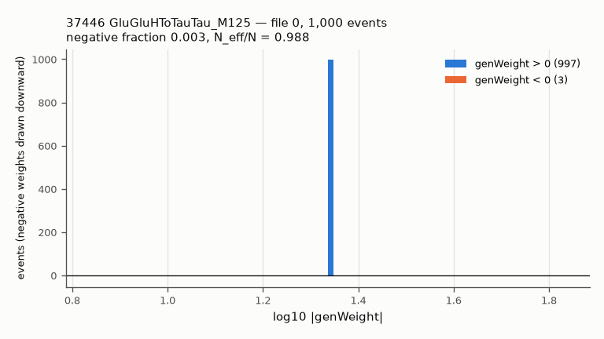
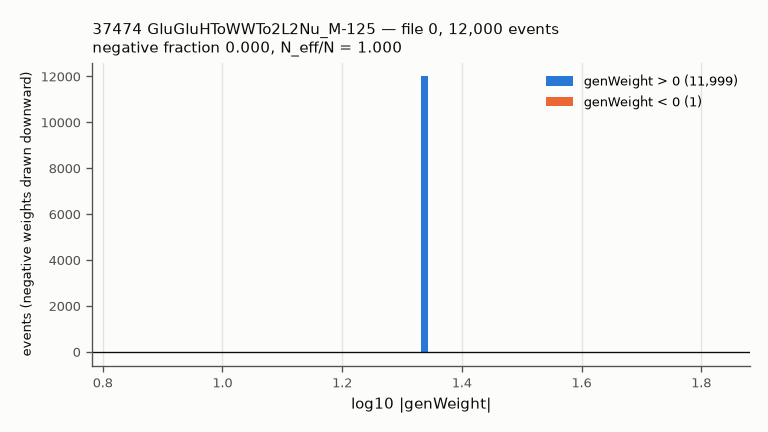
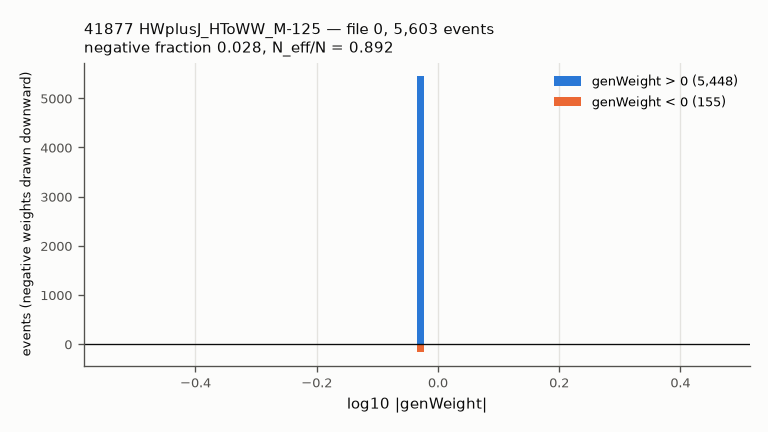
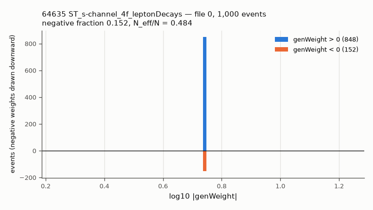
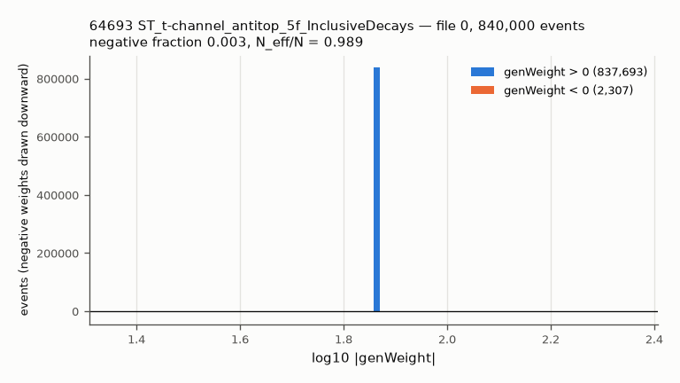
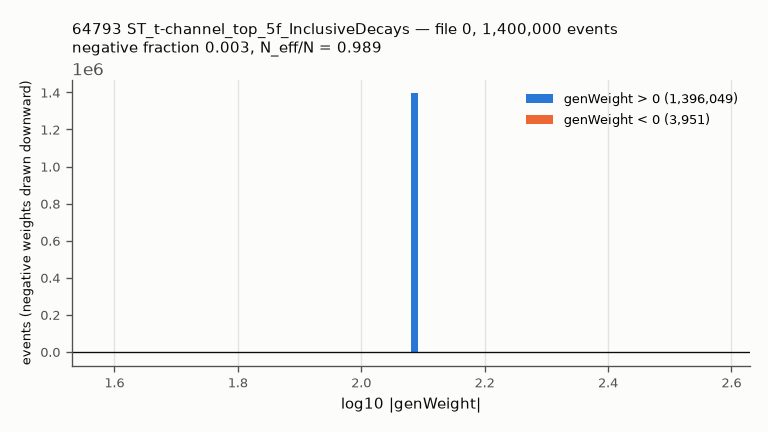
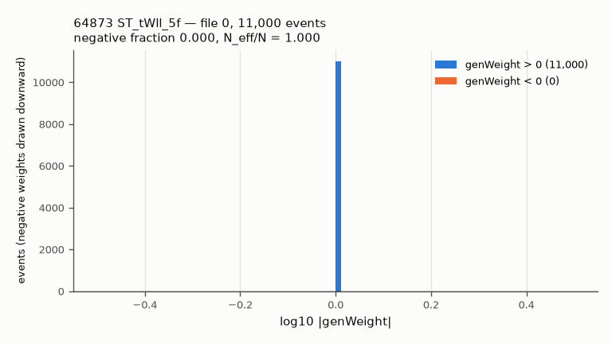
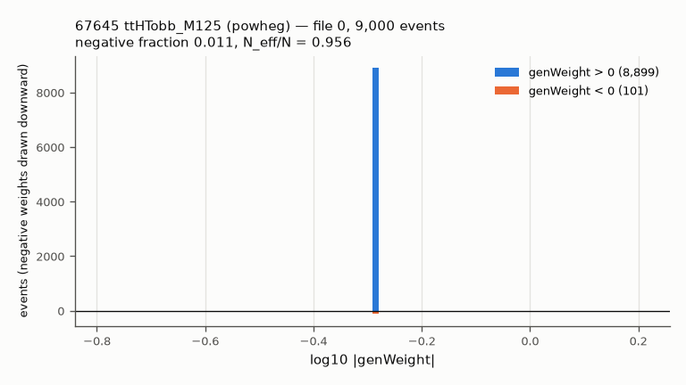
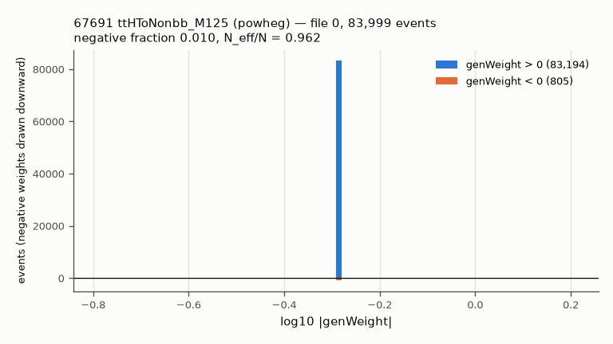
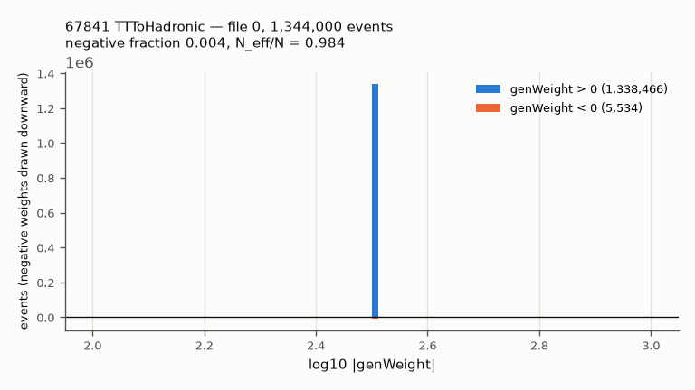
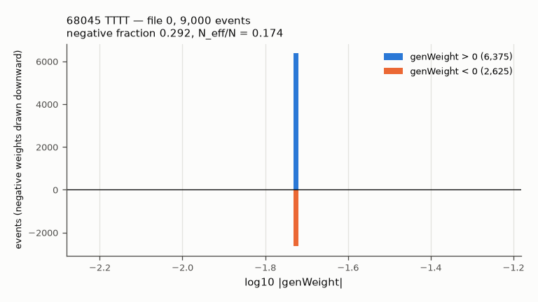
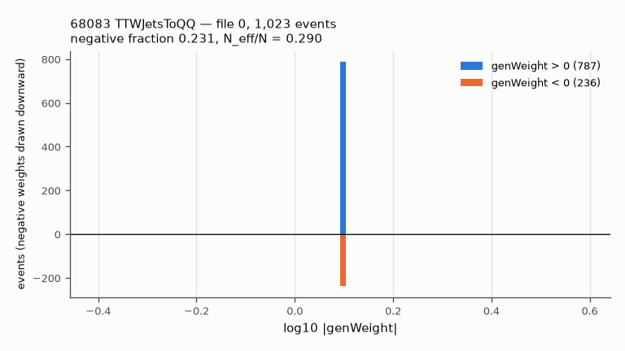
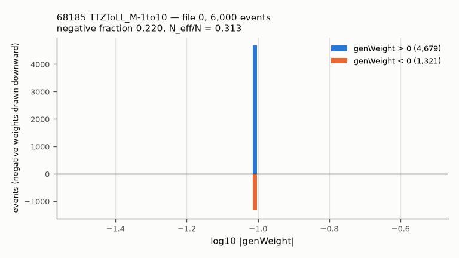
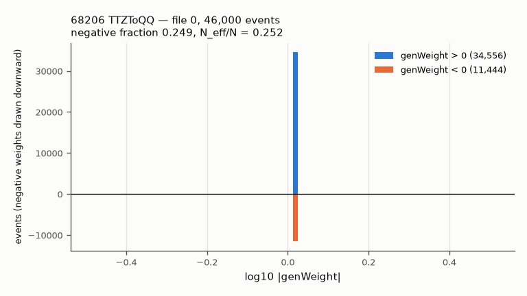
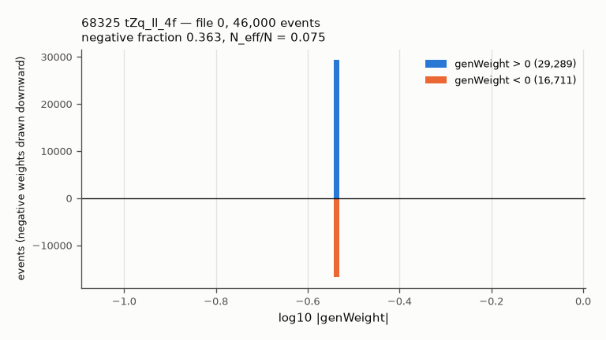
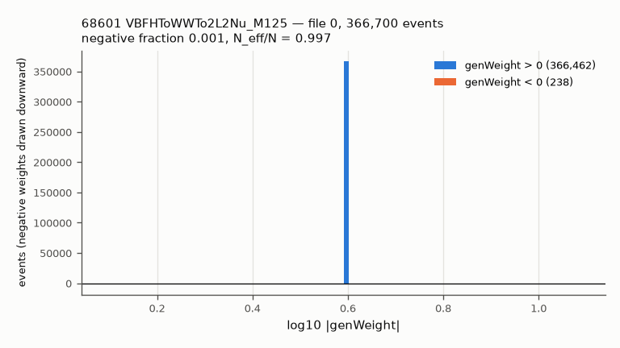
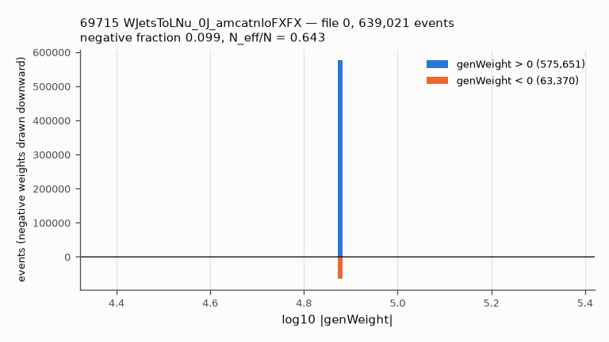
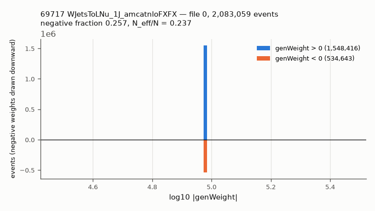
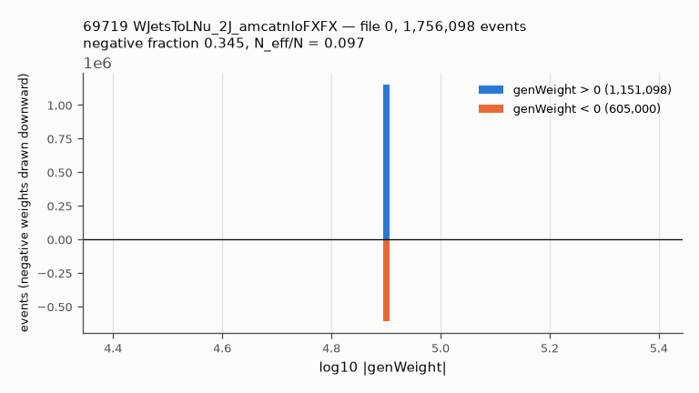
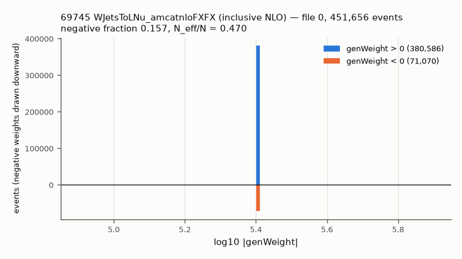
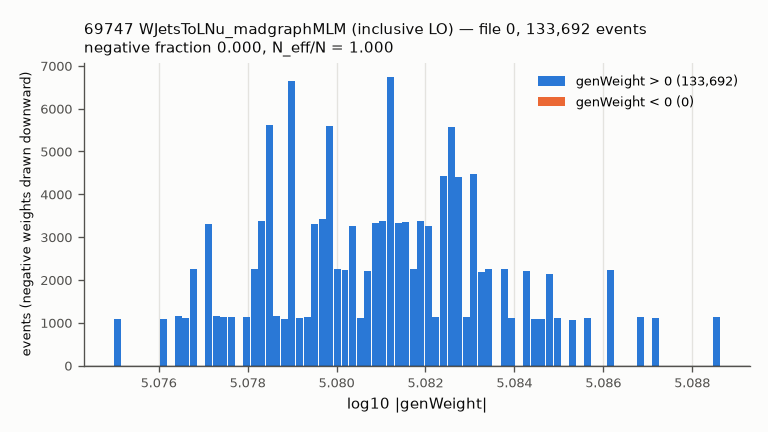
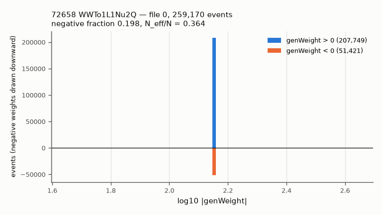
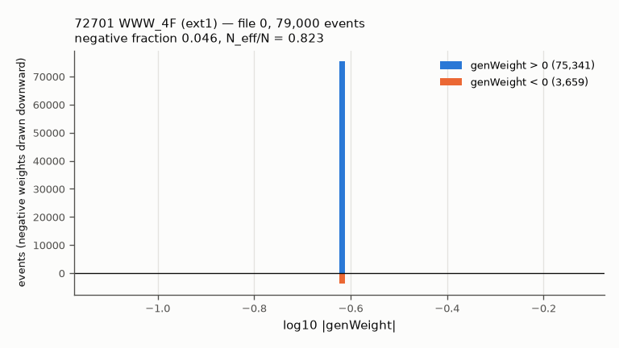
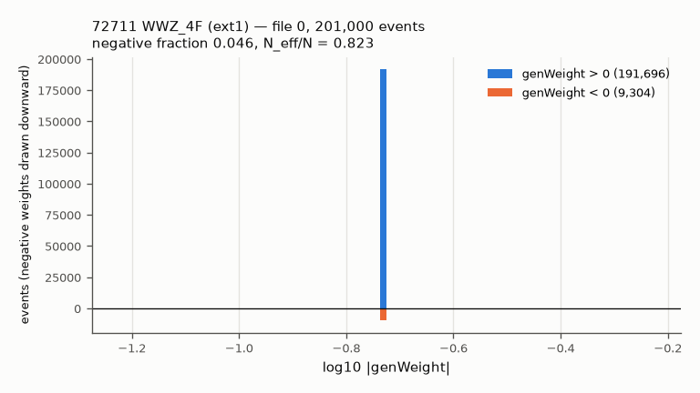
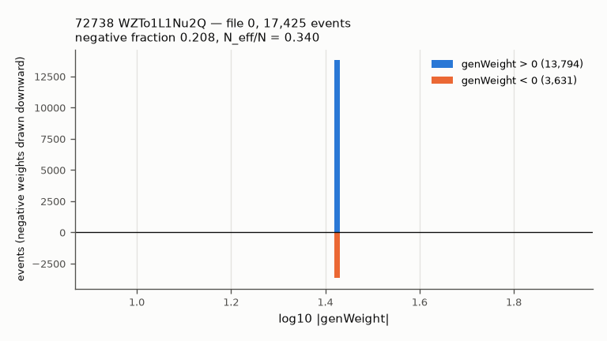
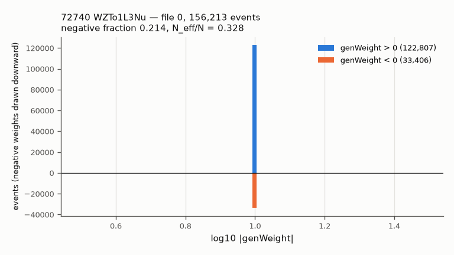
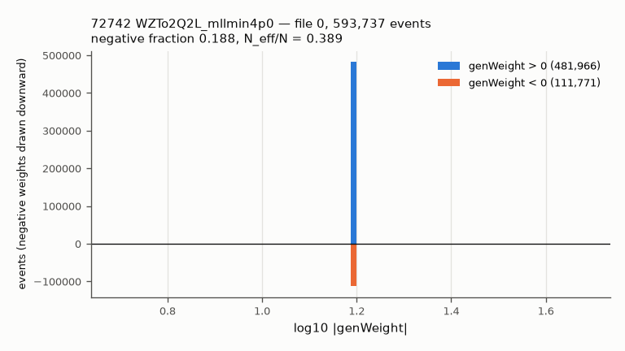
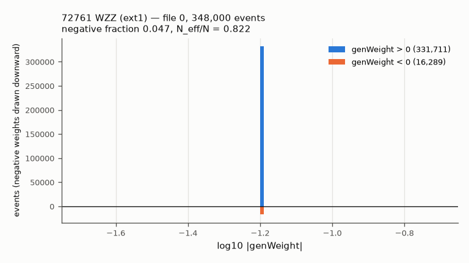
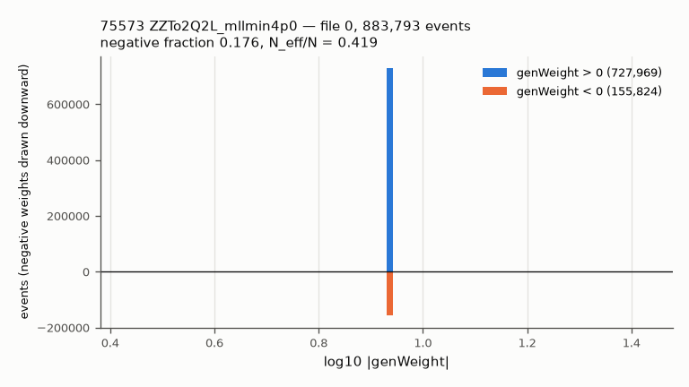
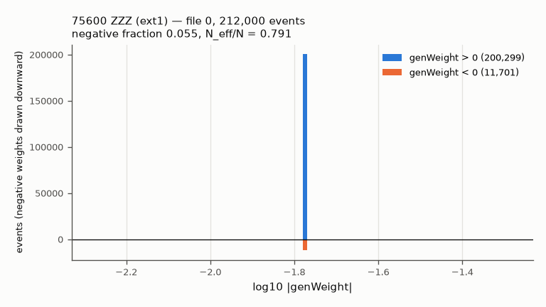

**Flags.**
- **MC luminosity below the data's 16.393 fb⁻¹:** only W+jets — the recommended pieces at 0.13 / 0.29 / 0.16 ×
  the data, the alternatives at 0.013 × (inclusive NLO) and 0.08 × (inclusive LO). A W+jets event will carry
  a weight of 6.4 / 1.7 / 1.9 (0J / 1J / 2J, in units of |genWeight|, PROVISIONAL; confirmed by the probe), and each effective MC
  event stands for 8 / 3.5 / 6 data events, so sparse histograms can show isolated spikes —
  relevant for a bump-hunting input. Everything else is ≥ 6.5 × the data (WZ → ℓννν lowest).
- **Wall time:** no file is estimated above the 2 h wall time used on 25 Oct (largest: gg → ZH 3,300 s, qq̄
  → ZH → WW 2,600 s, tt̄Z → qq 2,000 s per file). The tt+X samples ran up to 2,668 s per file on 25 Oct, so
  the 3 h wall time used then for tt̄Z/tt̄W should be kept for tier 4.
- **Queue limit:** at most 1,000 queued subjobs per user (25 Oct). Tier 1 (518 files) fits in one go; the
  whole list (1,145) must be submitted tier by tier.
- **File quota:** fits at every tier (table above). If it ever did not: the 25-26 Oct pinned clone
  `checkouts/fullrun_20261025/repo_75b399e` (~235 files, already archived as a tarball) and the 17 Oct
  run directories are the obvious candidates to archive — nothing was deleted, that is Matan's call.

## 5. Proposed priority order

Starting point kept, with one reasoning note per tier:

1. **Tier 1 — W+jets, single top t- and s-channel, tt̄ hadronic.** The backgrounds the stack plots name as
   missing; W+jets and single top can put a prompt lepton plus a fake into exactly the final states where
   data exceeds MC (μ + jet + b 1.44, μμ 0j 1.16), and W+jets is the prime suspect for the e-μ 0j ratio of
   2.19. tt̄ hadronic is kept here as the starting point said, but it is the weakest of the four (it needs two
   non-prompt leptons) and costs 146 files; it could move to after tier 2 without loss.
2. **Tier 2 — WZ → ℓℓqq, ZZ → ℓℓqq, WZ → ℓνqq, WW → ℓνqq, WZ → ℓννν.** Large cross sections (3.8-52 pb),
   good statistics, cheap (127 files), and they populate ℓℓ + jets and ℓ + jets final states.
3. **Tier 3 — WWW, WWZ, WZZ, ZZZ.** Small (0.015-0.22 pb) but multi-lepton; cheap (60 files).
4. **Tier 4 — rare top** (tZq, tWℓℓ, tt̄H → bb̄ / non-bb̄, tt̄Z → qq, tt̄W → qq, tt̄tt̄, tt̄ + low-mass ℓℓ).
   Small but multi-lepton + b-jets; 160 files, but the most CPU per event.
5. **Tier 5 — Higgs** (WW, ττ, ZZ → 2ℓ2ν, WH → 4ℓ). The ATLAS list has 133 Higgs DSIDs, but their total
   contribution is small (largest: ggH → ττ 3.0 pb, ggH → WW → 2ℓ2ν 1.1 pb). Note that ggH/VBF → WW → eμνν
   and H → ττ → eμ give *genuine* e-μ events, also with 0 jets.

**Can each new sample contribute to the e-μ 0-jet histogram?** (statement only, nothing computed)
W+jets: yes (prompt lepton + fake/non-prompt). Single top t/s: yes, but usually with jets. tt̄ hadronic:
only with two fakes, small. Dibosons ℓνqq/ℓℓqq: only with lost jets and a fake. Tribosons, rare top:
mostly with jets. Higgs → WW → 2ℓ2ν and → ττ: yes, genuine e-μ.

## 6. Decisions for Matan

Each with options, trade-offs and my recommendation. Nothing was decided.

**D1. Which W+jets set.**
| option | samples (files) | MC lumi (ESTIMATE) | consistent with our NLO DY? | stitching |
|---|---|---|---|---|
| A. jet-binned NLO 0J/1J/2J | 69715/17/19 (277) | 2.1 / 4.7 / 2.7 fb⁻¹ (0.13-0.29 ×) | yes, same FxFx NLO setup | none |
| B. inclusive NLO | 69745 (28) | 0.22 fb⁻¹ (0.013 ×) | yes | none |
| C. inclusive LO | 69747 (68) | 1.3 fb⁻¹ (0.08 ×) | no (LO) | none |
| D. LO inclusive + W1-4Jets or HT-binned | 69747 + 4 or 8 records (234 / 257) | 0-jet part as C; more in the tails | no (LO) | LHE_Njets or LHE_HT stitching — new builder code |

Recommendation **A**: the most statistics where W+jets matters most (low jet counts), NLO like the DY, and
no new code. Cost: 413 M events, ~28 CPU hours, ~3,400 cluster files.

**D2. W+jets normalisation.** (a) RazorAnalyzer 61,526.7 pb (SECONDARY; the same table as our DY, so W
and Z are normalised consistently), split over the three pieces in proportion to their generator values
(k = 0.9381); (b) the primary ATLAS prediction 3 × 20.08 nb = 60,240 pb (arXiv:1603.09222 Table 3; −2.1 %);
(c) k from the inclusive NLO sample (61,526.7 / 66,970; −2.1 %). Recommendation **(a)** for consistency
with DY, with (b) recorded as the primary cross-check.

**D3. Samples with MC luminosity far below the data (W+jets).** (a) Add them and state in the delivery note
that W+jets has 0.13-0.29 × the data luminosity, then look at the first build for single-event spikes;
(b) add W+jets only to the final states it dominates; (c) do not add W+jets. Recommendation **(a)**:
today W+jets is missing entirely, which is worse than being statistically thin, and the effect can be
checked in the first build.

**D4. Single-top t-channel: 5-flavour (64793/64693) or 4-flavour (64759/64659).** Same NNLO normalisation
applies to both. 5f: 76 files, 0.3 % negative weights; 4f: 121 files, 3 % negative weights, better
description of the extra b quark. Statistics are the same (~360-410 fb⁻¹). Recommendation **5f** (cheaper),
unless the technical lead prefers the 4f modelling.

**D5. Single-top normalisation, and a finding about our tW.** The Top WG page used on 15 Oct
(SingleTopRefXsec) now says its t-channel values are "Superseded by NNLO predictions" and points to
**SingleTopNNLORef** (dated 2 Oct 2026), which gives t-channel 134.2 / 80.0 pb (NNLO), s-channel 11.073 pb
(NNLO) and **tW 79.3 pb** (NLO + NNLL third-order soft gluon). Proposal: use the new page for t and s
(the old NLO values are within +1.4 % / −6.8 %). **Our delivered tW (64895/64839) uses 71.7 pb from the old
page; the new page's 79.3 pb is +10.6 %.** Nothing changed (out of scope); recommendation: revisit tW in the
cross-section step, since the 15 Oct review already recorded 79.5 pb (arXiv:2106.12910) as an alternative.

**D6. Z branching ratios (not covered by the settled conventions).** Needed for gg → ZH (Z → ℓℓ) and H → ZZ
→ 2ℓ2ν. (a) PDG individually measured values (ee 3.3632 %, μμ 3.3662 %, ττ 3.3696 %, invisible 20.000 %,
hadrons 69.911 %, pdglive S044), as for the W; (b) the lepton-universal PDG average 3.3658 %; (c) the YR4
page's own BR(Z → ℓℓ) = 0.0335962. Recommendation **(a)**, by analogy with the W convention. Effect < 0.2 %.

**D7. tt̄tt̄ (68045).** The rule "no NNLO → generator NLO" gives 8.09 fb, but published, more complete
values are 11.97 fb (NLO QCD+EW, arXiv:1711.02116 Table 5; +48 %) and 14.65 fb (NLO+NLL′, arXiv:2212.03259
Table I; +81 %). Recommendation **11.97 fb**: same order as the rule asks for, but the published complete-NLO
number; the effect on any histogram is tiny.

**D8. tWℓℓ (64873) has only an LO generator value** (0.01105 pb; no NLO sample, no published total for its
phase space). (a) use it, labelled LO; (b) drop the sample. Recommendation **(a)**; it is tiny.

**D9. Semileptonic WZ normalisation.** Generator × (51.11 / 46.068), as for our WZ → 3ℓν (proposed), or
on-shell 51.11 pb × branching ratios (WZ → ℓνqq +15 %, WZ → ℓννν −12 %, WZ → ℓℓqq −51 % because the sample
also contains γ* → ℓℓ). Recommendation **generator × k** (consistent with 72752; the on-shell form misses γ*).

**D10. Tribosons: two records per process.** Use only the large ext1 record (proposed) or both. Both would
need the builder to normalise them together (one σ, one combined Σw); with today's per-record
normalisation, using both counts the process twice. The small records add 1.5-3 % of events.
Recommendation **ext1 only**.

**D11. Z → νν.** Recommendation: **do not add** (no prompt leptons; only via fakes, far below W+jets).

**D12. Drell-Yan extras.** Recommendation: **none now.** Only option worth discussing: DY M-4to50 HT-binned
(5 records, 146 files) would add 4 < m(ℓℓ) < 10 GeV for HT > 70 GeV, which our M-10to50 does not cover —
only if the delivered histograms reach that low.

**D13. Higgs scope.** (a) the 15 proposed samples (decays with leptons); (b) also the optional ones listed
in `plan_samples.py` (H → μμ, VH → bb̄ with leptonic V, ggH → ZZ → 2ℓ2q, bb̄H, ggH → WW → ℓνqq); (c) a full
mirror of the ATLAS 133. Recommendation **(a) now**, revisit with Maryna's DSID list. Not proposed at all:
tHq/tHW (portal values ~10 × the YR4 SM values; they look generated at a non-SM coupling and need per-event
reweighting — UNVERIFIED) and ZH → ZZ filtered samples (their portal "matching efficiency" 0.2-0.9 on POWHEG
samples looks like a misplaced filter efficiency — UNVERIFIED).

**D14. ZZTo2L2Nu 75567.** Stays excluded until the 15 Oct 42 % mismatch is resolved (not addressed here).

**D15. The matching-efficiency open point (information, no decision asked now).** New evidence: the three
W NLO pieces' portal values add up to the inclusive NLO value only if total_value already *includes* the
matching efficiency, and the inclusive W value (66,970 pb) times its 0.4 would be 26,788 pb — less than half
of every W prediction and measurement. The same holds for the DY M-50 NLO record (6,422 pb × 0.4 = 2,569 pb
vs 5,765 pb). This supports "matching is already in total_value" for the FxFx records. Nothing applied.

## 7. What the implementation step would need

See HANDOFF.md. In short: Matan's cross-section decisions → new registry entries (a new registry version,
never an edit of v3 in place) → the input-file sweep and mappings for the new records → production tier by
tier (≤ 1,000 queued subjobs; io=25; 2 h, 3 h for tier 4) → one MC build with old + new samples → the usual
audits and plots. The probe (§4a) found no missing branch.

## 8. Files

- `PLAN.md` (this file), `XSEC_PROPOSALS.md` (one section per sample), `candidates.json` (all 311 records,
  machine-readable), `HANDOFF.md`;
- scripts: `fetch_records.py`, `fetch_cards.py`, `plan_samples.py`, `xsec_proposals.py`, `stats_cost.py`,
  `make_candidates.py`, `make_plots.py`, `probe_sample.py` + `cluster/pbs_probe.sh` (not yet run);
- evidence: `evidence/records/` (622 raw API records), `evidence/cards/` (generator cards),
  `evidence/portal_search_titles.json`, `evidence/records_summary.json`, `evidence/xsec_proposals.json`,
  `evidence/stats_cost.json`, `evidence/group_tables.md`, `evidence/stats_table.md`;
- plots: `plots/mc_lumi_vs_data.png`, `plots/genweight_<recid>.png` (30, from the probe);
- probe: `evidence/probe/probe_<recid>.json`, `evidence/probe/logs/`.

## 7. ATLAS DSID mapping (27 Oct)

*(Added 27 Oct as requested; it shares the number 7 with "What the implementation step would need" above,
which is unchanged.)* Full write-up and tables: **`atlas_mapping/MAPPING.md`**. All of it comes from the
public ATLAS Open Data metadata (atlasopenmagic, release 2024r-pp; VERIFIED BY RUNNING). ATLAS cross sections
are cross-checks only.

- **Coverage.** All 337 of Maryna's background DSIDs are in the metadata and map to **108 processes**: 53
  non-Higgs processes and 55 Higgs production × decay cells.
  - Of the 44 in-scope non-Higgs processes: **9 delivered, 17 added by this plan, 14 on the CMS portal but not
    proposed** (5 of them without leptons), and 4 with no CMS 2016 sample (WZ → qqνν, VV → 4ν, Z → bb at high
    pT, VBS interference terms).
  - Higgs: 2 cells delivered, 11 proposed, 31 on the portal but not proposed, 7 with no CMS sample, 4 out of
    scope.
  - Photons, QCD and BSM: 9 processes, marked out of scope.
- **The class labels in Maryna's list do not always match the metadata.**
  - Her "EW boson" class holds a full **Pythia8 QCD dijet set** (364700–364712, 13 DSIDs).
  - Her "QCD jets" DSID 700442 is an electroweak γ + 2 jets sample.
  - "HC model (SM modes)" is Pythia8 diphoton.

  The QCD decision is not reopened. It may be worth asking Maryna whether those dijet DSIDs are used.
- **Cross sections.** Like-for-like ratios ATLAS/CMS are 0.81–1.21 (tt̄, W, Z, single top, dibosons,
  tt̄V, Higgs). The flagged ratios are explained by different decay channels or phase space. One
  exception: **tt̄tt̄**, where ATLAS's 12.0 fb supports D7's 11.97 fb over the provisional 8.09 fb. A few ATLAS
  metadata values look wrong on their side (MAPPING.md).
- **337 vs 353:** the metadata does not show which 16 DSIDs differ (UNKNOWN).

**Recommended changes to the sample list (for Matan; not applied):**
1. D13: option (a) **plus 11 small Higgs samples**:
   - H → μμ: 37432, 68571, 71295, 70451, 74682;
   - H → Zγ: 37604, 68731, 71145, 70301, 74292;
   - gg → ZH → 4ℓ: 40062.

   Cost (ESTIMATE): ~67 files, ~2,700 cluster files, ~4 CPU h. Cross-section proposals are still needed.
2. Optional ATLAS-parity extras, low priority:
   - EW Z/W + 2 jets: 35999, 35987, 35993;
   - VBS: 75561, 69771, 72648, 71638, 71642;
   - tt̄WW and three-top: 68087, 67771, 68067.

   Together about 157 files and ~3,800 cluster files (ESTIMATE).
3. Keep ggF/VBF H → ZZ → 2ℓ2ν and tt̄ + ℓℓ (1–10 GeV), even though ATLAS has no clear counterpart.
4. D14 matters for parity: the ATLAS VV → ℓℓνν sample includes ZZ → ℓℓνν.
5. **Correction to §2g:** gg → ZH, H → ZZ → 4ℓ *does* exist (40062).

File-quota projection: ~115,300 with item 1, ~119,100 with items 1 + 2. Both are under 125,000; this is a
projection, not re-measured.

## Appendix: every candidate record, by group

### The 13 delivered samples (campaign check)

| NanoAOD / MiniAOD | dataset (short) | gen. order | events | files | size GB | portal σ [pb] (filter / matching) | role |
|---|---|---|---:|---:|---:|---|---|
| [67801](https://opendata.cern.ch/record/67801) / 67800 | TTTo2L2Nu-powheg-pythia8 | NLO | 43,546,000 | 49 | 91.2 | 6.871e+02 (1.000e+00 / 1.0) | delivered |
| [67993](https://opendata.cern.ch/record/67993) / 67992 | TTToSemiLeptonic-powheg-pythia8 | NLO | 144,722,000 | 138 | 308.3 | 6.871e+02 (1.000e+00 / 1.0) | delivered |
| [35669](https://opendata.cern.ch/record/35669) / 35668 | DYJetsToLL_M-50-amcatnloFXFX-pythia8 | NLO | 71,839,442 | 41 | 91.2 | 6.422e+03 (1.000e+00 / 0.4) | delivered |
| [35631](https://opendata.cern.ch/record/35631) / 35630 | DYJetsToLL_M-10to50-amcatnloFXFX-pythia8 | NLO | 49,267,069 | 25 | 41.6 | 2.048e+04 (1.000e+00 / 0.6) | delivered |
| [64895](https://opendata.cern.ch/record/64895) / 64894 | ST_tW_top_5f_NoFullyHadronicDecays-powheg-pythia8 | NLO | 3,368,375 | 11 | 6.7 | 3.245e+01 (1.000e+00 / 1.0) | delivered |
| [64839](https://opendata.cern.ch/record/64839) / 64838 | ST_tW_antitop_5f_NoFullyHadronicDecays-powheg-pythia8 | NLO | 3,654,510 | 10 | 7.2 | 3.251e+01 (1.000e+00 / 1.0) | delivered |
| [72676](https://opendata.cern.ch/record/72676) / 72675 | WWTo2L2Nu-powheg-pythia8 | NLO | 2,900,000 | 7 | 4.3 | 1.109e+01 (1.000e+00 / 1.0) | delivered |
| [72752](https://opendata.cern.ch/record/72752) / 72751 | WZTo3LNu-amcatnloFXFX-pythia8 | NLO | 10,441,724 | 31 | 15.4 | 5.218e+00 (1.000e+00 / 0.6) | delivered |
| [75589](https://opendata.cern.ch/record/75589) / 75588 | ZZTo4L_powheg_pythia8 | NLO | 52,104,000 | 99 | 71.5 | 1.325e+00 (1.000e+00 / 1.0) | delivered |
| [68187](https://opendata.cern.ch/record/68187) / 68186 | TTZToLLNuNu_M-10-amcatnlo-pythia8 | NLO | 6,017,000 | 42 | 15.3 | 2.439e-01 (1.000e+00 / 1.0) | delivered |
| [68073](https://opendata.cern.ch/record/68073) / 68072 | TTWJetsToLNu-amcatnloFXFX-madspin-pythia8 | NLO | 3,322,643 | 12 | 8.9 | 2.151e-01 (1.000e+00 / 0.6) | delivered |
| [37728](https://opendata.cern.ch/record/37728) / 37727 | GluGluHToZZTo4L_M125_powheg2_JHUGenV7011_pythia8 | NLO | 1,000,000 | 8 | 1.7 | 2.887e+01 (1.000e+00 / 1.0) | delivered |
| [68847](https://opendata.cern.ch/record/68847) / 68846 | VBF_HToZZTo4L_M125_powheg2_JHUGenV7011_pythia8 | NLO | 498,000 | 24 | 1.1 | 3.935e+00 (1.000e+00 / 1.0) | delivered |

### a. W+jets

| NanoAOD / MiniAOD | dataset (short) | gen. order | events | files | size GB | portal σ [pb] (filter / matching) | role |
|---|---|---|---:|---:|---:|---|---|
| [69747](https://opendata.cern.ch/record/69747) / 69746 | WJetsToLNu-madgraphMLM-pythia8 | LO | 80,958,227 | 68 | 79.4 | 5.411e+04 (1.000e+00 / 0.4) | alternative (tier 1) |
| [69745](https://opendata.cern.ch/record/69745) / 69744 | WJetsToLNu-amcatnloFXFX-pythia8 | NLO | 28,268,221 | 28 | 30.0 | 6.697e+04 (1.000e+00 / 0.4) | alternative (tier 1) |
| [69545](https://opendata.cern.ch/record/69545) / 69544 | W1JetsToLNu-madgraphMLM-pythia8 | LO | 42,019,790 | 62 | 45.9 | 8.914e+03 (1.000e+00 / 0.3) | not proposed |
| [69547](https://opendata.cern.ch/record/69547) / 69546 | W2JetsToLNu-madgraphMLM-pythia8 | LO | 24,453,579 | 37 | 30.9 | 2.829e+03 (1.000e+00 / 0.2) | not proposed |
| [69549](https://opendata.cern.ch/record/69549) / 69548 | W3JetsToLNu-madgraphMLM-pythia8 | LO | 17,832,683 | 19 | 26.0 | 8.233e+02 (1.000e+00 / 0.1) | not proposed |
| [69551](https://opendata.cern.ch/record/69551) / 69550 | W4JetsToLNu-madgraphMLM-pythia8 | LO | 4,816,485 | 48 | 8.6 | 3.882e+02 (1.000e+00 / 0.1) | not proposed |
| [69715](https://opendata.cern.ch/record/69715) / 69714 | WJetsToLNu_0J-amcatnloFXFX-pythia8 | NLO | 159,756,701 | 97 | 151.5 | 5.330e+04 (1.000e+00 / 0.9) | recommended (tier 1) |
| [69717](https://opendata.cern.ch/record/69717) / 69716 | WJetsToLNu_1J-amcatnloFXFX-pythia8 | NLO | 167,292,982 | 117 | 196.1 | 8.958e+03 (1.000e+00 / 0.2) | recommended (tier 1) |
| [69719](https://opendata.cern.ch/record/69719) / 69718 | WJetsToLNu_2J-amcatnloFXFX-pythia8 | NLO | 85,825,681 | 63 | 123.2 | 3.330e+03 (1.000e+00 / 0.1) | recommended (tier 1) |
| [69733](https://opendata.cern.ch/record/69733) / 69732 | WJetsToLNu_HT-70To100-madgraphMLM-pythia8 | LO | 19,439,931 | 19 | 24.6 | 1.269e+03 (1.000e+00 / 0.2) | not proposed |
| [69721](https://opendata.cern.ch/record/69721) / 69720 | WJetsToLNu_HT-100To200-madgraphMLM-pythia8 | LO | 19,753,958 | 20 | 28.1 | 1.254e+03 (1.000e+00 / 0.1) | not proposed |
| [69725](https://opendata.cern.ch/record/69725) / 69724 | WJetsToLNu_HT-200To400-madgraphMLM-pythia8 | LO | 15,067,621 | 60 | 26.7 | 3.364e+02 (1.000e+00 / 0.1) | not proposed |
| [69729](https://opendata.cern.ch/record/69729) / 69728 | WJetsToLNu_HT-400To600-madgraphMLM-pythia8 | LO | 2,115,509 | 11 | 4.6 | 4.521e+01 (1.000e+00 / 0.1) | not proposed |
| [69731](https://opendata.cern.ch/record/69731) / 69730 | WJetsToLNu_HT-600To800-madgraphMLM-pythia8 | LO | 2,251,807 | 13 | 5.4 | 1.098e+01 (1.000e+00 / 0.1) | not proposed |
| [69735](https://opendata.cern.ch/record/69735) / 69734 | WJetsToLNu_HT-800To1200-madgraphMLM-pythia8 | LO | 2,132,228 | 46 | 5.5 | 4.927e+00 (1.000e+00 / 0.1) | not proposed |
| [69723](https://opendata.cern.ch/record/69723) / 69722 | WJetsToLNu_HT-1200To2500-madgraphMLM-pythia8 | LO | 2,090,561 | 3 | 5.7 | 1.157e+00 (1.000e+00 / 0.1) | not proposed |
| [69727](https://opendata.cern.ch/record/69727) / 69726 | WJetsToLNu_HT-2500ToInf-madgraphMLM-pythia8 | LO | 709,514 | 17 | 2.2 | 2.624e-02 (1.000e+00 / 0.1) | not proposed |
| [69737](https://opendata.cern.ch/record/69737) / 69736 | WJetsToLNu_Pt-100To250_MatchEWPDG20-amcatnloFXFX-pythia8 | NLO | 220,783,469 | 163 | 344.7 | 7.578e+02 (1.000e+00 / 0.5) | not proposed |
| [69739](https://opendata.cern.ch/record/69739) / 69738 | WJetsToLNu_Pt-250To400_MatchEWPDG20-amcatnloFXFX-pythia8 | NLO | 45,945,573 | 43 | 90.6 | 2.749e+01 (1.000e+00 / 0.5) | not proposed |
| [69741](https://opendata.cern.ch/record/69741) / 69740 | WJetsToLNu_Pt-400To600_MatchEWPDG20-amcatnloFXFX-pythia8 | NLO | 5,425,860 | 10 | 11.5 | 3.501e+00 (1.000e+00 / 0.5) | not proposed |
| [69743](https://opendata.cern.ch/record/69743) / 69742 | WJetsToLNu_Pt-600ToInf_MatchEWPDG20-amcatnloFXFX-pythia8 | NLO | 1,794,895 | 16 | 4.1 | 5.427e-01 (1.000e+00 / 0.5) | not proposed |
| [69749](https://opendata.cern.ch/record/69749) / 69748 | WJetsToLNu_Wpt-200toInf_BPSFilter-madgraphMLM-pythia8 | LO | 2,342,750 | 34 | 5.1 | 2.900e+00 (1.000e+00 / 0.1) | not proposed |
| [69553](https://opendata.cern.ch/record/69553) / 69552 | WBJetsToLNu_Wpt-100to200-madgraphMLM-pythia8 | LO | 3,615,026 | 5 | 6.5 | 5.590e+00 (1.000e+00 / 0.1) | not proposed |
| [69555](https://opendata.cern.ch/record/69555) / 69554 | WBJetsToLNu_Wpt-200toInf-madgraphMLM-pythia8 | LO | 942,874 | 25 | 2.1 | 8.100e-01 (1.000e+00 / 0.1) | not proposed |
| [69713](https://opendata.cern.ch/record/69713) / 69711 | WJetsToLNu_012JetsNLO_34JetsLO_EWNLOcorr-sherpa | NLO (0-2j) / LO | 75,503,798 | 127 | 213.2 | 6.250e+04 (1.000e+00 / None) | not proposed |
| [69712](https://opendata.cern.ch/record/69712) / 69710 | WJetsToLNu_012JetsNLO_34JetsLO_EWNLOcorr-sherpa ext1 | NLO (0-2j) / LO | 112,968,000 | 178 | 318.7 | 6.250e+04 (1.000e+00 / None) | not proposed |
| [35987](https://opendata.cern.ch/record/35987) / 35986 | EWKWMinus2Jets_WToLNu_M-50_withDipoleRecoil-madgraph-pythia8 | LO | 2,202,000 | 18 | 3.2 | 3.210e+01 (1.000e+00 / 1.0) | not proposed |
| [35993](https://opendata.cern.ch/record/35993) / 35992 | EWKWPlus2Jets_WToLNu_M-50_withDipoleRecoil-madgraph-pythia8 | LO | 2,033,000 | 8 | 2.9 | 3.908e+01 (1.000e+00 / 1.0) | not proposed |

### b. Single top t- and s-channel

| NanoAOD / MiniAOD | dataset (short) | gen. order | events | files | size GB | portal σ [pb] (filter / matching) | role |
|---|---|---|---:|---:|---:|---|---|
| [64759](https://opendata.cern.ch/record/64759) / 64758 | ST_t-channel_top_4f_InclusiveDecays-powheg-madspin-pythia8 | NLO | 63,073,000 | 86 | 104.6 | 1.134e+02 (1.000e+00 / 1.0) | alternative (tier 1) |
| [64659](https://opendata.cern.ch/record/64659) / 64658 | ST_t-channel_antitop_4f_InclusiveDecays-powheg-madspin-pythia8 | NLO | 30,609,000 | 35 | 50.9 | 6.793e+01 (1.000e+00 / 1.0) | alternative (tier 1) |
| [64793](https://opendata.cern.ch/record/64793) / 64792 | ST_t-channel_top_5f_InclusiveDecays-powheg-pythia8 | NLO | 55,783,000 | 51 | 91.3 | 1.197e+02 (1.000e+00 / 1.0) | recommended (tier 1) |
| [64693](https://opendata.cern.ch/record/64693) / 64692 | ST_t-channel_antitop_5f_InclusiveDecays-powheg-pythia8 | NLO | 29,394,000 | 25 | 48.3 | 7.174e+01 (1.000e+00 / 1.0) | recommended (tier 1) |
| [64635](https://opendata.cern.ch/record/64635) / 64634 | ST_s-channel_4f_leptonDecays-amcatnlo-pythia8 | NLO | 5,471,000 | 19 | 8.7 | 3.549e+00 (1.000e+00 / 1.0) | recommended (tier 1) |
| [64633](https://opendata.cern.ch/record/64633) / 64632 | ST_s-channel_4f_hadronicDecays-amcatnlo-pythia8 | NLO | 5,300,000 | 23 | 8.3 | 7.104e+00 (1.000e+00 / 1.0) | optional |
| [64881](https://opendata.cern.ch/record/64881) / 64880 | ST_tW_top_5f_inclusiveDecays-powheg-pythia8 | NLO | 2,491,000 | 24 | 4.8 | 3.245e+01 (1.000e+00 / 1.0) | not proposed |
| [64825](https://opendata.cern.ch/record/64825) / 64824 | ST_tW_antitop_5f_inclusiveDecays-powheg-pythia8 | NLO | 2,554,000 | 23 | 5.0 | 3.251e+01 (1.000e+00 / 1.0) | not proposed |
| [64853](https://opendata.cern.ch/record/64853) / 64852 | ST_tW_Dilept_5f_DR2-amcatnlo-pythia8 | NLO | 1,864,000 | 19 | 3.6 | 3.004e+00 (1.000e+00 / 1.0) | not proposed |
| [64855](https://opendata.cern.ch/record/64855) / 64854 | ST_tW_Dilept_5f_DR-amcatnlo-pythia8 | NLO | 1,900,000 | 5 | 3.6 | 3.289e+00 (1.000e+00 / 1.0) | not proposed |
| [64711](https://opendata.cern.ch/record/64711) / 64710 | ST_t-channel_eleDecays-comphep-pythia8 | LO | 532,959 | 1 | 0.8 | 2.476e+01 (6.255e-01 / 1.0) | not proposed |
| [64745](https://opendata.cern.ch/record/64745) / 64744 | ST_t-channel_tauDecays-comphep-pythia8 | LO | 520,069 | 1 | 0.7 | 2.473e+01 (6.260e-01 / 1.0) | not proposed |

### c. tt̄ fully hadronic

| NanoAOD / MiniAOD | dataset (short) | gen. order | events | files | size GB | portal σ [pb] (filter / matching) | role |
|---|---|---|---:|---:|---:|---|---|
| [67841](https://opendata.cern.ch/record/67841) / 67840 | TTToHadronic-powheg-pythia8 | NLO | 107,067,000 | 146 | 227.2 | 6.871e+02 (1.000e+00 / 1.0) | recommended (tier 1) |
| [67731](https://opendata.cern.ch/record/67731) / 67730 | TTJets-amcatnloFXFX-pythia8 | NLO | 89,003,534 | 109 | 200.6 | 7.561e+02 (1.000e+00 / 0.4) | not proposed |
| [67733](https://opendata.cern.ch/record/67733) / 67732 | TTJets-madgraphMLM-pythia8 | LO | 5,068,919 | 29 | 10.5 | 4.755e+02 (1.000e+00 / 0.3) | not proposed |

### d. Dibosons not yet covered

| NanoAOD / MiniAOD | dataset (short) | gen. order | events | files | size GB | portal σ [pb] (filter / matching) | role |
|---|---|---|---:|---:|---:|---|---|
| [72738](https://opendata.cern.ch/record/72738) / 72737 | WZTo1L1Nu2Q_4f-amcatnloFXFX-pythia8 | NLO | 3,690,271 | 23 | 5.8 | 9.159e+00 (1.000e+00 / 0.6) | recommended (tier 2) |
| [72740](https://opendata.cern.ch/record/72740) / 72739 | WZTo1L3Nu_4f-amcatnloFXFX-pythia8 | NLO | 1,229,946 | 21 | 1.7 | 3.415e+00 (1.000e+00 / 0.6) | recommended (tier 2) |
| [72742](https://opendata.cern.ch/record/72742) / 72741 | WZTo2Q2L_mllmin4p0-amcatnloFXFX-pythia8 | NLO | 13,526,954 | 39 | 22.1 | 6.429e+00 (1.000e+00 / 0.7) | recommended (tier 2) |
| [72744](https://opendata.cern.ch/record/72744) / 72743 | WZTo3LNu_5f-madgraphMLM-pythia8 | LO | 20,810,003 | 18 | 36.9 | 8.223e-01 (1.000e+00 / 0.6) | not proposed |
| [72746](https://opendata.cern.ch/record/72746) / 72745 | WZTo3LNu_mllmin01_NNPDF31_powheg_pythia8 | NLO | 28,869,000 | 83 | 40.7 | none on portal | not proposed |
| [72748](https://opendata.cern.ch/record/72748) / 72747 | WZTo3LNu_mllmin0p1-powheg-pythia8 | NLO | 29,935,000 | 51 | 35.4 | 6.278e+01 (1.000e+00 / 1.0) | not proposed |
| [72750](https://opendata.cern.ch/record/72750) / 72749 | WZTo3LNu_mllmin4p0-powheg-pythia8 | NLO | 904,000 | 18 | 1.3 | 4.664e+00 (1.000e+00 / 1.0) | not proposed |
| [72754](https://opendata.cern.ch/record/72754) / 72753 | WZ-pythia8 | LO | 7,584,000 | 16 | 9.0 | 2.756e+01 (1.000e+00 / None) | not proposed |
| [75567](https://opendata.cern.ch/record/75567) / 75566 | ZZTo2L2Nu_powheg_pythia8 | NLO | 15,928,000 | 15 | 21.5 | 9.738e-01 (1.000e+00 / 1.0) | not proposed |
| [75565](https://opendata.cern.ch/record/75565) / 75564 | ZZTo2E2Nu_DipoleRecoil_powheg_pythia8 | NLO | 499,321 | 1 | 1.1 | none on portal | not proposed |
| [75569](https://opendata.cern.ch/record/75569) / 75568 | ZZTo2Mu2Nu_DipoleRecoil_powheg_pythia8 | NLO | 479,507 | 1 | 1.0 | none on portal | not proposed |
| [75571](https://opendata.cern.ch/record/75571) / 75570 | ZZTo2Nu2Q_5f-amcatnloFXFX-pythia8 | NLO | 2,468,807 | 23 | 3.2 | 4.557e+00 (1.000e+00 / 0.6) | not proposed |
| [75573](https://opendata.cern.ch/record/75573) / 75572 | ZZTo2Q2L_mllmin4p0-amcatnloFXFX-pythia8 | NLO | 13,740,600 | 14 | 22.6 | 3.699e+00 (1.000e+00 / 0.7) | recommended (tier 2) |
| [75587](https://opendata.cern.ch/record/75587) / 75586 | ZZTo4L_M-1toInf_powheg_pythia8 | NLO | 18,155,696 | 17 | 20.4 | 1.381e+01 (1.000e+00 / 1.0) | not proposed |
| [75577](https://opendata.cern.ch/record/75577) / 75576 | ZZTo4L_5f-madgraphMLM-pythia8 | LO | 20,673,283 | 18 | 39.8 | 8.167e-02 (1.000e+00 / 0.5) | not proposed |
| [75593](https://opendata.cern.ch/record/75593) / 75592 | ZZ-pythia8 | LO | 1,151,000 | 17 | 1.4 | 1.208e+01 (1.000e+00 / None) | not proposed |
| [72658](https://opendata.cern.ch/record/72658) / 72657 | WWTo1L1Nu2Q_4f-amcatnloFXFX-pythia8 | NLO | 19,976,139 | 30 | 30.0 | 5.089e+01 (1.000e+00 / 0.6) | recommended (tier 2) |
| [72694](https://opendata.cern.ch/record/72694) / 72693 | WWTolnulnu-madgraph-pythia8 | LO | 4,932,000 | 16 | 9.3 | 2.134e+00 (1.000e+00 / 1.0) | not proposed |
| [72696](https://opendata.cern.ch/record/72696) / 72695 | WW-pythia8 | LO | 15,821,000 | 41 | 18.6 | 7.588e+01 (1.000e+00 / None) | not proposed |
| [72684](https://opendata.cern.ch/record/72684) / 72683 | WWTo4Q_4f-amcatnloFXFX-pythia8 | NLO | 19,814,659 | 40 | 29.1 | 5.157e+01 (1.000e+00 / 0.6) | not proposed |
| [69543](https://opendata.cern.ch/record/69543) / 69542 | VVTo2L2Nu_MLL-1toInf-amcatnloFXFX-pythia8 | NLO | 39,742,795 | 25 | 57.9 | 1.410e+01 (1.000e+00 / 0.6) | not proposed |
| [72678](https://opendata.cern.ch/record/72678) / 72677 | WWTo2L2Nu_DoubleScattering-pythia8 | LO | 500,000 | 29 | 0.6 | 2.088e-01 (1.000e+00 / None) | optional |
| [40044](https://opendata.cern.ch/record/40044) / 40043 | GluGluToWWToENEN_MCFM701_pythia8 | LO | 1,959,000 | 16 | 2.8 | 3.680e+01 (1.000e+00 / 1.0) | not proposed |
| [40046](https://opendata.cern.ch/record/40046) / 40045 | GluGluToWWToENMN_MCFM701_pythia8 | LO | 1,927,000 | 7 | 2.7 | 3.680e+01 (1.000e+00 / 1.0) | not proposed |
| [40048](https://opendata.cern.ch/record/40048) / 40047 | GluGluToWWToENTN_MCFM701_pythia8 | LO | 1,982,000 | 7 | 2.6 | 3.680e+01 (1.000e+00 / 1.0) | not proposed |
| [40050](https://opendata.cern.ch/record/40050) / 40049 | GluGluToWWToMNEN_MCFM701_pythia8 | LO | 1,991,000 | 9 | 2.8 | 3.681e+01 (1.000e+00 / 1.0) | not proposed |
| [40052](https://opendata.cern.ch/record/40052) / 40051 | GluGluToWWToMNMN_MCFM701_pythia8 | LO | 1,984,000 | 23 | 2.5 | 3.680e+01 (1.000e+00 / 1.0) | not proposed |
| [40054](https://opendata.cern.ch/record/40054) / 40053 | GluGluToWWToMNTN_MCFM701_pythia8 | LO | 1,859,000 | 14 | 2.3 | 3.680e+01 (1.000e+00 / 1.0) | not proposed |
| [40056](https://opendata.cern.ch/record/40056) / 40055 | GluGluToWWToTNEN_MCFM701_pythia8 | LO | 1,996,000 | 15 | 2.7 | 3.681e+01 (1.000e+00 / 1.0) | not proposed |
| [40058](https://opendata.cern.ch/record/40058) / 40057 | GluGluToWWToTNMN_MCFM701_pythia8 | LO | 1,973,000 | 4 | 2.4 | 3.680e+01 (1.000e+00 / 1.0) | not proposed |
| [40060](https://opendata.cern.ch/record/40060) / 40059 | GluGluToWWToTNTN_MCFM701_pythia8 | LO | 1,991,000 | 17 | 2.4 | 3.680e+01 (1.000e+00 / 1.0) | not proposed |
| [71638](https://opendata.cern.ch/record/71638) / 71637 | WpWpJJ_EWK-madgraph-pythia8 | LO | 75,000 | 22 | 0.2 | 2.824e-02 (1.000e+00 / 1.0) | optional |
| [71642](https://opendata.cern.ch/record/71642) / 71641 | WpWpJJ_QCD-madgraph-pythia8 | LO | 75,000 | 17 | 0.2 | 2.377e-02 (1.000e+00 / 1.0) | not proposed |
| [72728](https://opendata.cern.ch/record/72728) / 72727 | WZJJ_EWK_InclusivePolarization_madgraph-madspin-pythia8 | LO | 1,858,000 | 14 | 4.3 | 1.630e-02 (1.000e+00 / 1.0) | optional |
| [75561](https://opendata.cern.ch/record/75561) / 75560 | ZZJJTo4L_EWKnotop-madgraph-pythia8 | LO | 1,149,069 | 9 | 3.0 | 9.928e-04 (1.000e+00 / 1.0) | not proposed |
| [75563](https://opendata.cern.ch/record/75563) / 75562 | ZZJJTo4L-madgraph-pythia8 | LO | 1,991,666 | 41 | 5.1 | 1.011e-03 (1.000e+00 / 1.0) | not proposed |
| [69771](https://opendata.cern.ch/record/69771) / 69770 | WLLJJ_WToLNu_EWK_madgraph-madspin-pythia8 | LO | 500,000 | 34 | 1.2 | 3.566e-02 (1.000e+00 / 1.0) | not proposed |
| [72648](https://opendata.cern.ch/record/72648) / 72647 | WWJJToLNuLNu_EWK_noTop-madgraph-pythia8 | LO | 500,000 | 5 | 1.0 | 9.219e-02 (1.000e+00 / 1.0) | not proposed |

### e. Tribosons

| NanoAOD / MiniAOD | dataset (short) | gen. order | events | files | size GB | portal σ [pb] (filter / matching) | role |
|---|---|---|---:|---:|---:|---|---|
| [72702](https://opendata.cern.ch/record/72702) / 72700 | WWW_4F-amcatnlo-pythia8 | NLO | 69,000 | 14 | 0.2 | 2.158e-01 (1.000e+00 / 1.0) | not proposed |
| [72701](https://opendata.cern.ch/record/72701) / 72699 | WWW_4F-amcatnlo-pythia8 ext1 | NLO | 4,159,000 | 24 | 7.9 | 2.158e-01 (1.000e+00 / 1.0) | recommended (tier 3) |
| [72698](https://opendata.cern.ch/record/72698) / 72697 | WWW_4F_DiLeptonFilter-amcatnlo-pythia8 | NLO | 1,785,796 | 24 | 3.5 | 6.870e-03 (3.183e-02 / 1.0) | not proposed |
| [72712](https://opendata.cern.ch/record/72712) / 72710 | WWZ_4F-amcatnlo-pythia8 | NLO | 67,000 | 8 | 0.2 | 1.707e-01 (1.000e+00 / 1.0) | not proposed |
| [72711](https://opendata.cern.ch/record/72711) / 72709 | WWZ_4F-amcatnlo-pythia8 ext1 | NLO | 4,595,000 | 7 | 9.2 | 1.707e-01 (1.000e+00 / 1.0) | recommended (tier 3) |
| [72718](https://opendata.cern.ch/record/72718) / 72717 | WWZJetsTo4L2Nu_4F-amcatnlo-pythia8 | NLO | 1,840,000 | 14 | 4.0 | 2.067e-03 (1.000e+00 / 1.0) | not proposed |
| [72762](https://opendata.cern.ch/record/72762) / 72760 | WZZ-amcatnlo-pythia8 | NLO | 137,000 | 18 | 0.3 | 5.709e-02 (1.000e+00 / 1.0) | not proposed |
| [72761](https://opendata.cern.ch/record/72761) / 72759 | WZZ-amcatnlo-pythia8 ext1 | NLO | 4,554,000 | 9 | 9.2 | 5.709e-02 (1.000e+00 / 1.0) | recommended (tier 3) |
| [75601](https://opendata.cern.ch/record/75601) / 75599 | ZZZ-amcatnlo-pythia8 | NLO | 72,000 | 4 | 0.1 | 1.476e-02 (1.000e+00 / 1.0) | not proposed |
| [75600](https://opendata.cern.ch/record/75600) / 75598 | ZZZ-amcatnlo-pythia8 ext1 | NLO | 4,534,000 | 20 | 8.3 | 1.476e-02 (1.000e+00 / 1.0) | recommended (tier 3) |

### f. Rare top

| NanoAOD / MiniAOD | dataset (short) | gen. order | events | files | size GB | portal σ [pb] (filter / matching) | role |
|---|---|---|---:|---:|---:|---|---|
| [68325](https://opendata.cern.ch/record/68325) / 68324 | tZq_ll_4f_ckm_NLO-amcatnlo-pythia8 | NLO | 3,967,000 | 52 | 9.6 | 7.561e-02 (1.000e+00 / 1.0) | recommended (tier 4) |
| [64873](https://opendata.cern.ch/record/64873) / 64872 | ST_tWll_5f-madgraph-pythia8 | LO | 320,000 | 2 | 0.9 | 1.105e-02 (1.000e+00 / 1.0) | recommended (tier 4) |
| [68087](https://opendata.cern.ch/record/68087) / 68086 | TTWW-madgraph-pythia8 | LO | 309,000 | 13 | 0.9 | 6.998e-03 (1.000e+00 / 1.0) | not proposed |
| [68089](https://opendata.cern.ch/record/68089) / 68088 | TTWZ-madgraph-pythia8 | LO | 159,000 | 4 | 0.5 | 2.452e-03 (1.000e+00 / 1.0) | not proposed |
| [68215](https://opendata.cern.ch/record/68215) / 68214 | TTZZ-madgraph-pythia8 | LO | 152,000 | 8 | 0.5 | 1.388e-03 (1.000e+00 / 1.0) | not proposed |
| [68045](https://opendata.cern.ch/record/68045) / 68044 | TTTT-amcatnlo-pythia8 | NLO | 4,544,000 | 23 | 16.9 | 8.091e-03 (1.000e+00 / 1.0) | recommended (tier 4) |
| [68067](https://opendata.cern.ch/record/68067) / 68066 | TTTW-madgraph-pythia8 | LO | 159,000 | 18 | 0.6 | 7.288e-04 (1.000e+00 / 1.0) | not proposed |
| [67771](https://opendata.cern.ch/record/67771) / 67770 | TTTJ-madgraph-pythia8 | LO | 160,000 | 3 | 0.5 | 4.004e-04 (1.000e+00 / 1.0) | not proposed |
| [68069](https://opendata.cern.ch/record/68069) / 68068 | TTWH-madgraph-pythia8 | LO | 160,000 | 6 | 0.5 | 1.141e-03 (1.000e+00 / 1.0) | not proposed |
| [68097](https://opendata.cern.ch/record/68097) / 68096 | TTZH-madgraph-pythia8 | LO | 160,000 | 6 | 0.5 | 1.135e-03 (1.000e+00 / 1.0) | not proposed |
| [65649](https://opendata.cern.ch/record/65649) / 65648 | THQ_ctcvcp_4f_Hincl_madgraph_pythia8 | LO | 14,939,986 | 77 | 36.5 | 7.449e-01 (1.000e+00 / 1.0) | not proposed |
| [65721](https://opendata.cern.ch/record/65721) / 65720 | THW_ctcvcp_5f_Hincl_madgraph_pythia8 | LO | 7,484,000 | 35 | 22.0 | 1.466e-01 (1.000e+00 / 1.0) | not proposed |
| [68197](https://opendata.cern.ch/record/68197) / 68196 | TTZToLL_amcatnlo-pythia8 | NLO | 13,454,550 | 166 | 39.4 | none on portal | not proposed |
| [68185](https://opendata.cern.ch/record/68185) / 68184 | TTZToLL_M-1to10-amcatnlo-pythia8 | NLO | 320,000 | 9 | 0.8 | 5.370e-02 (1.000e+00 / 1.0) | recommended (tier 4) |
| [68201](https://opendata.cern.ch/record/68201) / 68199 | TTZToNuNu_amcatnlo-pythia8 | NLO | 13,429,630 | 179 | 31.8 | none on portal | not proposed |
| [68200](https://opendata.cern.ch/record/68200) / 68198 | TTZToNuNu-amcatnlo-pythia8 | NLO | 1,816,000 | 4 | 4.2 | 1.476e-01 (1.000e+00 / 1.0) | not proposed |
| [68206](https://opendata.cern.ch/record/68206) / 68204 | TTZToQQ-amcatnlo-pythia8 | NLO | 5,401,000 | 20 | 14.5 | 5.113e-01 (1.000e+00 / 1.0) | recommended (tier 4) |
| [68207](https://opendata.cern.ch/record/68207) / 68205 | TTZToQQ_amcatnlo-pythia8 | NLO | 27,569,578 | 224 | 74.8 | none on portal | not proposed |
| [68083](https://opendata.cern.ch/record/68083) / 68082 | TTWJetsToQQ-amcatnloFXFX-madspin-pythia8 | NLO | 308,983 | 8 | 0.9 | 4.375e-01 (1.000e+00 / 0.6) | recommended (tier 4) |
| [68071](https://opendata.cern.ch/record/68071) / 68070 | ttWJetsToLNu_5f_EWK_amcatnlo-pythia8 | NLO | 14,972,000 | 61 | 41.7 | 1.598e-02 (1.000e+00 / 1.0) | optional |
| [67691](https://opendata.cern.ch/record/67691) / 67690 | ttHToNonbb_M125-powheg-pythia8 | NLO | 2,240,994 | 20 | 6.3 | 5.013e-01 (1.000e+00 / 1.0) | recommended (tier 4) |
| [67645](https://opendata.cern.ch/record/67645) / 67644 | ttHTobb_M125-powheg-pythia8 | NLO | 4,937,000 | 26 | 14.0 | 5.013e-01 (1.000e+00 / 1.0) | recommended (tier 4) |
| [67639](https://opendata.cern.ch/record/67639) / 67638 | ttHJetToNonbb_M125_amcatnloFXFX_madspin_pythia8 | NLO | 4,941,250 | 22 | 14.2 | 5.032e-01 (1.000e+00 / 0.5) | not proposed |
| [67589](https://opendata.cern.ch/record/67589) / 67588 | ttHJetTobb_M125_amcatnloFXFX_madspin_pythia8 | NLO | 5,231,575 | 13 | 15.1 | 5.035e-01 (1.000e+00 / 0.5) | not proposed |

### g. Higgs, other production modes and decays

| NanoAOD / MiniAOD | dataset (short) | gen. order | events | files | size GB | portal σ [pb] (filter / matching) | role |
|---|---|---|---:|---:|---:|---|---|
| [37474](https://opendata.cern.ch/record/37474) / 37473 | GluGluHToWWTo2L2Nu_M-125-powheg-pythia8 | NLO | 2,838,995 | 10 | 3.7 | 2.147e+01 (1.000e+00 / 1.0) | recommended (tier 5) |
| [37472](https://opendata.cern.ch/record/37472) / 37471 | GluGluHToWWTo2L2Nu_M-125-powheg-jhugen727-pythia8 | NLO | 2,894,000 | 23 | 4.0 | 2.147e+01 (1.000e+00 / 1.0) | not proposed |
| [37616](https://opendata.cern.ch/record/37616) / 37615 | GluGluHToZZTo2L2Nu_M125_powheg2_JHUGenV735_pythia8 | NLO | 496,000 | 2 | 0.7 | 2.887e+01 (1.000e+00 / 1.0) | recommended (tier 5) |
| [37678](https://opendata.cern.ch/record/37678) / 37677 | GluGluHToZZTo2L2Q_M125_powheg2_JHUGenV7011_pythia8 | NLO | 1,000,000 | 21 | 1.6 | 2.887e+01 (1.000e+00 / 1.0) | optional |
| [37532](https://opendata.cern.ch/record/37532) / 37531 | GluGluHToWWToLNuQQ_M-125_powheg_jhugen751_pythia8 | NLO | 400,000 | 2 | 0.5 | 2.888e+01 (1.000e+00 / 1.0) | optional |
| [37446](https://opendata.cern.ch/record/37446) / 37445 | GluGluHToTauTau_M125-powheg-pythia8 | NLO | 6,439,000 | 40 | 8.3 | 2.146e+01 (1.000e+00 / 1.0) | recommended (tier 5) |
| [37260](https://opendata.cern.ch/record/37260) / 37259 | GluGluHToBB_M-125-powheg-pythia8 | NLO | 6,864,000 | 23 | 8.6 | 2.147e+01 (1.000e+00 / 1.0) | not proposed |
| [37432](https://opendata.cern.ch/record/37432) / 37431 | GluGluHToMuMu_M125-powheg-pythia8 | NLO | 500,000 | 1 | 0.6 | 2.146e+01 (1.000e+00 / 1.0) | optional |
| [37604](https://opendata.cern.ch/record/37604) / 37602 | GluGluHToZG_ZToLL_M-125-powheg-pythia8 | NLO | 216,000 | 19 | 0.4 | 2.938e+01 (1.000e+00 / 1.0) | not proposed |
| [37350](https://opendata.cern.ch/record/37350) / 37349 | GluGluHToGG_M-125-powheg-pythia8 | NLO | 540,000 | 3 | 0.6 | 2.146e+01 (1.000e+00 / 1.0) | not proposed |
| [68603](https://opendata.cern.ch/record/68603) / 68602 | VBFHToWWTo2L2Nu_M-125-powheg-jhugen727-pythia8 | NLO | 2,893,000 | 38 | 4.8 | 3.892e+00 (1.000e+00 / 1.0) | not proposed |
| [68601](https://opendata.cern.ch/record/68601) / 68600 | VBFHToWWTo2L2Nu_M125_powheg2_JHUGenV714_pythia8 | NLO | 3,596,630 | 30 | 6.2 | 3.892e+00 (1.000e+00 / 1.0) | recommended (tier 5) |
| [68741](https://opendata.cern.ch/record/68741) / 68740 | VBF_HToZZTo2L2Nu_M125_powheg2_JHUGenV735_pythia8 | NLO | 500,000 | 21 | 0.9 | 3.935e+00 (1.000e+00 / 1.0) | recommended (tier 5) |
| [68833](https://opendata.cern.ch/record/68833) / 68832 | VBF_HToZZTo2L2X_M125_powheg2_JHUGenV7011_pythia8_withDipoleRecoil | NLO | 270,000 | 1 | 0.5 | 3.935e+00 (1.000e+00 / 1.0) | not proposed |
| [68659](https://opendata.cern.ch/record/68659) / 68658 | VBFHToWWToLNuQQ_M-125_withDipoleRecoil_powheg_jhugen751_pythia8 | NLO | 125,000 | 2 | 0.2 | 3.892e+00 (1.000e+00 / 1.0) | not proposed |
| [68591](https://opendata.cern.ch/record/68591) / 68590 | VBFHToTauTau_M125-powheg-pythia8 | NLO | 1,500,000 | 7 | 2.4 | 3.861e+00 (1.000e+00 / 1.0) | recommended (tier 5) |
| [68445](https://opendata.cern.ch/record/68445) / 68444 | VBFHToBB_M-125-powheg-pythia8 | NLO | 3,514,000 | 6 | 5.5 | 3.873e+00 (1.000e+00 / 1.0) | not proposed |
| [68571](https://opendata.cern.ch/record/68571) / 68570 | VBFHToMuMu_M125_withDipoleRecoil-powheg-pythia8 | NLO | 943,000 | 1 | 1.5 | 3.861e+00 (1.000e+00 / 1.0) | optional |
| [68731](https://opendata.cern.ch/record/68731) / 68729 | VBFHToZG_ZToLL_M-125-powheg-pythia8 | NLO | 108,000 | 4 | 0.2 | 3.861e+00 (1.000e+00 / 1.0) | not proposed |
| [68499](https://opendata.cern.ch/record/68499) / 68498 | VBFHToGG_M-125-powheg-pythia8 | NLO | 485,000 | 17 | 0.8 | 3.861e+00 (1.000e+00 / 1.0) | not proposed |
| [71227](https://opendata.cern.ch/record/71227) / 71226 | WplusH_HToZZTo4L_M125_powheg2-minlo-HWJ_JHUGenV7011_pythia8 | NLO | 294,744 | 12 | 0.6 | 8.648e-01 (1.000e+00 / 1.0) | recommended (tier 5) |
| [70383](https://opendata.cern.ch/record/70383) / 70382 | WminusH_HToZZTo4L_M125_powheg2-minlo-HWJ_JHUGenV7011_pythia8 | NLO | 193,088 | 7 | 0.4 | 5.409e-01 (1.000e+00 / 1.0) | recommended (tier 5) |
| [71161](https://opendata.cern.ch/record/71161) / 71160 | WplusH_HToZZTo2L2Nu_M125_powheg2-minlo-HWJ_JHUGenV735_pythia8 | NLO | 498,426 | 25 | 0.9 | 8.648e-01 (1.000e+00 / 1.0) | not proposed |
| [70317](https://opendata.cern.ch/record/70317) / 70316 | WminusH_HToZZTo2L2Nu_M125_powheg2-minlo-HWJ_JHUGenV735_pythia8 | NLO | 499,996 | 1 | 0.9 | 5.409e-01 (1.000e+00 / 1.0) | not proposed |
| [71213](https://opendata.cern.ch/record/71213) / 71212 | WplusH_HToZZTo2L2X_M125_powheg2-minlo-HWJ_JHUGenV7011_pythia8 | NLO | 299,996 | 34 | 0.7 | 8.648e-01 (1.000e+00 / 1.0) | not proposed |
| [70369](https://opendata.cern.ch/record/70369) / 70368 | WminusH_HToZZTo2L2X_M125_powheg2-minlo-HWJ_JHUGenV7011_pythia8 | NLO | 199,999 | 28 | 0.5 | 5.409e-01 (1.000e+00 / 1.0) | not proposed |
| [41877](https://opendata.cern.ch/record/41877) / 41876 | HWplusJ_HToWW_M-125-powheg-jhugen727-pythia8 | NLO | 2,855,188 | 58 | 5.1 | 8.720e-01 (1.000e+00 / 1.0) | recommended (tier 5) |
| [41873](https://opendata.cern.ch/record/41873) / 41872 | HWminusJ_HToWW_M-125-powheg-jhugen727-pythia8 | NLO | 2,931,162 | 66 | 5.3 | 5.445e-01 (1.000e+00 / 1.0) | recommended (tier 5) |
| [71305](https://opendata.cern.ch/record/71305) / 71304 | WplusHToWW_2LOSFilter_M-125_CPS_NNPDF31-powheg-jhugen735-pythia8 | NLO | 246,466 | 1 | 0.4 | 8.648e-01 (1.000e+00 / 0.5) | not proposed |
| [70461](https://opendata.cern.ch/record/70461) / 70460 | WminusHToWW_2LOSFilter_M-125_CPS_NNPDF31-powheg-jhugen735-pythia8 | NLO | 244,931 | 1 | 0.4 | 5.409e-01 (1.000e+00 / 0.5) | not proposed |
| [41879](https://opendata.cern.ch/record/41879) / 41878 | HWplusJ_HToWWTo2L2Nu_WTo2L_M-125-powheg-pythia8 | NLO | 2,948,600 | 59 | 5.2 | 2.836e-01 (1.000e+00 / 1.0) | not proposed |
| [41875](https://opendata.cern.ch/record/41875) / 41874 | HWminusJ_HToWWTo2L2Nu_WTo2L_M-125-powheg-pythia8 | NLO | 2,925,190 | 55 | 5.1 | 1.770e-01 (1.000e+00 / 1.0) | not proposed |
| [71297](https://opendata.cern.ch/record/71297) / 71296 | WplusHToTauTau_M125-powheg-pythia8 | NLO | 2,000,000 | 7 | 3.4 | 8.670e-01 (1.000e+00 / 1.0) | recommended (tier 5) |
| [70453](https://opendata.cern.ch/record/70453) / 70452 | WminusHToTauTau_M125-powheg-pythia8 | NLO | 1,995,182 | 3 | 3.4 | 5.412e-01 (1.000e+00 / 1.0) | recommended (tier 5) |
| [71003](https://opendata.cern.ch/record/71003) / 71002 | WplusH_HToBB_WToLNu_M-125-powheg-pythia8 | NLO | 2,222,533 | 41 | 3.9 | 2.832e-01 (1.000e+00 / 1.0) | optional |
| [70163](https://opendata.cern.ch/record/70163) / 70162 | WminusH_HToBB_WToLNu_M-125-powheg-pythia8 | NLO | 2,238,522 | 31 | 3.9 | 1.770e-01 (1.000e+00 / 1.0) | optional |
| [71295](https://opendata.cern.ch/record/71295) / 71294 | WplusHToMuMu_M125-powheg-pythia8 | NLO | 300,000 | 1 | 0.5 | 8.670e-01 (1.000e+00 / 1.0) | not proposed |
| [70451](https://opendata.cern.ch/record/70451) / 70450 | WminusHToMuMu_M125-powheg-pythia8 | NLO | 300,000 | 1 | 0.5 | 5.412e-01 (1.000e+00 / 1.0) | not proposed |
| [71145](https://opendata.cern.ch/record/71145) / 71144 | WplusH_HToZG_WToAll_M-125-powheg-pythia8 | NLO | 161,991 | 1 | 0.3 | 8.668e-01 (1.000e+00 / 1.0) | not proposed |
| [70301](https://opendata.cern.ch/record/70301) / 70300 | WminusH_HToZG_WToAll_M-125-powheg-pythia8 | NLO | 161,988 | 9 | 0.3 | 5.413e-01 (1.000e+00 / 1.0) | not proposed |
| [71013](https://opendata.cern.ch/record/71013) / 71012 | WplusH_HToGG_WToAll_M125-powheg-pythia8 | NLO | 162,000 | 4 | 0.3 | 8.670e-01 (1.000e+00 / 1.0) | not proposed |
| [70173](https://opendata.cern.ch/record/70173) / 70172 | WminusH_HToGG_WToAll_M125-powheg-pythia8 | NLO | 147,484 | 15 | 0.3 | 5.412e-01 (1.000e+00 / 1.0) | not proposed |
| [74314](https://opendata.cern.ch/record/74314) / 74313 | ZH_HToZZ_4LFilter_M125_powheg2-minlo-HZJ_JHUGenV7011_pythia8 | NLO | 486,281 | 4 | 1.0 | 7.935e-01 (1.000e+00 / 0.2) | not proposed |
| [74300](https://opendata.cern.ch/record/74300) / 74299 | ZH_HToZZ_2LFilter_M125_powheg2-minlo-HZJ_JHUGenV7011_pythia8 | NLO | 549,260 | 1 | 1.1 | 7.935e-01 (1.000e+00 / 0.3) | not proposed |
| [74384](https://opendata.cern.ch/record/74384) / 74383 | ZH_HToZZTo2L2Q_2LFilter_4LVeto_M125_powheg2-minlo-HZJ_JHUGenV735_pythia8 | NLO | 556,939 | 1 | 1.1 | 7.927e-01 (1.000e+00 / 0.9) | not proposed |
| [74440](https://opendata.cern.ch/record/74440) / 74439 | ZH_HToZZTo2Nu2X_2LFilter_4LVeto_M125_powheg2-minlo-HZJ_JHUGenV735_pythia8 | NLO | 2,737,297 | 4 | 4.8 | 7.927e-01 (1.000e+00 / 0.2) | not proposed |
| [41915](https://opendata.cern.ch/record/41915) / 41913 | HZJ_HToWW_M-125-powheg-jhugen727-pythia8 | NLO | 2,959,129 | 59 | 5.3 | 9.595e-01 (1.000e+00 / None) | not proposed |
| [41914](https://opendata.cern.ch/record/41914) / 41912 | HZJ_HToWW_M-125-powheg-jhugen727-pythia8 ext1 | NLO | 4,465,166 | 6 | 7.8 | 9.595e-01 (1.000e+00 / None) | recommended (tier 5) |
| [41911](https://opendata.cern.ch/record/41911) / 41910 | HZJ_HToWW_M-125_CPS_NNPDF31-powheg-jhugen735-pythia8 | NLO | 249,315 | 1 | 0.4 | 7.927e-01 (1.000e+00 / 1.0) | not proposed |
| [41963](https://opendata.cern.ch/record/41963) / 41962 | HZJ_HToWWTo2L2Nu_ZTo2L_M-125-powheg-jhugen727-pythia8 | NLO | 2,976,898 | 57 | 6.0 | 8.237e-02 (1.000e+00 / 1.0) | not proposed |
| [74684](https://opendata.cern.ch/record/74684) / 74683 | ZHToTauTau_M125_CP5-powheg-pythia8_ext1 | NLO | 2,419,675 | 6 | 4.2 | 7.891e-01 (1.000e+00 / 1.0) | recommended (tier 5) |
| [74116](https://opendata.cern.ch/record/74116) / 74115 | ZH_HToBB_ZToLL_M-125-powheg-pythia8 | NLO | 2,209,078 | 21 | 4.4 | 7.977e-02 (1.000e+00 / 1.0) | optional |
| [74682](https://opendata.cern.ch/record/74682) / 74681 | ZHToMuMu_M125_CP5-powheg-pythia8 | NLO | 496,320 | 1 | 0.9 | 7.891e-01 (1.000e+00 / 1.0) | not proposed |
| [74292](https://opendata.cern.ch/record/74292) / 74291 | ZH_HToZG_ZToAll_M-125-powheg-pythia8 | NLO | 162,044 | 8 | 0.3 | 7.891e-01 (1.000e+00 / 1.0) | not proposed |
| [74132](https://opendata.cern.ch/record/74132) / 74131 | ZH_HToGG_ZToAll_M125-powheg-pythia8 | NLO | 151,002 | 20 | 0.3 | 7.891e-01 (1.000e+00 / 1.0) | not proposed |
| [40096](https://opendata.cern.ch/record/40096) / 40094 | GluGluZH_HToWW_ZTo2L_M-125-powheg-pythia8 | NLO | 250,000 | 18 | 0.6 | 6.185e-03 (1.000e+00 / None) | not proposed |
| [40095](https://opendata.cern.ch/record/40095) / 40093 | GluGluZH_HToWW_ZTo2L_M-125-powheg-pythia8 ext1 | NLO | 4,737,669 | 5 | 10.1 | 6.185e-03 (1.000e+00 / None) | recommended (tier 5) |
| [40090](https://opendata.cern.ch/record/40090) / 40089 | GluGluZH_HToWWTo2L2Nu_M-125-powheg-pythia8 | NLO | 245,929 | 26 | 0.5 | 6.160e-02 (1.000e+00 / 1.0) | not proposed |
| [36595](https://opendata.cern.ch/record/36595) / 36594 | ggZH_HToBB_ZToLL_M-125-powheg-pythia8 | NLO | 2,189,000 | 26 | 4.7 | 6.185e-03 (1.000e+00 / 1.0) | optional |
| [36611](https://opendata.cern.ch/record/36611) / 36610 | ggZH_HToGG_ZToLL_M125-powheg-pythia8 | NLO | 160,000 | 10 | 0.4 | 6.185e-03 (1.000e+00 / 1.0) | not proposed |
| [67697](https://opendata.cern.ch/record/67697) / 67696 | ttHToTauTau_M125-powheg-pythia8 | NLO | 10,789,000 | 19 | 30.2 | 5.269e-01 (1.000e+00 / 1.0) | not proposed |
| [67689](https://opendata.cern.ch/record/67689) / 67688 | ttHToMuMu_M125-powheg-pythia8 | NLO | 499,068 | 2 | 1.4 | 5.269e-01 (1.000e+00 / 1.0) | not proposed |
| [67707](https://opendata.cern.ch/record/67707) / 67706 | ttHToZG_ZToLL_M-125-powheg-pythia8 | NLO | 250,000 | 31 | 0.9 | 4.916e-01 (1.000e+00 / 1.0) | not proposed |
| [32783](https://opendata.cern.ch/record/32783) / 32782 | bbH_inclusive_M-125_4FS_yb2-13TeV-amcatnlo-pythia8 | NLO | 4,584,000 | 32 | 6.2 | 3.668e-01 (1.000e+00 / 1.0) | optional |
| [32785](https://opendata.cern.ch/record/32785) / 32784 | bbH_inclusive_M-125_4FS_yt2-13TeV-amcatnlo-pythia8 | NLO | 5,000,000 | 36 | 7.7 | 7.320e-01 (1.000e+00 / 1.0) | not proposed |
| [32825](https://opendata.cern.ch/record/32825) / 32824 | bbHToTauTau_M-125_4FS_yb2-amcatnlo-pythia8 | NLO | 1,608,000 | 20 | 2.3 | none on portal | not proposed |
| [69389](https://opendata.cern.ch/record/69389) / 69388 | VHToNonbb_M125-amcatnloFXFX_madspin_pythia8 | NLO | 330,462 | 14 | 0.6 | 2.516e+00 (1.000e+00 / 0.4) | not proposed |

### h. Z → νν and other Drell-Yan

| NanoAOD / MiniAOD | dataset (short) | gen. order | events | files | size GB | portal σ [pb] (filter / matching) | role |
|---|---|---|---:|---:|---:|---|---|
| [74894](https://opendata.cern.ch/record/74894) / 74893 | ZJetsToNuNu_HT-100To200-madgraphMLM-pythia8 | LO | 7,083,216 | 18 | 8.3 | 2.663e+02 (1.000e+00 / 0.1) | not proposed |
| [74896](https://opendata.cern.ch/record/74896) / 74895 | ZJetsToNuNu_HT-1200To2500-madgraphMLM-pythia8 | LO | 115,609 | 21 | 0.3 | 2.495e-01 (1.000e+00 / 0.1) | not proposed |
| [74898](https://opendata.cern.ch/record/74898) / 74897 | ZJetsToNuNu_HT-200To400-madgraphMLM-pythia8 | LO | 6,814,106 | 10 | 10.1 | 7.302e+01 (1.000e+00 / 0.1) | not proposed |
| [74900](https://opendata.cern.ch/record/74900) / 74899 | ZJetsToNuNu_HT-2500ToInf-madgraphMLM-pythia8 | LO | 110,461 | 2 | 0.3 | 5.614e-03 (1.000e+00 / 0.1) | not proposed |
| [74902](https://opendata.cern.ch/record/74902) / 74901 | ZJetsToNuNu_HT-400To600-madgraphMLM-pythia8 | LO | 6,114,046 | 13 | 11.6 | 9.914e+00 (1.000e+00 / 0.1) | not proposed |
| [74904](https://opendata.cern.ch/record/74904) / 74903 | ZJetsToNuNu_HT-600To800-madgraphMLM-pythia8 | LO | 1,881,671 | 21 | 4.0 | 2.409e+00 (1.000e+00 / 0.1) | not proposed |
| [74906](https://opendata.cern.ch/record/74906) / 74905 | ZJetsToNuNu_HT-800To1200-madgraphMLM-pythia8 | LO | 633,500 | 22 | 1.5 | 1.077e+00 (1.000e+00 / 0.1) | not proposed |
| [74908](https://opendata.cern.ch/record/74908) / 74907 | ZJetsToNuNu_Zpt-100to200_BPSFilter-madgraphMLM-pythia8 | LO | 2,227,447 | 45 | 3.3 | 5.019e+00 (1.000e+00 / 0.1) | not proposed |
| [74910](https://opendata.cern.ch/record/74910) / 74909 | ZJetsToNuNu_Zpt-200toInf_BPSFilter-madgraphMLM-pythia8 | LO | 453,967 | 7 | 0.8 | 7.399e-01 (1.000e+00 / 0.1) | not proposed |
| [73746](https://opendata.cern.ch/record/73746) / 73745 | Z1JetsToNuNu_M-50_LHEFilterPtZ-150To250_MatchEWPDG20-amcatnloFXFX-pythia8 | NLO | 19,042,898 | 103 | 22.7 | 1.741e+01 (4.023e-01 / 0.5) | not proposed |
| [73748](https://opendata.cern.ch/record/73748) / 73747 | Z1JetsToNuNu_M-50_LHEFilterPtZ-250To400_MatchEWPDG20-amcatnloFXFX-pythia8 | NLO | 9,182,520 | 18 | 11.6 | 1.978e+00 (5.328e-01 / 0.3) | not proposed |
| [73750](https://opendata.cern.ch/record/73750) / 73749 | Z1JetsToNuNu_M-50_LHEFilterPtZ-400ToInf_MatchEWPDG20-amcatnloFXFX-pythia8 | NLO | 804,519 | 23 | 1.1 | 2.171e-01 (6.748e-01 / 0.2) | not proposed |
| [73752](https://opendata.cern.ch/record/73752) / 73751 | Z1JetsToNuNu_M-50_LHEFilterPtZ-50To150_MatchEWPDG20-amcatnloFXFX-pythia8 | NLO | 6,880,793 | 81 | 6.9 | 5.776e+02 (3.183e-01 / 0.2) | not proposed |
| [73760](https://opendata.cern.ch/record/73760) / 73759 | Z2JetsToNuNu_M-50_LHEFilterPtZ-150To250_MatchEWPDG20-amcatnloFXFX-pythia8 | NLO | 42,184,787 | 47 | 61.2 | 2.883e+01 (4.737e-01 / 0.5) | not proposed |
| [73762](https://opendata.cern.ch/record/73762) / 73761 | Z2JetsToNuNu_M-50_LHEFilterPtZ-250To400_MatchEWPDG20-amcatnloFXFX-pythia8 | NLO | 40,464,278 | 125 | 66.0 | 4.976e+00 (5.827e-01 / 0.6) | not proposed |
| [73764](https://opendata.cern.ch/record/73764) / 73763 | Z2JetsToNuNu_M-50_LHEFilterPtZ-400ToInf_MatchEWPDG20-amcatnloFXFX-pythia8 | NLO | 5,860,253 | 17 | 10.3 | 8.151e-01 (7.229e-01 / 0.7) | not proposed |
| [73766](https://opendata.cern.ch/record/73766) / 73765 | Z2JetsToNuNu_M-50_LHEFilterPtZ-50To150_MatchEWPDG20-amcatnloFXFX-pythia8 | NLO | 9,965,435 | 37 | 12.2 | 3.151e+02 (4.603e-01 / 0.1) | not proposed |
| [36001](https://opendata.cern.ch/record/36001) / 36000 | EWKZ2Jets_ZToNuNu_M-50_withDipoleRecoil-madgraph-pythia8 | LO | 1,500,000 | 28 | 1.8 | 1.065e+01 (1.000e+00 / 1.0) | not proposed |
| [35663](https://opendata.cern.ch/record/35663) / 35662 | DYJetsToLL_M-50_HT-70to100_PSweights-madgraphMLM-pythia8 | LO | 5,893,910 | 35 | 8.8 | 1.400e+02 (1.000e+00 / 0.2) | not proposed |
| [35651](https://opendata.cern.ch/record/35651) / 35650 | DYJetsToLL_M-50_HT-100to200_PSweights-madgraphMLM-pythia8 | LO | 8,316,351 | 43 | 13.8 | 1.402e+02 (1.000e+00 / 0.1) | not proposed |
| [35655](https://opendata.cern.ch/record/35655) / 35654 | DYJetsToLL_M-50_HT-200to400_PSweights-madgraphMLM-pythia8 | LO | 5,653,782 | 26 | 11.5 | 3.838e+01 (1.000e+00 / 0.1) | not proposed |
| [35659](https://opendata.cern.ch/record/35659) / 35658 | DYJetsToLL_M-50_HT-400to600_PSweights-madgraphMLM-pythia8 | LO | 2,491,416 | 32 | 6.2 | 5.212e+00 (1.000e+00 / 0.1) | not proposed |
| [35661](https://opendata.cern.ch/record/35661) / 35660 | DYJetsToLL_M-50_HT-600to800_PSweights-madgraphMLM-pythia8 | LO | 2,299,853 | 7 | 6.1 | 1.266e+00 (1.000e+00 / 0.1) | not proposed |
| [35665](https://opendata.cern.ch/record/35665) / 35664 | DYJetsToLL_M-50_HT-800to1200_PSweights-madgraphMLM-pythia8 | LO | 2,393,976 | 36 | 6.8 | 5.686e-01 (1.000e+00 / 0.1) | not proposed |
| [35653](https://opendata.cern.ch/record/35653) / 35652 | DYJetsToLL_M-50_HT-1200to2500_PSweights-madgraphMLM-pythia8 | LO | 1,970,857 | 19 | 5.9 | 1.332e-01 (1.000e+00 / 0.1) | not proposed |
| [35657](https://opendata.cern.ch/record/35657) / 35656 | DYJetsToLL_M-50_HT-2500toInf_PSweights-madgraphMLM-pythia8 | LO | 696,811 | 22 | 2.3 | 2.977e-03 (1.000e+00 / 0.1) | not proposed |
| [35647](https://opendata.cern.ch/record/35647) / 35646 | DYJetsToLL_M-4to50_HT-70to100-madgraphMLM-pythia8 | LO | 4,371,465 | 11 | 5.3 | 3.167e+02 (1.000e+00 / 0.2) | not proposed |
| [35639](https://opendata.cern.ch/record/35639) / 35638 | DYJetsToLL_M-4to50_HT-100to200-madgraphMLM-pythia8 | LO | 4,242,858 | 41 | 5.9 | 1.897e+02 (1.000e+00 / 0.1) | not proposed |
| [35641](https://opendata.cern.ch/record/35641) / 35640 | DYJetsToLL_M-4to50_HT-200to400-madgraphMLM-pythia8 | LO | 4,345,339 | 38 | 7.3 | 4.263e+01 (1.000e+00 / 0.1) | not proposed |
| [35643](https://opendata.cern.ch/record/35643) / 35642 | DYJetsToLL_M-4to50_HT-400to600-madgraphMLM-pythia8 | LO | 4,474,611 | 45 | 9.7 | 4.072e+00 (1.000e+00 / 0.1) | not proposed |
| [35645](https://opendata.cern.ch/record/35645) / 35644 | DYJetsToLL_M-4to50_HT-600toInf-madgraphMLM-pythia8 | LO | 4,520,910 | 11 | 11.0 | 1.201e+00 (1.000e+00 / 0.1) | not proposed |
| [35523](https://opendata.cern.ch/record/35523) / 35522 | DY1JetsToLL_M-50_MatchEWPDG20-madgraphMLM-pythia8 | LO | 31,570,459 | 27 | 40.9 | 9.268e+02 (1.000e+00 / 0.3) | not proposed |
| [35541](https://opendata.cern.ch/record/35541) / 35540 | DY2JetsToLL_M-50_MatchEWPDG20-madgraphMLM-pythia8 | LO | 14,573,456 | 15 | 21.6 | 2.944e+02 (1.000e+00 / 0.2) | not proposed |
| [35547](https://opendata.cern.ch/record/35547) / 35546 | DY3JetsToLL_M-50_MatchEWPDG20-madgraphMLM-pythia8 | LO | 9,553,830 | 17 | 16.2 | 8.660e+01 (1.000e+00 / 0.1) | not proposed |
| [35551](https://opendata.cern.ch/record/35551) / 35550 | DY4JetsToLL_M-50_MatchEWPDG20-madgraphMLM-pythia8 | LO | 4,450,325 | 50 | 9.1 | 4.123e+01 (1.000e+00 / 0.1) | not proposed |
| [35521](https://opendata.cern.ch/record/35521) / 35519 | DY1JetsToLL_M-10to50_MatchEWPDG20-madgraphMLM-pythia8 | LO | 1,824,652 | 32 | 2.0 | 5.653e+02 (1.000e+00 / None) | not proposed |
| [35539](https://opendata.cern.ch/record/35539) / 35537 | DY2JetsToLL_M-10to50_MatchEWPDG20-madgraphMLM-pythia8 | LO | 1,650,879 | 31 | 2.0 | 3.150e+02 (1.000e+00 / None) | not proposed |
| [35545](https://opendata.cern.ch/record/35545) / 35543 | DY3JetsToLL_M-10to50_MatchEWPDG20-madgraphMLM-pythia8 | LO | 2,190,922 | 6 | 3.0 | 7.731e+01 (1.000e+00 / None) | not proposed |
| [35549](https://opendata.cern.ch/record/35549) / 35548 | DY4JetsToLL_M-10to50_MatchEWPDG20-madgraphMLM-pythia8 | LO | 1,852,229 | 50 | 3.2 | 2.855e+01 (1.000e+00 / 0.1) | not proposed |
| [35577](https://opendata.cern.ch/record/35577) / 35576 | DYJetsToLL_0J-amcatnloFXFX-pythia8 | NLO | 73,908,089 | 60 | 84.0 | 5.130e+03 (1.000e+00 / 0.9) | not proposed |
| [35595](https://opendata.cern.ch/record/35595) / 35594 | DYJetsToLL_1J-amcatnloFXFX-pythia8 | NLO | 82,259,479 | 76 | 114.0 | 9.555e+02 (1.000e+00 / 0.2) | not proposed |
| [35613](https://opendata.cern.ch/record/35613) / 35612 | DYJetsToLL_2J-amcatnloFXFX-pythia8 | NLO | 41,816,675 | 75 | 69.7 | 3.590e+02 (1.000e+00 / 0.1) | not proposed |
| [35615](https://opendata.cern.ch/record/35615) / 35614 | DYJetsToLL_LHEFilterPtZ-0To50_MatchEWPDG20-amcatnloFXFX-pythia8 | NLO | 100,271,951 | 125 | 137.0 | 1.498e+03 (2.400e-01 / 0.4) | not proposed |
| [35623](https://opendata.cern.ch/record/35623) / 35622 | DYJetsToLL_LHEFilterPtZ-50To100_MatchEWPDG20-amcatnloFXFX-pythia8 | NLO | 59,792,819 | 90 | 91.7 | 3.979e+02 (2.505e-01 / 0.3) | not proposed |
| [35617](https://opendata.cern.ch/record/35617) / 35616 | DYJetsToLL_LHEFilterPtZ-100To250_MatchEWPDG20-amcatnloFXFX-pythia8 | NLO | 38,786,699 | 76 | 71.2 | 9.662e+01 (4.011e-01 / 0.4) | not proposed |
| [35619](https://opendata.cern.ch/record/35619) / 35618 | DYJetsToLL_LHEFilterPtZ-250To400_MatchEWPDG20-amcatnloFXFX-pythia8 | NLO | 12,318,492 | 47 | 28.7 | 3.738e+00 (5.695e-01 / 0.5) | not proposed |
| [35621](https://opendata.cern.ch/record/35621) / 35620 | DYJetsToLL_LHEFilterPtZ-400To650_MatchEWPDG20-amcatnloFXFX-pythia8 | NLO | 1,980,401 | 18 | 4.9 | 5.050e-01 (6.805e-01 / 0.5) | not proposed |
| [35625](https://opendata.cern.ch/record/35625) / 35624 | DYJetsToLL_LHEFilterPtZ-650ToInf_MatchEWPDG20-amcatnloFXFX-pythia8 | NLO | 2,018,613 | 17 | 5.2 | 4.763e-02 (6.632e-01 / 0.5) | not proposed |
| [35629](https://opendata.cern.ch/record/35629) / 35628 | DYJetsToLL_M-100to200-amcatnloFXFX-pythia8 | NLO | 219,887,619 | 242 | 290.9 | 2.482e+02 (1.000e+00 / 0.4) | not proposed |
| [35649](https://opendata.cern.ch/record/35649) / 35648 | DYJetsToLL_M-500to700-amcatnloFXFX-pythia8 | NLO | 284,416 | 19 | 0.6 | 2.657e-01 (1.000e+00 / 0.3) | not proposed |
| [35627](https://opendata.cern.ch/record/35627) / 35626 | DYJetsToLL_M-1000to1500-amcatnloFXFX-pythia8 | NLO | 201,894 | 9 | 0.4 | 1.878e-02 (1.000e+00 / 0.3) | not proposed |
| [35635](https://opendata.cern.ch/record/35635) / 35634 | DYJetsToLL_M-1500to2000-amcatnloFXFX-pythia8 | NLO | 202,387 | 7 | 0.4 | 2.465e-03 (1.000e+00 / 0.3) | not proposed |
| [35637](https://opendata.cern.ch/record/35637) / 35636 | DYJetsToLL_M-2000to3000-amcatnloFXFX-pythia8 | NLO | 204,033 | 2 | 0.4 | 5.779e-04 (1.000e+00 / 0.3) | not proposed |
| [35673](https://opendata.cern.ch/record/35673) / 35672 | DYJetsToLL_M-50_Zpt-100to200_BPSFilter-madgraphMLM-pythia8 | LO | 4,918,136 | 41 | 9.9 | 2.638e+00 (1.000e+00 / 0.1) | not proposed |
| [35675](https://opendata.cern.ch/record/35675) / 35674 | DYJetsToLL_M-50_Zpt-200toInf_BPSFilter-madgraphMLM-pythia8 | LO | 734,253 | 55 | 2.0 | 3.930e-01 (1.000e+00 / 0.1) | not proposed |
| [35999](https://opendata.cern.ch/record/35999) / 35998 | EWKZ2Jets_ZToLL_M-50_withDipoleRecoil-madgraph-pythia8 | LO | 453,000 | 10 | 0.8 | 6.206e+00 (1.000e+00 / 1.0) | not proposed |
| [35677](https://opendata.cern.ch/record/35677) / 35676 | DYJetsToTauTau_TauToMuEle_M-50-amcatnloFXFX-pythia8 | NLO | 34,096,218 | 39 | 39.9 | 2.222e+03 (1.000e+00 / 0.4) | not proposed |
| [35633](https://opendata.cern.ch/record/35633) / 35632 | DYJetsToLL_M-10to50-madgraphMLM-pythia8 | LO | 22,388,550 | 34 | 18.0 | 1.588e+04 (1.000e+00 / 0.8) | not proposed |
| [35671](https://opendata.cern.ch/record/35671) / 35670 | DYJetsToLL_M-50-madgraphMLM-pythia8 | LO | 82,448,537 | 61 | 97.3 | 5.396e+03 (1.000e+00 / 0.4) | not proposed |

### i. Photon samples (DEFERRED)

| NanoAOD / MiniAOD | dataset (short) | gen. order | events | files | size GB | portal σ [pb] (filter / matching) | role |
|---|---|---|---:|---:|---:|---|---|
| [36949](https://opendata.cern.ch/record/36949) / 36948 | GJets_DR-0p4_HT-40To100-madgraphMLM-pythia8 | LO | 15,025,784 | 9 | 16.6 | 1.557e+04 (1.000e+00 / 0.2) | not proposed |
| [36943](https://opendata.cern.ch/record/36943) / 36942 | GJets_DR-0p4_HT-100To200-madgraphMLM-pythia8 | LO | 4,421,327 | 9 | 5.9 | 5.034e+03 (1.000e+00 / 0.2) | not proposed |
| [36945](https://opendata.cern.ch/record/36945) / 36944 | GJets_DR-0p4_HT-200To400-madgraphMLM-pythia8 | LO | 13,744,262 | 50 | 22.8 | 1.125e+03 (1.000e+00 / 0.1) | not proposed |
| [36947](https://opendata.cern.ch/record/36947) / 36946 | GJets_DR-0p4_HT-400To600-madgraphMLM-pythia8 | LO | 4,124,520 | 19 | 8.6 | 1.258e+02 (1.000e+00 / 0.1) | not proposed |
| [36951](https://opendata.cern.ch/record/36951) / 36950 | GJets_DR-0p4_HT-600ToInf-madgraphMLM-pythia8 | LO | 3,427,780 | 11 | 8.0 | 4.126e+01 (1.000e+00 / 0.1) | not proposed |
| [36957](https://opendata.cern.ch/record/36957) / 36956 | GJets_HT-40To100-madgraphMLM-pythia8 | LO | 8,910,882 | 6 | 9.9 | 1.855e+04 (1.000e+00 / 0.2) | not proposed |
| [36953](https://opendata.cern.ch/record/36953) / 36952 | GJets_HT-200To400-madgraphMLM-pythia8 | LO | 18,315,845 | 17 | 29.9 | 2.191e+03 (1.000e+00 / 0.1) | not proposed |
| [36955](https://opendata.cern.ch/record/36955) / 36954 | GJets_HT-400To600-madgraphMLM-pythia8 | LO | 4,475,962 | 23 | 9.2 | 2.603e+02 (1.000e+00 / 0.1) | not proposed |
| [36959](https://opendata.cern.ch/record/36959) / 36958 | GJets_HT-600ToInf-madgraphMLM-pythia8 | LO | 4,040,799 | 4 | 9.2 | 8.630e+01 (1.000e+00 / 0.1) | not proposed |
| [34123](https://opendata.cern.ch/record/34123) / 34122 | DiPhotonJets_MGG-80toInf-amcatnloFXFX-pythia8 | NLO | 2,420,370 | 9 | 3.3 | 1.273e+02 (1.000e+00 / 0.4) | not proposed |
| [34121](https://opendata.cern.ch/record/34121) / 34120 | DiPhotonJetsBox_MGG-80toInf-sherpa | NLO (0-2j) / LO | 14,263,911 | 67 | 20.7 | 8.762e+01 (1.000e+00 / None) | not proposed |
| [69575](https://opendata.cern.ch/record/69575) / 69574 | WGToLNuG_01J_5f-amcatnloFXFX-pythia8 | NLO | 55,939,475 | 43 | 73.9 | 1.912e+02 (1.000e+00 / 0.5) | not proposed |
| [69577](https://opendata.cern.ch/record/69577) / 69576 | WGToLNuG-madgraphMLM-pythia8 | LO | 3,353,413 | 6 | 3.9 | 4.122e+02 (1.000e+00 / 0.4) | not proposed |
| [69567](https://opendata.cern.ch/record/69567) / 69566 | WGToLNuG_01J_5f_PDFWeights-amcatnloFXFX-pythia8 | NLO | 26,034,072 | 25 | 34.3 | 1.915e+02 (1.000e+00 / 0.5) | not proposed |
| [73904](https://opendata.cern.ch/record/73904) / 73903 | ZGToLLG_01J_5f-amcatnloFXFX-pythia8 | NLO | 31,562,465 | 26 | 47.7 | 5.144e+01 (1.000e+00 / 0.5) | not proposed |
| [73902](https://opendata.cern.ch/record/73902) / 73901 | ZGToLLG_01J_5f_lowMLL_lowGPt-amcatnloFXFX-pythia8 | NLO | 39,041,586 | 27 | 55.3 | 1.739e+02 (1.000e+00 / 0.5) | not proposed |
| [67475](https://opendata.cern.ch/record/67475) / 67474 | TTGJets-amcatnloFXFX-madspin-pythia8 | NLO | 1,416,230 | 7 | 3.6 | 3.785e+00 (1.000e+00 / 0.6) | not proposed |
| [67439](https://opendata.cern.ch/record/67439) / 67438 | TTGamma_Dilept-madgraph-pythia8 | LO | 4,678,000 | 15 | 10.0 | 1.502e+00 (1.000e+00 / 1.0) | not proposed |
| [67459](https://opendata.cern.ch/record/67459) / 67458 | TTGamma_SingleLept-madgraph-pythia8 | LO | 9,654,000 | 17 | 21.1 | 5.091e+00 (1.000e+00 / 1.0) | not proposed |
| [67453](https://opendata.cern.ch/record/67453) / 67452 | TTGamma_Hadronic-madgraph-pythia8 | LO | 4,773,000 | 16 | 10.4 | 4.181e+00 (1.000e+00 / 1.0) | not proposed |

### j. QCD multijet (availability only)

| NanoAOD / MiniAOD | dataset (short) | gen. order | events | files | size GB | portal σ [pb] (filter / matching) | role |
|---|---|---|---:|---:|---:|---|---|
| [63164](https://opendata.cern.ch/record/63164) / 63163 | QCD_Pt-15To20_MuEnrichedPt5-pythia8 | LO | 4,529,975 | 19 | 4.6 | 2.803e+06 (3.302e-03 / None) | not proposed |
| [63186](https://opendata.cern.ch/record/63186) / 63185 | QCD_Pt-20To30_MuEnrichedPt5-pythia8 | LO | 30,853,571 | 23 | 33.4 | 2.529e+06 (6.359e-03 / None) | not proposed |
| [63204](https://opendata.cern.ch/record/63204) / 63203 | QCD_Pt-30To50_MuEnrichedPt5-pythia8 | LO | 35,474,172 | 25 | 42.0 | 1.367e+06 (1.278e-02 / None) | not proposed |
| [63222](https://opendata.cern.ch/record/63222) / 63221 | QCD_Pt-50To80_MuEnrichedPt5-pythia8 | LO | 21,491,325 | 33 | 28.2 | 3.778e+05 (2.403e-02 / None) | not proposed |
| [63238](https://opendata.cern.ch/record/63238) / 63237 | QCD_Pt-80To120_MuEnrichedPt5-pythia8 | LO | 22,005,632 | 43 | 32.4 | 8.897e+04 (3.796e-02 / None) | not proposed |
| [63154](https://opendata.cern.ch/record/63154) / 63153 | QCD_Pt-120To170_MuEnrichedPt5-pythia8 | LO | 19,772,747 | 31 | 33.6 | 2.118e+04 (5.194e-02 / None) | not proposed |
| [63174](https://opendata.cern.ch/record/63174) / 63173 | QCD_Pt-170To300_MuEnrichedPt5-pythia8 | LO | 34,183,334 | 71 | 69.4 | 7.011e+03 (6.766e-02 / None) | not proposed |
| [63192](https://opendata.cern.ch/record/63192) / 63191 | QCD_Pt-300To470_MuEnrichedPt5-pythia8 | LO | 29,824,712 | 31 | 68.6 | 6.203e+02 (9.068e-02 / None) | not proposed |
| [63216](https://opendata.cern.ch/record/63216) / 63215 | QCD_Pt-470To600_MuEnrichedPt5-pythia8 | LO | 19,771,458 | 22 | 48.4 | 5.908e+01 (1.069e-01 / None) | not proposed |
| [63228](https://opendata.cern.ch/record/63228) / 63227 | QCD_Pt-600To800_MuEnrichedPt5-pythia8 | LO | 18,165,741 | 57 | 46.3 | 1.820e+01 (1.162e-01 / None) | not proposed |
| [63232](https://opendata.cern.ch/record/63232) / 63231 | QCD_Pt-800To1000_MuEnrichedPt5-pythia8 | LO | 38,913,226 | 83 | 103.0 | 3.275e+00 (1.246e-01 / None) | not proposed |
| [63146](https://opendata.cern.ch/record/63146) / 63145 | QCD_Pt-1000_MuEnrichedPt5-pythia8 | LO | 13,905,446 | 19 | 38.3 | 1.079e+00 (1.311e-01 / None) | not proposed |
| [63180](https://opendata.cern.ch/record/63180) / 63179 | QCD_Pt-20_MuEnrichedPt15-pythia8 | LO | 8,884,250 | 25 | 11.5 | 2.389e+05 (4.565e-04 / None) | not proposed |
| [63198](https://opendata.cern.ch/record/63198) / 63197 | QCD_Pt-30_MuEnrichedPt4_pythia8 | LO | 21,335,910 | 16 | 26.2 | 2.781e+06 (2.215e-02 / None) | not proposed |
| [63162](https://opendata.cern.ch/record/63162) / 63161 | QCD_Pt-15to20_EMEnriched-pythia8 | LO | 4,026,314 | 54 | 3.2 | 1.323e+06 (1.558e-03 / None) | not proposed |
| [63184](https://opendata.cern.ch/record/63184) / 63183 | QCD_Pt-20to30_EMEnriched-pythia8 | LO | 7,134,788 | 60 | 5.9 | 4.906e+06 (1.233e-02 / None) | not proposed |
| [63202](https://opendata.cern.ch/record/63202) / 63201 | QCD_Pt-30to50_EMEnriched-pythia8 | LO | 4,351,014 | 6 | 3.8 | 6.419e+06 (6.000e-02 / None) | not proposed |
| [63220](https://opendata.cern.ch/record/63220) / 63219 | QCD_Pt-50to80_EMEnriched-pythia8 | LO | 5,443,934 | 22 | 5.2 | 1.987e+06 (1.264e-01 / None) | not proposed |
| [63236](https://opendata.cern.ch/record/63236) / 63235 | QCD_Pt-80to120_EMEnriched-pythia8 | LO | 4,804,788 | 9 | 5.3 | 3.669e+05 (1.566e-01 / None) | not proposed |
| [63152](https://opendata.cern.ch/record/63152) / 63151 | QCD_Pt-120to170_EMEnriched-pythia8 | LO | 5,007,347 | 7 | 6.6 | 6.645e+04 (1.629e-01 / None) | not proposed |
| [63172](https://opendata.cern.ch/record/63172) / 63171 | QCD_Pt-170to300_EMEnriched-pythia8 | LO | 1,861,129 | 4 | 3.0 | 1.654e+04 (1.595e-01 / None) | not proposed |
| [63196](https://opendata.cern.ch/record/63196) / 63195 | QCD_Pt-300toInf_EMEnriched-pythia8 | LO | 1,138,742 | 11 | 2.1 | 1.100e+03 (1.451e-01 / None) | not proposed |
| [63160](https://opendata.cern.ch/record/63160) / 63159 | QCD_Pt_15to20_bcToE_pythia8 | LO | 8,336,997 | 82 | 7.9 | 1.866e+05 (2.198e-04 / None) | not proposed |
| [63182](https://opendata.cern.ch/record/63182) / 63181 | QCD_Pt_20to30_bcToE_pythia8 | LO | 7,308,299 | 28 | 7.2 | 3.055e+05 (7.680e-04 / None) | not proposed |
| [63208](https://opendata.cern.ch/record/63208) / 63207 | QCD_Pt_30to80_bcToE_pythia8 | LO | 7,714,512 | 60 | 8.6 | 3.608e+05 (2.941e-03 / None) | not proposed |
| [63242](https://opendata.cern.ch/record/63242) / 63241 | QCD_Pt_80to170_bcToE_pythia8 | LO | 7,882,938 | 23 | 10.6 | 3.379e+04 (1.228e-02 / None) | not proposed |
| [63170](https://opendata.cern.ch/record/63170) / 63169 | QCD_Pt_170to250_bcToE_pythia8 | LO | 7,863,538 | 20 | 14.0 | 2.127e+03 (2.292e-02 / None) | not proposed |
| [63190](https://opendata.cern.ch/record/63190) / 63189 | QCD_Pt_250toInf_bcToE_pythia8 | LO | 8,152,626 | 22 | 16.3 | 5.626e+02 (3.048e-02 / None) | not proposed |
| [63132](https://opendata.cern.ch/record/63132) / 63131 | QCD_HT50to100_PSWeights-madgraphMLM-pythia8 | LO | 35,474,117 | 35 | 32.3 | 1.862e+08 (1.000e+00 / 0.2) | not proposed |
| [63087](https://opendata.cern.ch/record/63087) / 63086 | QCD_HT100to200_PSWeights-madgraphMLM-pythia8 | LO | 73,506,112 | 67 | 80.6 | 2.362e+07 (1.000e+00 / 0.2) | not proposed |
| [63111](https://opendata.cern.ch/record/63111) / 63110 | QCD_HT200to300_PSWeights-madgraphMLM-pythia8 | LO | 43,280,518 | 35 | 57.6 | 1.553e+06 (1.000e+00 / 0.1) | not proposed |
| [63119](https://opendata.cern.ch/record/63119) / 63118 | QCD_HT300to500_PSWeights-madgraphMLM-pythia8 | LO | 46,335,846 | 56 | 75.8 | 3.247e+05 (1.000e+00 / 0.1) | not proposed |
| [63127](https://opendata.cern.ch/record/63127) / 63126 | QCD_HT500to700_PSWeights-madgraphMLM-pythia8 | LO | 52,661,606 | 74 | 105.1 | 3.035e+04 (1.000e+00 / 0.1) | not proposed |
| [63140](https://opendata.cern.ch/record/63140) / 63139 | QCD_HT700to1000_PSWeights-madgraphMLM-pythia8 | LO | 41,664,730 | 61 | 90.3 | 6.425e+03 (1.000e+00 / 0.1) | not proposed |
| [63079](https://opendata.cern.ch/record/63079) / 63078 | QCD_HT1000to1500_PSWeights-madgraphMLM-pythia8 | LO | 12,254,238 | 24 | 28.4 | 1.117e+03 (1.000e+00 / 0.1) | not proposed |
| [63095](https://opendata.cern.ch/record/63095) / 63094 | QCD_HT1500to2000_PSWeights-madgraphMLM-pythia8 | LO | 9,376,965 | 24 | 23.2 | 1.083e+02 (1.000e+00 / 0.1) | not proposed |
| [63103](https://opendata.cern.ch/record/63103) / 63102 | QCD_HT2000toInf_PSWeights-madgraphMLM-pythia8 | LO | 4,867,995 | 9 | 12.7 | 2.194e+01 (1.000e+00 / 0.1) | not proposed |

